# Move/rotate history editor — FH-23

> **Status reconciliation, October 26, 2026:** Cluster and individual Move/Rotate C1–C9 is complete (October 26 final entry); both gates are ON and MV-52 is closed. Earlier FH-23-open and named-group requirements are historical. Current counts, scope and next task: [handoff](session_handoff.md). Dated entries below retain their original evidence, not current instructions.

## Current scope — user decision, October 25, 2026
Clusters alone own geometry among grouping constructs; Staple Groups are
organizational. The experimental PartGroup migration and arbitrary named-group
Move selected members/compiler/geometry-consumer matrix are removed from this
tool's completion requirements. Older “full original exit” clauses below are
superseded for that scope. Preserve existing individual-nucleotide movement.
Finish cluster/individual controls, atomic multi-cluster Apply, chronology,
constraints, downstream dependencies, undo/reopen, preview and desktop qualification.
The experimental conversion/sidebar/membership-menu authoring path is removed;
referenced internal compatibility helpers are not new completion requirements.
No gate or completion credit follows from pruning the scope alone. See the
[current handoff](session_handoff.md); do not revive the retired group migration.

October 16, 2026. Planning baseline follows U17: **20/38 milestones complete**.
FH-23 is open. This plan neither changes the estimate nor awards completion
credit. The fixed exit remains complete parameter controls, guarded publication,
downstream editing and undo/persistence parity. Desktop and measured interaction
qualification remain FH-27. Assemblies and machine-specific VR are deferred.

U26: FH-23 remains open after nine checkpoints. The
[native ordering experiments](group_placement_migration_plan.md#u26--native-ordering-counterexamples-and-implementation-boundary)
reject ordinary owner insertion and an unconditional final-pass shortcut for
arbitrary member motion; ISSUE-135 characterizes existing terminal-tail display
disagreement. Production geometry is unchanged. Advance the bounded
[FH-24 editor implementation](fine_routing_history_editor_plan.md) next while the
complete member-motion contract/comparison remains required. This changes only
execution order: **20/38 complete,18 remaining,+0 completed,+0 total**.

The first checkpoint (U18, `909f2de5`) delivered a backend primitive across four existing
roles: `cluster_op`, `nucleotide-transform`, `nucleotide-transform-batch` and
`nucleotide-transform-delete`. It provides strict input normalization, protected
identity binding, reference checks and owned feature-stage preview. The existing
native history-edit API uses the same selected-row binder, including reset target
receipts and explicit placement target replacement. It does not deliver a display
DTO, preview host lifecycle, new HTTP route or UI, and cannot close FH-23.
No molecular builder, constant or numerical manifest change is authorized by
that checkpoint.

### U19 audit decisions — retained full movement scope

The shared host remains the sole session catalog, work slot and publication owner.
A closed family-work adapter selects deformation, Sweep or transform preparation,
evaluation and projection; it does not register arbitrary callbacks. Transform
identity is the stable feature plus its command kind. A batch or reset has no
single deformation output, so its wire contract must not invent `deformation_id`.
Existing deformation/Sweep envelopes retain their established shape.

The transform projection needs its own versioned ordinary-DNA inventory. Existing
comparison and deformation projection contracts deliberately exclude extensions,
flexible strands, CPD display fields, duplex drivers and inserted-base poses.
Weakening those schemas or emitting only their accepted subset would silently
omit geometry. The complete transform component must carry native records and
the topology needed by the existing companion renderers. Projection tests on
an owned model are distinct from actual historical-prefix admission: a family
with no input-defined replay command is not made regenerable by displaying it.
The extension/connection/CPD replay matrix remains explicit integration work.

The native mixed-end root-to-root DS linker fixture has duplicate directional
bridge occupancy (ISSUE-126), already recorded by prior connection-route evidence.
The transform projection must refuse that whole display. Compatible native DS
inputs retain positive parity coverage; do not weaken the inventory or modify
scientific topology to make the invalid example pass. Connection admission/repair
remains FH-25's existing exit.

The audit also found **ISSUE-125**: `_paintLinks` queues additional placement
poses, but the old history Apply branch edits/clears only `editCtx.clusterId`.
Displayed linked movement can therefore be absent from the edited feature and
leave pending state behind. The separate flexible-relax snapshot records only
cluster IDs, so it cannot supply an input-only coupled-movement contract either.

The implementation direction is an explicit, versioned **multi-owner pose
feature**: distinguish the primary selected owner from all solver-assisted
affected owners, retain every accepted absolute pose with its original native
frame, and publish the complete operation atomically. Replay applies those
authored poses through unchanged native placement mechanics. This is not a
claim that a persistent constraint solver reruns on every upstream edit. Such
behavior would need its own driver/constraint inputs and versioned contract.

Old single-owner rows keep their recorded meaning. An edit that acquires linked
owners needs an explicit replacement/upgrade definition; never infer historical
transaction membership from neighboring rows, timestamps or proximity. Until
that definition is implemented and tested, linked controls must refuse the
unsupported write rather than paint it and commit only the primary owner. This
temporary refusal does not close FH-23 or transfer the work to assemblies/assets.
Required acceptance covers selected, linked and fixed owners, parent-local frames,
joint bounds, missing anchors, complete cancellation, atomic failure, downstream
edits and cold regeneration. New organizational-group motion remains the separate
existing FH-18/FH-23 integration exit below.

CAD evidence supports the distinction between explicit transform outputs and
constraint inputs. SOLIDWORKS Move/Copy Body separates Translate/Rotate from
Constraints and explicitly selects bodies allowed to move. Onshape Mates and
Named Positions describe constraint degrees of freedom versus absolute placement;
these are assembly precedents, not evidence of Part Studio implementation details.
Onshape's manipulator origin does not by itself create a persistent mate. NADOC's
multi-owner contract above is an engineering inference, not a copied CAD API.
Sources retrieved October 16, 2026:
[SOLIDWORKS Move/Copy Body](https://help.solidworks.com/2023/english/solidworks/sldworks/t_Move_Copy_Body_PM_features.htm),
[Onshape Mates](https://cad.onshape.com/help/Content/Assembly/mates.htm),
[Onshape Named Positions](https://cad.onshape.com/help/Content/Assembly/named_positions.htm),
[Onshape manipulator](https://cad.onshape.com/help/Content/Home/triad_manipulator.htm).

### U20 integration checkpoint — FH-23 remains open

This checkpoint follows pushed `46477edd`. Counts remain **20/38 complete, 18 remaining
(9 core, 9 parked)**; no completion credit is claimed here. This is the third
engineering checkpoint on still-open FH-23. The containment review retains the
original exit: finish the existing isolated movement workflow and explicit linked
outputs in this checkpoint, then address the remaining native-prefix and new-group
integration cases below. Do not rename those cases as optional enhancements or
transfer standard-core movement into parked nanoparticle work. There is no estimate
change and no new milestone.

The new `placement-poses` v1 snapshot records a primary owner, ordered selected
owner IDs, and every accepted selected/auxiliary absolute pose. Each pose includes
translation, quaternion, pivot, exact parent ID and duplex-driver overhang ID in
the existing native frames. Inputs admit at most 64 unique owners within the
shared 10,000-node/256 KiB operation envelope; the private display's separate
32-owner allowance remains unchanged. The existing ordered placement list stays
the numerical authority. All references and frame bindings resolve before any
pose is applied through the unchanged `cluster_op` overlay in source-list order.
There is no solver rerun or intermediate reconciliation/retry.

`authoring` retains `mode` (`free`, `joint`, `tethers`), `joint_id`, fixed owner IDs
and the native `pivot_id` choice (`centroid`, a joint, `ssdna`, `dup:taut`, or an
owned `dup:root:<overhang>`). Those controls describe how the accepted pose was
authored; they do not become a persistent follow-root or constraint-solving feature.
Unknown or missing referenced controls refuse. The absolute numbers are replay
inputs, not an assertion that the constraints are physically satisfied.

Old `cluster_op` v1 remains single-owner. Explicit upgrade uses a closed
`{upgrade_to:'placement-poses-v1', expected_definition_sha256, definition}` request.
The digest covers the complete original typed row retained by Prepare, including
its provenance. The server supplies that receipt in `control_context.placement_upgrade`;
the client must not hash a newer canonical row. Upgrade preserves feature ID,
autogenerated provenance, old source label and all coauthored name/member/style
fields. The caller cannot replace those inherited fields. The primary owner is
the fixed anchor for subsequent normal compound edits; repairing a missing anchor
needs a future explicit replacement contract. Existing single-owner target-edit
semantics are unchanged.

Lease `command_kind` remains the original selected role. Every transform display
packet additionally reports `evaluated_command_kind`; an explicit upgrade may
therefore have `cluster_op` → `placement-poses` without changing lease identity.
The family host supplies the retained original row to projection. The renderer and
controller must require the locally requested upgrade before accepting that change.
Apply independently reproves source inputs and rebuilds the whole suffix with one
publication/undo. Prepare/Evaluate remain feature-stage display, not full proof.

The only numerical-manifest member changed for this engineering schema addition is
`models.py`: one `SnapshotOpKind` literal. The captured before manifests and exact
prior 17-edge policy are retained in
`placement_poses_schema_compatibility_before.json` and
`placement_poses_schema_compatibility_prior_policy.json`. The reviewed live policy
contains 20 direct old→exact-current edges under the unchanged 32-edge/32 KiB cap.
Engine contracts/helper, molecular calculations, template/runtime checks and saved
pins are unchanged. This is schema admissibility, not a historical-binary oracle.
Root alone runs the software/native regression checks. The compact
[validation record](validation_transform_history_integration.json) records actual
runs and retained failures; app/performance qualification remains open.

| Fixed exit | U20 implementation scope | Remaining obligation |
|---|---|---|
| Ordinary placement and residue controls | Shared existing panel/gizmos, complete native private display/companions, source-owned controls and lifecycle integration are connected. | Complete actual gesture/source-frame matrix and desktop acceptance; bounded real-Three and Python→JS checks do not replace those exits. |
| Linked output completeness (ISSUE-125) | Explicit upgrade and complete absolute multi-owner feature, stable primary, selected/fixed/auxiliary and native frame references. | Qualify actual linked gesture→definition→full suffix/save/cold proof; do not infer neighbors or silently discard auxiliary poses. |
| Historical prefix families | Existing bounded ordinary prefix contracts are reused. | Producer histories for all required extension/connection/CPD cases remain explicit; projection of a current model is not proof of its construction history. |
| Arbitrary named new-group motion | No new placement interpretation in this checkpoint. | Original FH-18/FH-23 whole/partial/multiple/overlap/unowned/frame/driver/extension matrix below remains required; molecular authorization applies if native consumers must change. |
| Delivery qualification | Gates remain off; no browser or bulk artifacts while Archive is unavailable. | FH-27 desktop/latency qualification remains separate. This does not close FH-23's implementation exits. |

## Complete existing control and role matrix

| Role/control | Existing behavior to preserve | Owned history requirement |
|---|---|---|
| Explicit placement pose | `ClusterOpLogEntry` replaces absolute translation, quaternion and pivot on an existing ordered placement. A child pose retains its parent-local interpretation. | Preserve feature identity, explicit placement reference, source/provenance and any coauthored name/member/style fields. Target replacement must be explicit; ordinary gizmo selection cannot silently retarget history. Preserve unrelated authored fields during pose editing. |
| Numeric placement controls | XYZ translation in nm; XYZ Euler angles in degrees; per-axis minus/plus 45 degrees; world/local gizmo frame and 45-degree rotation snap. Quaternion is the persisted/internal representation, not a current text control. | Reuse `rotation_math.js` and existing composition conventions. Opening, unchanged Apply and reset preserve the original quaternion/pose; do not introduce conversion drift or a mandatory quaternion UI. |
| Placement gestures | Translate/rotate handles, Tab mode switch, axis picking, rotation rings; ordinary multiple-placement selection applies a common delta about the combined centroid and stores separate absolute poses. | Private display and picking context. A selected historical row cannot silently become a multi-placement transaction or retarget when canonical selection changes. Existing batch/linked records need an explicit consistent edit contract. |
| Pivot/frame | Saved pivot, centroid rebasing, duplex driver/driven root choices. Placement order, parent and driver references are numerical context. | Resolve against the fixed prefix/candidate. Pivot rebasing remains a private calculation until Apply; no ordinary pivot POST during preview. |
| Joint constraint | Joint selector, numerical angle, constrained rotation ring and axis translation, angular limits and locked joints. | Prefix joint axes and ownership, existing solver/math, complete limit/locked-state feedback. Missing or ambiguous dependencies refuse visibly. |
| Flexible/duplex constraints | ssDNA tether and duplex-taut choices; movable link solver can queue transforms for other placements. | Prefix-generated payloads, no latest-document queries. Specify how auxiliary moved placements are represented by the historical feature; never preview them and silently publish only the primary row. |
| Selected nucleotide transforms | Exact base direction/copy address or extra-base address; single/batch transforms distinguish compose from replace. Base/End/Domain/Strand selections expand to exact addresses, including CPD pairing. Ordinary panel is gizmo-only for this role. | Preserve authored address lists, ordering, transform IDs and compose semantics. No rediscovery from current selection, proximity or latest topology. Loop copies, extra bases and CPD scope have explicit native controls. |
| Nucleotide pose deletion | Recorded deletion/reset of one saved transform, with native CPD restrictions. | Resolve its exact historical transform/target; no invented pose knobs or silent target substitution. Display and replay the reset effect with honest missing-reference diagnostics. |
| Group/placement creation | `cluster_create` is birth/membership/ownership, not merely a pose. Organizational creation is separate again. | Classify these rows explicitly in the feature list. Preserve creation dependencies during pose editing; do not claim a pose editor repairs or replaces group creation. |
| Lifecycle | Apply, Cancel, Reset, toolbar/keyboard entry, selection changes, camera changes, document reset and undo. | One owner, source/session/revision/stable-feature binding, no canonical preview writes, cancellation/expiry/supersession, retained refused draft, unknown-publication recovery, one guarded publication and one undo. |

The full eventual placement matrix includes whole-helix and domain scopes,
overlapping ordered owners, child/parent frames, duplex drivers/driven children,
empty frame owners, extensions and other extra geometry affected by the existing
native pipeline. Projection limits or current preview-family exclusions are
admission facts, not permission to remove these cases from the milestone exit.

## Audited live hazards and reuse seams

Source locations below describe the pre-FH23 audit, not executed reproductions.

- `frontend/src/app/feature_editor.js:183` rejects all organized `cluster_op`
  history edits. For legacy earlier poses, it seeks the canonical design first,
  then retains a numeric row index, placement ID and restore cursor rather than
  an owned source-bound history session.
- `frontend/src/scene/translate_rotate_tool.js:553` handles history Apply
  separately from the better-guarded ordinary Apply path. It clears edit context,
  ignores null `editFeature` responses, clears pending poses and closes. Later
  seek/rebake work is not guarded by the ordinary path's document/reset checks.
  Refusal must not be reported as a saved edit or consume the draft.
- `translate_rotate_tool.js:494` restores optimistic preview by publishing a
  canonical store update. Historical Cancel can also seek the old cursor. The
  owned editor must instead dispose only its private render/gesture resources.
- `frontend/src/scene/move_rotate_panel.js:172` reads current placements/joints;
  its duplex pivot choice calls the ordinary mutating rotation-point endpoint
  at line 377. `scene/flex_relax.js:98` obtains current-document tether/link
  payloads. These are not historical-prefix data sources.
- `frontend/src/scene/move_rotate_subscriptions.js:17` resets fields, pivots and
  constraints from canonical selection. The shared panel needs exclusive owned
  session binding so those subscriptions cannot overwrite private controls.
- `frontend/src/scene/cluster_gizmo.js` already contains the required pose,
  centroid, pivot-rebase, joint and constraint mechanics. Its injected store and
  live-paint callbacks currently target the canonical renderer; its detach also
  writes active selection. Reuse those mechanics through a private context,
  not a second numerical implementation or canonical preview mutation.
- `frontend/src/ui/feature_log_panel.js:1425` has no edit entry for the three
  nucleotide-transform snapshot kinds. The generic move/rotate branch at line
  1560 also catches `cluster_create`, whose Edit reaches no corresponding handler
  in `feature_editor`. Fix the role classification, not just the button label.
- `feature_log_panel.js:922` judges a historical placement missing using the
  latest placement map. A placement deleted later can still be valid at the
  selected feature's prefix. Prefix diagnostics must distinguish these cases.
- `scene/nucleotide_transform_tool.js:78` supplies the ordinary residue gesture
  contract and native address expansion. Its optimistic renderer ownership is
  not an isolated history session. Reuse input/gesture mechanics while retaining
  exact prefix targets and the shared publication lifecycle.

Reuse `createDeformationHistoryController`, the closed endpoint-family adapter,
the existing lease/status/receipt host, and private native display infrastructure.
`app/sweep_history_editor.js` demonstrates the current owner/view separation.
An `app/transform_history_editor.js` can be constructed from dependencies already
available in `feature_editor`; the target is **`main.js` delta 0**. The singleton
move/rotate panel must expose a scoped session/view binding, not install a second
set of listeners on the same controls. Final ownership review covers camera,
raycaster, keyboard, picker, pending requests and teardown before the full suite.

## Four finite implementation batches

1. **Native edit/preview primitives — U18 baseline.** Admit the four roles
   above with closed fields and strict scalar/vector/quaternion validation. Bind
   exact authored identities and protected metadata, check referenced targets on
   an independently reconstructed prefix, and evaluate the selected command on
   owned models. Preserve compose versus replacement and complete native batch
   semantics. A deletion remains a deletion. Test missing targets, malformed
   inputs, false/extra fields, poisoned recovery, repeated evaluation isolation,
   full native parity and source immutability. No DTO/host/UI or gate enablement.
   Existing native history API edits share this binder and retain full proof,
   suffix regeneration and one guarded publication; malformed edits cannot
   silently coerce values or ignore fields. Reset target metadata is derived
   from its selected prefix, not carried over from the previously selected pose.
2. **Owned host and complete display/control contract.** Add the closed transform
   family to existing lifecycle infrastructure. Supply bounded native components,
   original input values, prefix placement/joint/frame and native constraint
   context. Resolve pivot and auxiliary-link behavior explicitly. Bind stable
   feature identity across Prepare/Evaluate/Apply/Cancel/Status, and preserve
   exact session, revision, policy, latest-cursor and protected-loadout checks.
   Apply proves the full source and rebuilds the suffix before guarded publication.
   Source unchanged after failed Apply means the draft remains usable. Independent
   status/receipt recovery must never automatically recommit an unknown result.
3. **Complete ordinary history controls and entry points.** Connect the shared
   owner to placement and nucleotide history rows, existing panel/gizmos, private
   camera/picking context and source-bound control data. Preserve every matrix
   row, including constraints and reset. Explain fixed targets and missing
   dependencies. Keep legacy compatibility explicit; no fallback after native
   selection. Test real controls/gestures and actual Python-to-JavaScript packets,
   not only mocks agreeing with each other. No canonical seek/PATCH/PUT/pivot POST
   during an owned preview.
4. **End-to-end closure, pruning and integration review.** Exercise earlier edits
   through later poses/topology/deformations, exact downstream failure locations,
   undo/redo, save/reload and independent cold proof. Cover current and stale
   sources, held Prepare cancellation, same-ID reset/ABA, takeover by a newer
   camera/picker/session, expiry, refusal and unknown Apply. Finish the named-group
   integration exit below rather than declare an explicit-placement-only result
   complete. Publish exact automated evidence and remaining FH-27 desktop/latency
   debt; keep client/server gates coordinated and closed until qualification.

These are implementation batches, not four new milestones. Preserve the fixed
FH-23 exit. At **three major checkpoints on unfinished FH-23**, report cumulative
effort, the remaining exit and containment/refactor/re-estimate before continuing,
as required by the [existing ledger](remaining_standard_part_checkpoints.md#reporting-and-scope-control-rule).
Do not hide effort by renaming batches or shifting unfinished group work to parked
assets. This document does not update the ledger or memory.

## Explicit FH-18/FH-23 new-group movement exit

Editing an existing placement does not define movement of an arbitrary
`part_group`. Equal text IDs, coincident membership or the first overlapping
placement cannot make the namespaces interchangeable. Nor may a group move be
implemented as an invisible replacement owner, frozen output geometry or a
per-residue expansion that omits axes, frames, extensions or future topology.

Keep the [group/placement migration contract](group_placement_migration_plan.md)
open through this shared exit. The required matrix covers a group equal to one
owner, a partial/domain subset, multiple owners, overlaps, unowned members,
parent/driver/child composition, extensions and frame/deformation consumers.
The operation needs an explicit scope, frame and pivot, visible historical
provenance, source-bound preview, downstream replay and undo/persistence parity.
Changing or dissolving organization must preserve existing placement semantics.

Current native consumers differ in composition/ownership treatment, notably
ordered child/whole/domain placements, arm/frame selection and extension pose.
Applying a new rigid delta to arbitrary grouped material may therefore require a
scientific consumer change. That remains behind the repository's molecular
authorization gate: produce an isolated same-frame A/B atom/geometry artifact,
identify affected atoms/bonds/rings and per-junction numeric deltas, and obtain
explicit authorization before changing normal display/export/simulation behavior.
Do not change constants, numerical locks or goldens as part of the proposal.
The Archive outage prevents producing that bulk/visual evidence now; it does not
erase the integration obligation or authorize a guessed placement formula.

## Work budgets, acceptance and safe pruning

Prepare reconstructs a bounded prefix once. Drag evaluation changes only the
selected operation on owned input; no full-history proof or live-document
serialization belongs in a frame callback. Admission must bound input bytes,
nodes, commands, selected targets and prospective native sites before allocation,
including sparse spans, repeated domains/loop copies and extra-base geometry.
Reuse existing preview/output budgets where applicable; document any narrower
admitted scope instead of silently truncating targets or geometry. DTO/envelope
charging occurs once at the appropriate boundary. Cooperative deadlines and
resource counts are not measured latency or heap guarantees.

Successful native replay must not add a second per-target occupancy scan. Check
unique owner identities and duplicate requested addresses before the unchanged
builder; enrich only its exact missing-target failure using the native predicate.
Direct prefix binding still checks slots. Neither this staging optimization nor
the bounded tests qualify large-batch latency; the native predicate itself still
walks strand domains and connector lists. CPD partner expansion retains native
constraints; implicit-partner diagnostics need their complete later contract.

Reuse regression coverage in `move_rotate_panel.test.js`,
`cluster_gizmo.test.js`, `cluster_gizmo_commit.test.js`,
`translate_rotate_tool.test.js`, `move_rotate_subscriptions.test.js`,
`nucleotide_transform_tool.test.js`, `tests/test_group_placement_ui_host.py`,
`tests/test_group_rotation_point_recording.py` and `tests/test_nucleotide_transforms.py`.
Add the missing history/lifecycle/native-geometry cases; do not replace the
ordinary controls with six-field-only mocks. Root runs validation serially.
Archive remains unavailable; no application, representative performance or
desktop interaction claim follows from the initial primitive checkpoint.

Pruning requires a whole-repository caller inventory and replacement coverage.
After native dispatch, eliminate its canonical seek/restore, ignored-null commit
and manual rebake path. Retain genuinely used legacy recovery callers and their
compatibility tests until replaced; gate-off behavior must remain deliberate.
Do not prune ordinary placement commits, nucleotide commits, shared joint/tether
math, public staging guards or scientific refusal branches simply because the
new history host bypasses them. Correct stale comments claiming drag PATCHes or
creation-as-pose behavior only with the corresponding behavior/caller evidence.

## CAD workflow evidence and NADOC's decision

Onshape's Transform documentation makes the selected part and transformation
basis explicit: XYZ translation, direction-based translation, axis rotation and
mate-connector transformations have distinct inputs; manipulators complement
numeric controls. This supports retaining explicit target/frame/pivot controls,
not inferring a placement owner from a group label. It does not establish DNA
placement semantics or require adding Onshape's scale/copy tools to FH-23.
[Onshape Transform](https://cad.onshape.com/help/Content/PartStudio/transform.htm)
(retrieved October 16, 2026).

Onshape's repair workflow uses a historical reference view or last healthy feature
state to expose missing references and lets the user explicitly replace them;
downstream propagation is a deliberate option with stated limits. NADOC's
corresponding design decision is prefix-based diagnostics and reviewed reference
repair, followed by native downstream regeneration, rather than nearest-geometry
substitution or a latest-state missing-ID heuristic. The source does not describe
NADOC's ownership/transaction internals.
[Onshape Repairing](https://cad.onshape.com/help/Content/Document/repairing.htm)
(retrieved October 16, 2026).

## U21 native-prefix and constraint acceptance

The finite producer/gesture batch remains the same FH-23 exit. This checkpoint
adds prospective admission to the shared prefix replay, retaining1024 sites,
16 helices,64 operations and existing coordinate-span/time limits. It charges
sequence growth, domain/insert walks, backing-helix allocation and bounded saved
native topology before builders allocate. Terminal sequences/modifications count
in the existing site allowance. Accepted admission grants no replay authority;
unchanged native builders still resolve identities and topology.

| Original acceptance area | U21 boundary / remaining work |
|---|---|
| Ordinary native producers | OH extrusion, sequence/rotation, subdomains/bindings, finite connection versions/Apply, ordinary linkers and duplex lifecycle use bounded native prefix admission. Saved bound topology is charged before the existing parser/restorer. |
| Terminal extensions | New top-level input commands record ordinary CRUD/batch, protect created IDs and expose typed strand/extension failures. Valid duplicate batch termini retain last-item-wins, but every item validates first. Delete remains synthetic-only and skips reconcile/retry; upsert retains that native postprocessing and a conservative dependency barrier. No fake import root is introduced for old documents. |
| Terminal history UI — OPEN | Ordinary terminal controls append recorded edits. A dedicated earlier-row input editor and repair reference selectors remain in the existing Fine Routing/core repair milestones FH-24/FH-26; backend input regeneration alone does not qualify those controls. |
| Actual native constraints | Empty-root source fixtures include flexible tethers, historical joints, movable duplex links, SS/compatible DS linkers and driver-child root/taut pivots. Real renderer/gizmo drafts enter owned host Apply, later features, one undo and cold proof. Constraint wiring is tested separately from physical correctness. |
| Flexible display | Verify the actual native flexible companion before crediting its consecutive bonds; preserve missing/unrelated-junction refusals. Suppress duplicate cross-helix and same-helix rigid chords only in the private display, leaving native record poses/metadata unchanged. |
| Joint gestures | Native capture/live composition supplies interim world poses; native pending poses supply final release. Accepted packets do not replace a gesture's baseline. Active-drag Apply refuses; retired/locked/replaced gestures cannot emit late completion. No joint solver math changes. |
| Long numerical producers — OPEN | Native CPD conversion/relax and duplex-relax need existing owned-worker Prepare/Apply integration. Fast prefix replay cannot call expensive solvers. Current-model render/import-root fixtures do not close native-empty-root producer replay. |
| Arbitrary organizational groups — OPEN | Retain original shared FH-18/FH-23 movement/frame/generated exits. Extension creation before conversion and delete after conversion replay; upsert after conversion remains refused pending conserved lineage and actual placement-owner qualification. Whole-helix tests cannot certify arbitrary domain ownership under legacy reconciliation. |
| Qualification — OPEN | Existing FH-27/MV-52 app, complete HTTP/render/lock/memory acceptance and broad regression debt remain. Archive is absent; no browser/bulk scratch fallback or rollout. |

### ISSUE-130 extension-upsert v2 integration — implemented privately

The versioned command and owned ordinary workflow below are implemented for the
existing FH-18/FH-23 terminal-extension exit. The preceding U21 table records the
older refusal boundary; v2 now supplies the explicit extension-only path after
conversion. This does not resolve arbitrary organizational-group motion, enable
rollout, or earn milestone completion credit. Software results and limitations are recorded in
[U25 evidence](validation_organized_extensions.json).

The implementation preserves the distinction that motivated the version change:

- `backend/api/part_extension_commands.py::build` changes only `extensions`.
  It validates complete entries, explicit create/update intent, unique
  identities/termini and live strand references. Updates retain the original
  strand/end; output IDs survive historical input edits through
  `backend/core/part_edit_identity.py`.
- Saved **v1** upserts retain global placement reconciliation and pending-ligation
  retry in `feature_recording.py` / `part_proof_commands.py`, together with their
  conservative dependency barrier. V1 remains refused after conversion; saved
  rows are not silently upgraded. `cluster_reconcile._compute_domain_membership`
  can select one direction-blind overlapping owner, while native ligation can
  coalesce domains and migrate/remove terminal annotations. Those old semantics
  have not been reinterpreted or changed.
- **V2 owns extension annotations only.** Its replay returns from the existing
  pure builder before reconciliation or ligation retry. Domain ordinals, ordered
  placement membership/poses, parent/driver references, empty frame owners,
  organization and every other authoring field remain unchanged. Organizational
  lineage is not used as a substitute for preserving numerical placement owners.
- V2 upsert and existing v1 delete both read/write the shared
  `Resource("part", "extensions")` inventory in addition to their specific
  references. This conservatively orders extension edits, including deletion and
  recreation with a different ID at the same terminus. It is neither a topology
  barrier nor a claim of exact per-terminus independence. V1 upsert retains its
  original barrier contract; delete retains its extension-only execution.

The distinction is a versioned command/transaction decision, not a new molecular
rule inferred from CAD grouping semantics. Native tail, atomistic/export
placement, polarity, contour, constants and solvers remain unchanged. In
particular, `design_geometry._strand_extension_geometry` uses terminal positions,
normals and tangents from native cluster/deformation placement, but populates its
anchor map before the later per-residue transform pass. V2 does not establish
that independently moving a terminal residue moves its extension. The display
helper `part_group_display.js` retains terminal-domain precedence (or whole-helix
membership when there are no domain selectors). Arbitrary member motion and its
companion/frame ordering still require the original full acceptance and molecular
authorization where applicable.

The implemented connected workflow is:

1. **Versioned input and replay.** The closed parser, local version predicate,
   capabilities and replay dispatch accept upsert v1/v2, with new organized
   authoring emitting v2 in the existing Snapshot kind. Existing operation-input,
   aggregate batch and native geometry-work bounds apply. No model field,
   operation literal, numerical manifest or stored pin changes are required.
   Legacy/rootless documents gain no fabricated root or native certificate.
2. **Owned ordinary publication.** `part_extension_owned_recording.py` captures a
   bounded owned source, prepares outside the state lock and publishes through
   `part_extension_publication.py`'s registered `extensions_v1` authority. The
   evidence is `owned_extension_edit`, not a full historical recipe proof. Only
   extensions and one recorded row/recovery pair may change; source history,
   physical/presentation fields and all other authoring fields are retained.
   Document, session incarnation, source object, revision, policy generation and
   request bind admission and final publication. Cursor/loadout/CPD guards,
   cancellation/liveness rechecks, one undo and failure rollback remain in force.
   Unchanged requests return the unchanged source/revision and create no undo.
   Generic active-document callbacks and strict-policy bypasses remain closed.
3. **All five existing ordinary URLs.** Single POST/PUT/DELETE and batch
   POST/DELETE under `/design/extensions` use the shared input resolver and
   recorder. The organized path requires the captured revision and uses v2 for
   upserts; the legacy path preserves v1 behavior. The bounded transport checks
   the original document/session/source again after request-body reading and at
   publication. Complete upsert geometry or the existing exact synthetic-delete
   response comes from that candidate, without a replacement-document GET.
   The shared frontend adapter and dialog retain draft/context ownership across
   requests, refusals and document reset. The organization rollout gate remains
   disabled. Dedicated earlier-row terminal controls and reference picking are
   still FH-24/FH-26 work; input regeneration alone does not complete them.

The focused acceptance files are `tests/test_part_extension_commands.py`,
`tests/test_part_extension_history.py`,
`tests/test_part_extension_placement_preservation.py`,
`tests/test_part_extension_owned_recording.py` and
`tests/test_part_extension_publication.py`, alongside ordinary HTTP/frontend
coverage. They cover strict version/field admission, the conservative inventory
edge, both termini and sequence/modification forms, actual overlapping and
opposite-direction owners, parent/driver and empty-frame owners, v1/v2 pending
ligation behavior, native producer/conversion/suffix replay, undo/reload/cold
proof and denied/stale/cancelled publication. Native existing-material/tail
comparisons use unchanged builders rather than a second geometry formula. Full
results, exact exercised cases and remaining qualification limits are in the
[U25 evidence](validation_organized_extensions.json); this section does not claim app, latency or physical
qualification, nor completion of the arbitrary-group movement exit.

Pruning replaces duplicated extension route mutations with the shared recorder
and updates the two existing fast-delete tests to actual recorded routes and
partial synthetic geometry assertions. The scientific/native movement helpers,
legacy public placement path and guarded release boundaries remain in use.
Two new model operation literals have captured prior manifests/policy and23
exact direct compatibility edges for the three numerical engines. No pin,
calculation, template, runtime, constant or golden is rewritten.

Next numerical-prefix batch uses the existing lease host: `_prepare` already
reserves an exact source/session/revision/policy-owned entry before family work.
A bounded child operation can rebuild the prefix using the existing long native
executor, thread cap, transport and supervisor; return typed prefix data plus
exact selected definition/binding to that same lease, with cancellation on removal
or supersession. Evaluate remains selected-command-only. Apply also needs the
existing worker edit/rebuild executor and decoded candidate before final source
checks/one-undo publication; fixing Prepare alone cannot close the exit. Reuse the
existing entry catalog and worker transport rather than introduce another registry.
Acceptance requires native-empty-root CPD and duplex numerical producers through
actual Prepare/gesture/Apply/cold proof, plus cancellation/stale policy/session
and unknown-engine refusal with no publication. Numerical fixtures and any needed
scratch must obey existing source/Archive rules; no physical simulation run is
required or authorized by this integration plan.
Keep the existing budget distinction explicit: pure Prepare currently1s, Apply5s,
lease TTL60s; public numerical jobs have a separate180s allowance. Worker reuse
alone does not authorize replacing ordinary budgets with that allowance. First
measure genuine tiny native histories; if they cannot fit, choose and research an
explicit asynchronous interaction with a revertible checkpoint, rather than
silently block the normal editor or weaken its timing tests.

## U22 numerical worker boundary and researched lifecycle decision

The private worker pair now implements both prefix Prepare and full-proof Apply.
It is intentionally not routed through the live lease host yet. Both native
empty-root numerical families have exercised the pair, including CPD conversion
and subsequent relaxation, and actual duplex relocation followed by relaxation.
The original capture, selected definition and explicit patch each bind a result;
typed reference failures retain their feature IDs and paths. Prepare carries no
source-equivalence certificate. Apply proves the original source independently
and rebuilds the suffix. Repeated Evaluate executes only the selected transform.

The child reuses the existing memory-only bounded transport and one-thread native
policy. Numerical execution is limited to CPD create/relax and duplex-relax;
ordinary prefix commands retain their prospective admission. Existing site,
helix, operation and command bounds remain. Capture graph limits cannot bound
expanded JSON aliases, so the existing occurrence-based serialization guard now
runs before capture hashing, output dumping and prefix decoding. Exact candidate
decode checks remain shared. No numerical manifest, pin, formula or golden changes.

Initial real worker measurements, including startup and transport, were CPD
Prepare46.59s/Apply46.01s, duplex Prepare1.42s/Apply1.46s; repeated selected-only
evaluations were roughly0.9–1.5ms. These are tiny-fixture measurements, not complete
HTTP/display/lock/heap latency or representative-design performance guarantees.
Final rerun measurements and all red/green outcomes are in
[U22 evidence](validation_transform_numerical_workers.json).

These measurements rule out reusing the ordinary1s/5s deadlines. They also expose
a concrete lifecycle incompatibility: the current client conservatively subtracts
the entire request time from the remaining60s lease, which is already measured
after server preparation. Long Prepare would expire prematurely. A successful
commit near lease expiry can also lose its scalar recovery receipt. Raising only
an HTTP timeout or TTL is not an acceptable integration.

Onshape normally previews the edited feature at its historical stage and offers
a separate Final result including downstream work. Its Performance Panel reports
regeneration timings and identifies features exceeding10s; that is a warning,
not a documented execution cutoff. SOLIDWORKS permits stopping regeneration,
with general rebuild cancellation taking effect after the current feature;
supported command cancellation returns to prior controls. These are interaction
precedents, not vendor evidence for NADOC's internal worker design or deadlines.
[Onshape dialogs](https://cad.onshape.com/help/Content/Home/dialogs.htm),
[Performance Panel](https://cad.onshape.com/help/Content/Home/performance_panel.htm),
[SOLIDWORKS interruption](https://help.solidworks.com/2026/english/SolidWorks/sldworks/c_Interrupt_Regeneration_of_Parts.htm)
(reviewed October16,2026).

The next integration decision is an explicitly cancellable numerical computation
within the existing lease catalog, with three distinct bounded lifetimes:

1. Computing: a pending operation with its own declared deadline and phase/elapsed
   status; the existing180s numerical ceiling is the proposed maximum. No invented
   percentage or silent extension of ordinary edits. Cancellation must reap the
   child and unlink buffers before releasing admission.
2. Ready: a fresh60s editable prefix lease after successful preparation, with
   bounded pending-result retrieval. No indefinite heartbeat renewal. Dragging
   remains selected-only. Apply independently enters a bounded computing phase.
3. Published: a separate bounded scalar-receipt recovery window after successful
   one-undo publication. A transport loss must never trigger automatic recommit.

Connect removal, expiry and sequence supersession to child cancellation; keep
source/session/revision/policy/request checks through final adoption/publication.
The existing supervisor owns the proof slot through cleanup; the host must
transfer ownership exactly once and retain its private work ownership until
decode/adoption finishes. Preserve the two-entry/nonqueued admission boundaries;
do not add another job registry or assume that async alone qualifies responsiveness.
ISSUE-132 fixes the shared supervisor's premature release after repeated dead-child
buffer cleanup failures. Persistent cleanup failure visibly retains admission.

This is containment of the existing numerical-prefix integration batch, not a new
milestone or a finished editor. Real pending Prepare/Apply cancellation, stale
policy/session/source rejection, result/receipt retrieval, unknown-engine refusal
through the host, native gestures and FH-27/MV-52 app/performance qualification
remain required. New-group movement stays the same shared FH-18/FH-23 exit.

## U23 — numerical computation in the existing editor host

The researched three-lifetime decision is implemented privately. Only transform
histories containing CPD create/relax or duplex-relax select numerical computation,
including numerical commands after the selected feature. Ordinary Prepare1s and
Apply5s limits remain; slider evaluation remains selected-only. No new registry:
the same two-entry catalog and single nonqueued work slot own preparation and
publication. The existing supervisor retains proof admission until reaping and
buffer cleanup; host work ownership persists through decode and adoption.

Prepare acknowledges its exact origin/lease/role and sequence0, then Status returns
the existing bounded display packet. Apply acknowledges its exact request sequence,
then Status returns the scalar receipt or a typed known refusal. Computation is
bounded by180s; ready prefixes, terminal errors and receipts have fixed60s windows.
Only a successful new operation starts a new phase window; polls never extend it.
The ready display is retained only until an accepted edit, cancellation or expiry;
its wrapper and result share the existing whole-response bound. Old timer callbacks
are bound to their own deadlines. Background threads preserve document context.

Cancel/removal signals the exact worker. Source/session/policy/sequence changes
prevent result adoption; full source proof and suffix rebuild still run on every
Apply. A timer failure after canonical publication preserves the authoritative
receipt. Lost Apply or Status responses retain uncertainty and cannot authorize a
second submission. Only validated terminal refusal can restore editable state.
OS cleanup can outlast its computational allowance; admission remains held until
it succeeds. The private wire currently reports the owned operation, not a
separate cleanup subphase; do not promise a hard cleanup deadline.

Frontend polling is finite and abortable, with validated scalar acknowledgements,
local final-read timing and independent controller checks. An owned modal appears
before Prepare and during Apply, showing elapsed time without invented percentage
or ETA. Cancel, close and Escape work before the main controls are created.
Completion/reset/disposal removes its timer and listeners; a late old operation
cannot close a replacement dialog. Ordinary controls retain unknown-result/status
recovery when the modal closes. No main.js growth or legacy live-tool pruning.

[U23 evidence](validation_transform_numerical_lifecycle.json) records tests,
measurements and cleanup. Native numerical gesture and full desktop/HTTP/render/
lock/heap acceptance, arbitrary new-group movement and post-conversion extension
upsert remain required. Both rollout gates stay false; FH-23 is still open after
six engineering checkpoints. No milestone exit is weakened or moved to parked work.

The U23 handoff specified that the next numerical gesture check reuse `test_part_transform_numerical_host.py`'s
real recipe/supervisor helpers and `test_part_transform_gesture_contract.py`'s
`gesture_draft` bridge. That bridge already drives the private renderer, tool,
gizmo and native events. Its current fixture assumes `placement-poses`; numerical
recipes select `cluster_op`, so exercise the existing explicit Upgrade control
and submit its actual emitted definition. Do not fabricate pending poses. The
joint oracle must bind the numerical fixture's real relaxed pose and30-degree
limit instead of inheriting the bridge's identity-pose/25-degree assumptions.
This is the remaining acceptance substep, not a new fixture framework or milestone.

## U24 — real numerical-prefix gesture qualification

The existing native bridge now opens a real numerical host packet, explicitly
upgrades its single-owner feature through the actual control, and submits only
the native gizmo's emitted definition. CPD free motion and relaxed-duplex root,
taut and joint gestures pass through selected-only evaluation, asynchronous
full-proof Apply, one undo/redo, save/reload and independent spawned cold proof.
A separate duplex case retains the original same-kind single-owner host Apply.
CPD Escape cancels the private gesture after upgrade without a late motion draft.

Joint expectations pin the ordinary historical25-degree and numerical30-degree
limits independently of the packet. The world-point oracle handles the real
nonidentity relaxed baseline and checks both intermediate and released poses.
Duplex-root checks the actual driver's exact native rest-frame pivot and its
recorded identity. Taut movement deliberately exceeds contour and requires a
native correction. These are software/constraint-use checks, not molecular
validity or convergence claims. Every child, shared-memory buffer, supervisor
thread, timer and admission is checked at teardown, including failed bodies.

[U24 evidence](validation_transform_numerical_gestures.json) records executed
checks and fixture corrections. No production code, scientific manifests, pins,
constants, goldens or rollout settings change. Ordinary native gesture regression
remains; app/HTTP/render/lock/heap qualification stays FH-27/MV-52.

**20/38 complete;18 remaining (9 core,9 parked);+0 completed,+0 total.** FH-23
remains open after7 checkpoints and FH-18 after13. The finite extension proposal
above and member-motion consumer matrix in the organization plan describe the
remaining integration; neither is implemented by this qualification checkpoint.
Next implement the complete extension-only v2 contract/owned transaction, then
resolve arbitrary member motion through its isolated native-consumer comparison.
No milestone split, exclusion or new completion credit.

## Ordinary movement app acceptance — October20,2026
- Opt-in fixture gates exercise the existing native host/panel; production transform gates remain OFF.
- Five native app workflows pass: menu/keyboard creation, ordinary historical owner, historical joint limit, and linked-owner gesture. Cancel, one Apply/undo, downstream IDs, save/reopen and independent cold replay are checked.
- Joint uses prefix25° despite later75°; linked gesture publishes the auxiliary pose and preserves fixed owners. The first linked test selected an inactive canonical gizmo; selecting the single active native gizmo corrected the harness.
- Shared failure attribution/feature-log feedback is now wired into the transform editor. Focused35pass; injected409 app check verifies earliest error/blocked rows, unchanged canonical state, Cancel and successful retry.
- Causal C4 now passes: real Move/Rotate edits break a later extrusion-domain reference, mark its earliest error and blocked descendant, preserve canonical state, and clear feedback on Cancel. Backend4pass and actual browser2pass; logs causal-and-repair.log/transform-causal-app-final.log.
- Native fixture replay9pass; isolated fixture checks5pass; launcher6pass. Final frontend779files/9380pass/1skip (341.63s).
- Evidence: transform-{owner,constraints,linked,creation,failure}-app.log, transform-native-fixtures.log and transform-final-frontend.log under .development-artifacts/feature-history-focus/.
- Browser scratch xlp40m5x/ngply6l9/6lpi_k00/v9lu5ilh/fin99kfk/wg9x_zte independently absent. No native placement, constants, manifests or goldens changed.
- This is an ordinary-owner acceptance checkpoint, not FH-23/MV-52 closure. Named-group semantics, remaining C1–C9 and coordinated gates remain open; current counts live in the handoff.
- Real 6×84/18×504 previews now fit finite display capacities and use the existing lossless f64 codec, lease-bound exact scalar deltas and detached native buffer reuse; aliases/cycles remain allocation-bounded, mutable JSON is never trusted across updates.
- Native scale2pass; checked-block authority/DTO133pass2deselected; scalar/native UI162pass plus guides16pass. Ordered lease-owned gates, checked coordinate reuse and private sampled axes reduce allocation; native authority arithmetic/tolerances and diagnostic fallback remain unchanged.
- Latest app10pass: small Move/Rotate72/60ms, large960/894ms; Apply422/2789ms, Cancel59/50ms. Fixed C8 limits pass; gates remain OFF pending named-motion exit. Log transform-block-final-app.log; scratch k7fzbcc9 independently absent. Earlier misses remain recorded.
- Current performance frontend780files/9425pass/1skip; backend FAST19185pass/83same known failures/19skip, FULL deferred/timing debt retained. Isolated ordering review144cases/native3/UI11/browser3pass at .development-artifacts/member-motion-ordering-review/index.html; final audit-view frontend781files/9426pass/1skip. Chronological sibling144cases/native10/browser3pass,72exact controls; both probes retain stretched bonds. Tail sibling288cases/native4/UI12/browser3pass, separate Full/atom deltas; user resolved single-residue locality (unselected tails stay fixed); final frontend781files/9427pass/1skip; named union/overlap and Bend/Twist/Sweep-prefix program13pass/no-M controls6pass (existing copies only); current-prefix native lineage integration10pass (not earlier-motion semantics). Limited probes, not full named-motion authorization or completion credit.

- Refusal UI follow-up: injected413 capacity and422 unsupported-scope responses retain a genuinely edited joint draft, exact saved/browser state, no false downstream badges, and working Cancel (browser2pass). These are transport/lifecycle checks, not native capacity benchmarks.
- Native DTO unsupported/preallocation checks9pass; downstream failure/classification4pass. Native explicit-pose inventory4pass confirms omitted auxiliary/fixed owners stay exact; it does not prove solver feasibility or named-motion semantics.
- Logs: transform-capacity-refusal-app.log, transform-refusal-native.log, transform-refusal-classification.log. Scratch hlrxaq6s independently absent; failed harness run5kcm3ls5 also absent. No production change or gate flip.

## Separated-strand attachment decision — October 21, 2026
- User authorized rejecting subsequent attached Sweep when partial movement separates source-strand frames. Automatic conversion to loose staple/ssDNA remains a design question, not authorized implementation.
- Sweep checks both occupied end frames, including final residue poses, before preview/build; admitted construction coordinates are unchanged. Detached Sweep remains available.
- Existing panel shows the reason and disables Next; direct HTTP commit also refuses. An earlier Move edit identifies the downstream Sweep failure without publishing a candidate.
- Focused native/HTTP:22pass; existing Sweep:39pass. Browser:1pass, exact Cancel/design/history, no commit request; scratch s4kantpm independently absent.
- Commands: guarded test_focused.py tests/test_sweep_separated_strands.py and tests/test_sweep.py; guarded history launcher with NADOC_HISTORY_E2E_GREP='Sweep explains separated'.
- Local snap just cannot create /run/user/1000; validation used the identical recipe commands through validation_guard.sh and test_guard.sh, without bypasses.
- Log: .development-artifacts/feature-history-focus/separated-sweep-app.log. Historical birth A/B artifacts depict pre-refusal behavior; regenerating those formerly accepted incompatible constructions now refuses.
- No automatic strand conversion, candidate ownership promotion, scientific constant/golden change, or Move/Rotate gate flip. Full named-member acceptance remains open.
- Guarded test-smart decision FAST:19320pass/19skip/83fail; exact failure-set match to stop-backend-final.log (no new failures). Ruff passes. FULL deferred to .nadoc-slow-pending.
- Timing triage:402s aggregate, zero >5s violators; slowest tests span existing native worker/geometry files, no Sweep offender. Aggregate debt retained; no markers or budgets changed.
- Next, user-directed October21: fully explore explicit unpair-to-ssDNA, covering free/one-anchor/two-anchor strands, identity/sequence/backbone preservation, subsequent editing, reattachment, history and export. Prepare native A/B evidence before molecular implementation; do not infer automatic conversion from movement.

## Recorded unpair Move history — October 21, 2026
- History normalization now retains the saved boolean reclassification contract and refuses attempts to change it through pose editing.
- Private controls follow native pose IDs across staple address relocation; gizmos use evaluated addresses while replay retains original prefix targets. No placement algorithm, manifest, model schema or canonical preview write changed.
- Native6pass: both moved partners, prior pose identity, real Python→JS display/rendering, edited suffix, undo/redo/cold replay, and downstream missing-reference refusal with zero publication.
- Browser1pass through native gizmo events: exact Cancel, Apply through a later nick, stable feature/output IDs, save/reopen and independent cold proof. The initial harness used the wrong edit-button title; corrected final run passes.
- Full frontend786files/9454pass/1skip. Focused pre-final UI123pass; Ruff and changed-file whitespace checks pass.
- Refreshed isolated ordering evidence:144cases,36 distinct native axial-roll geometries per direction/prior-pose combination; every no-motion control and unselected-material invariant passes. Existing sequence compiler/viewer reused; no production promotion.
- Review: `.development-artifacts/member-motion-completion-review/index.html` (296files/154925739bytes); two representative comparison images inspected, Full controls exercised, no page errors. Candidate bonds remain stretched (maximum5.73581nm); approval covers ordering only, not physical validity or unresolved birth/constraint semantics.
- Explicit user review of chronological ordering requested under the molecular-geometry authorization rule; production transform gates remain unchanged pending the complete named-motion exit.
- Logs: `.development-artifacts/feature-history-focus/transform-unpair-*` and `member-motion-completion.log`; all three browser fixture roots and review browser scratch verified absent. Six completed temporary logs moved into retained evidence.
- Guarded backend decision FAST:19369pass/19skip/83fail, exact baseline failure-set match;412.91s pytest/440s guard. FULL deferred to `.nadoc-slow-pending`. Timing triage: unrelated combined native display worker5.14s under broad load, focused rerun1pass/3.55s call; no source/test-marker/budget changes, aggregate/per-test warning retained.

## Guided authorization correction — October 21, 2026
- User rejected bare HTML/3D approval requests. Durable presentation rule recorded in `memory/feedback_geometry_change_authorization.md`.
- Replaced the current review entry point with `.development-artifacts/member-motion-completion-review/guided-review.html`, generated by `tools/member_motion_review_guide.py`; original case geometry and viewer remain untouched.
- Persistent guide explains synthetic construction, selected members, native vs candidate history, every move/reset/replacement, changed junctions and the narrow ordering decision; controls cover all 144 cases.
- Browser check passes: default, prior-pose toggle, reverse350° case, no page errors; screenshot visually inspected. Temporary browser directory verified removed; page and screenshot retained in existing evidence. Ruff/diff checks pass.
- View at `http://localhost:8766/guided-review.html` while the local review server is running. Restart: `python3 -m http.server 8766 --bind 127.0.0.1 --directory /home/joshua/NADOC/.development-artifacts/member-motion-completion-review`.
- Prior bare-artifact authorization request is superseded by this guided comparison; no approval inferred and no production placement changed.

## Native inspection example — October 21, 2026
- User prefers one/two real NADOC examples and chronological animation over phase-case review pages; memory updated accordingly.
- Created `workspace/move_rotate_ordering_example.nadoc` (58035 bytes): native bundle, recorded nick, base pose, group move, base translation/reset/replacement, second group move, final base translation. Nine readable feature names, genuine before/after snapshots, one saved animation pausing at every feature.
- Reproducer: `uv run --no-sync python -m tools.member_motion_native_example` (exclusive creation; preserves existing file). All nine prefixes and saved/reloaded tip pass native editable proof. Final atom/bond JSON exactly matches the earlier phase0 forward prior-pose current case; candidate evaluator is not serialized.
- Browser passed12.6s: load, all nine feature seeks, saved animation Play/Pause. Earlier harness attempts used an unsupported seed and hidden sidebar selectors/insufficient sidebar width; final2200px check passes. Logs retained under `.development-artifacts/feature-history-focus/native-ordering-example-browser*`; all five temporary roots verified absent, temporary browser spec removed.
- Ready to open through NADOC's workspace; download copy in existing completion-review directory. Native operations only; no production placement or gate change. This file replaces the external geometry page as the primary user inspection artifact.

## History scrubbing and tool names — October 21, 2026
- User's displaced-base report reproduced: rewind retained the final individual-base pose. Restore `nucleotide_transforms` from the selected snapshot alongside its topology; existing seek/preview/animation routes share this repair. No placement algorithm, constants, goldens, gates, or user file changed.
- Native3pass compares Full geometry and all atoms against independently executed construction prefixes through repeated backward/forward/reset/empty/tip visits; animation batch states match and preserve live state.
- Central UI labels enforce `F<position>: <user-facing tool> <occurrence> [elaboration]` for existing/new rows, routing children, assembly history, dependency/reorder views and animation selectors. Initial Extrude and later Extrude variants share one name/count. Persisted elaboration remains untouched; numbering follows log order.
- User-facing naming rule recorded in geometry-review feedback. Extrude editor titles use Extrude; placement creation remains distinct from Group and Move/Rotate.
- Full frontend:786files pass,1file fails solely on obsolete label expectation;9456pass/1fail/1skip,390.06s. Updated that assertion; final affected UI49+label8pass. No remaining known frontend regression.
- Browser1pass18.4s: native-file load, labels,11 seek visits with base/backbone coordinates checked against independent prefix construction, exact animation pose states, Play/Pause. First harness attempt passed coordinate checks but used a nonexistent sidebar-close selector; removed that unnecessary action and final run passes.
- First-step screenshot inspected: two intact helices, no displaced base. Evidence `feature-history-focus/history-scrub-*`; screenshot retained. Browser roots u_umpux0/zowjfe5m verified absent; all temporary fixture/expected-state/browser output stays under those roots.
- Guarded test-smart FAST:19372pass/19skip/83fail,413.28s pytest/445s guard. Failure-node set exactly matches transform-unpair-test-smart.log; no new or resolved failures. FULL deferred to `.nadoc-slow-pending`.
- Applied triage-slow-tests: zero per-test violators; slowest4.87s is existing native preview worker coverage, aggregate time comparable to prior440s. Broad19k-test growth remains timing debt; no markers or budgets changed and no redundant broad rerun.
- Refresh NADOC and select the first Extrude step again to replace any already-loaded stale display. User's working example is not rewritten; chronological named-motion candidate still awaits separate manual review.

## Make Cluster before Move/Rotate — October 21, 2026
- Replaced user-facing Create Placement with Make Cluster; membership creation and regular Move/Rotate have distinct rows and tool counts.
- Native example now creates each cluster at identity, then records its pose in a regular editable Move/Rotate feature. Saved animation visits all11 steps; F4/F9 create, F5/F10 move.
- Saved `workspace/move_rotate_cluster_steps.nadoc`; original user example preserved. All9 corresponding construction states retain exact base and atom geometry.
- Split exposed a stale later pivot before the first move. Seek now restores the recorded creation pose; generated-pattern baselines retain precedence.
- Native4pass covers unchanged geometry/atoms at Make Cluster, following movement, all seek prefixes and animation. Full frontend787files/9457pass/1skip; browser1pass20.2s including labels,13 seeks, animation batch and Play/Pause.
- Browser root `/tmp/__e2e__history-abukkx1x` independently verified absent; screenshot inspected. Evidence: `.development-artifacts/feature-history-focus/make-cluster-*`.
- Guarded test-smart FAST19372pass/19skip/84fail:83 identical baseline failures plus comparison capture-budget failure; focused rerun passes. FULL deferred to `.nadoc-slow-pending`.
- Slow-test triage: existing native display worker twist5.05s broad,3.65s isolated; comparison0.04s isolated. Both reruns pass; no budgets/markers changed. Broad run442s remains non-green.
- Durable naming/workflow rule updated; no geometry candidate approval inferred, no production Move/Rotate gate change.

## Partial axes and exposed staple overhangs — October 21, 2026
- Axis sticks preserve per-domain endpoints during redraw, deform/unfold and saved animation; independently moved residues are excluded from their original scaffold axis. F5 has separate0–2 and4–7 scaffold segments.
- User confirmed first-separation classification: F3 creates OH1; F5 expands the same ID/subdomain to4 bases. Native separation compares authored poses, not simulation geometry or a distance threshold.
- Ordinary cluster Move/Rotate records topology-bearing separation using the existing snapshot-backed Move/Rotate command; metadata-only cluster edits remain unchanged. Native dependencies include the topology barrier, and the existing history editor accepts the recorded move.
- Reclassification preserves rest axes and remaps ownership; adjacent unedited runs from the same source merge into the existing OH identity. Linked/deformed/loop-skip and independently authored overhang-growth cases still refuse explicitly.
- Scrub restores snapshot-owned cluster poses/membership, respects later Move/Rotate snapshots over earlier deltas, and replays Make Cluster's default-membership transfer. Common whole-cluster poses remain valid for residue unpairing.
- Compact/general/native-array/binary transport retains the unpaired flag. Overhang provenance is classified in reference/display/preparation schemas; names and selection use existing UI controls.
- New example `workspace/move_rotate_axes_overhang.nadoc`:11 verified features, one updated animation, original examples preserved. All11 corresponding states retain exact base/backbone coordinates; atom preservation verified through ordinary cluster API Apply.
- Focused native36 and cluster/transport122 passed; final65 passed including atom preservation, undo/redo/cold proof, private history editor and earlier-row precedence. Full frontend788files/9458pass/1skip.
- Browser verified actual rendered segment midpoints, OH1 identity/length/unpaired metadata, name/selection toggles, scrubbing and animation. F5 screenshot inspected; evidence under `feature-history-focus/axis-overhang-*`.
- Guarded FAST19376pass/19skip/83fail: failure-node set exactly matches baseline. FULL deferred. Final focused checks cover the subsequent small pose-precedence/common-frame refinements; no second broad sweep.
- Slow-test triage: native display workers twist5.42s/bend5.17s broad,3.56s/3.76s isolated; classified these two parameters slow/headless, with focused coverage retained. Tests/conftest.py has unrelated dirty hunks, so that registry change remains uncommitted.

## Focused manual example — October 22, 2026
- User requested fewer operations: new `workspace/move_rotate_axes_overhang_focused.nadoc` stops at F5, with five matching animation stages. Earlier files preserved.
- F1 Extrude provides duplexes and a stationary reference; F2 Nick defines scaffold bases0–3; F3 Move/Rotate exposes OH1; F4 Make Cluster defines selection; F5 Move/Rotate splits axes and expands OH1.
- F6–F11 belong to separate pose composition/reset/replacement and repeated-cluster regression coverage; keep them in the engineering fixture, exclude them from this manual review.
- Artifact-only change: validate native proof/save-reopen, all five prefix geometries against the original, scrubbing, animation indices and stable OH1 growth. No application behavior changed.

## Pose reset after cluster motion — October 22, 2026
- User requested reset testing after the five-step example. `tools/member_motion_reset_example.py` adds only F6 Move/Rotate [Reset base 3 pose; retain the cluster move]; writes `workspace/move_rotate_pose_reset.nadoc` exclusively, preserving prior examples.
- Native15pass covers reset/replacement contracts plus ordinary reset API, undo/redo, save/reopen/proof, repeated F5/F6 scrubbing, atom locality and independent rigid-motion coordinates.
- Only base3 moves; its individual pose disappears, cluster motion remains, OH1 retains its four-base identity, scaffold axis extends0–2 to0–3. No production behavior changed.
- Browser1pass11.4s (17.6s total): six labeled entries, F5/F6 rendered base/backbone parity, OH1, pose removal and animation Play/Pause. Screenshot `feature-history-focus/pose-reset-f6.png` inspected.
- First browser run passed geometry checks then timed out at hidden animation heading; fixed test navigation by opening Scene. Both scratch roots4ie5kbcu/2alyiqmp independently verified absent; retained only logs/screenshot.
- Focused checks only for test/example changes; prior broad-suite debt remains unchanged. No production gate advanced.

## Original issue status and example cleanup — October 22, 2026
- Corrected scope: axis/OH1/scrubbing repairs and reset tests do not solve the original chronological Move/Rotate defect. Current five-step F5 base3 backbone differs6.935091655nm from applying the cluster move to its F3 displayed position.
- Re-ran native ordering counterexamples:2pass (FORWARD6.935091655nm, REVERSE6.336679237nm); these assert the defect remains, not successful chronological motion. No production fix claimed.
- User authorized old example cleanup: deleted `move_rotate_ordering_example.nadoc`, `move_rotate_cluster_steps.nadoc`, `move_rotate_axes_overhang.nadoc` from workspace (288073 bytes). Historical links to these files are pruned.
- Checked workspace NADOC references (only self identity paths) and open file handles (none); verified all three absent. Retained five-step focused and six-step reset examples, generator sources and regression tests.

## Chronological cluster/member moves — October 22, 2026
- User authorized chronological Move/Rotate: later cluster movement carries existing member poses. Native overlay transports saved residue deltas through the authored before/after cluster frames; no geometry/physical coordinates baked into topology.
- F3→F5 independent Full/atom oracle now passes at1e-10nm; subsequent base delta and cluster movement, reset, no-op repeat, source immutability and cold proof covered.
- Carried pose identities survive: ordinary Apply uses complete snapshots even after installed live preview; commit geometry refresh and conservative topology dependencies retain replay order. Pivot-only changes use the same recording path.
- Selected ordinary/loop-copy sites and posed terminal tails follow native membership. Posed crossover inserts follow a common rigid end motion; differential-end rigid-pose movement refuses explicitly. General new-material/constraint integration remains outside this fix.
- Focused71pass plus final dependency/chronology38pass; includes ordinary API undo/redo, save/reopen, private history editor, repeated scrub, tail endpoints and all atoms of a posed crossover insert. Ruff passed.
- Browser2pass43.1s: Move history scrubbing/animation and six-step reset; F5 screenshot inspected, scratch `/tmp/__e2e__history-dshjlerf` independently absent.
- Rebuilt both existing focused examples from their authored operations, preserving feature IDs/animations; verified native proof. No extra workspace examples created; three previously pruned examples remain absent.
- Guarded FAST19381pass/19skip/85fail:83 identical baseline failures plus2 obsolete narrow-dependency assertions, updated and passing in final38. FULL deferred; no claim of broad green.
- Timing triage: aggregate398s, zero per-test violators, below prior437s; final focused15s/6s. No new shared-delay evidence, marker changes or guard changes; broad report later overwritten by focused timing report.
- Durable chronology rule updated; original five-step movement-order defect fixed. No Move/Rotate gate promotion or claim that the entire remaining revamp is complete.

## Return to the original operation sequence — October 22, 2026
- Traced provenance to the ordering review: earlier individual pose was applied after later cluster movement; compose/reset/replace/second-cluster/final-compose extended that same ordering question. Axis/OH1/scrubbing were inspection defects discovered along the way.
- Replayed the complete11-feature native recipe with current fixes. Added explicit independent chronological paths for every F3–F11 state, checking every Full position/normal and every atom against the F2 construction baseline.
- All16 focused tests pass; maximum chronological position discrepancy3.2e-15nm (F6). Reset removes individual edits while retaining cluster motion; replacement, second cluster and final individual move all pass. Ruff/diff checks pass.
- Original ordering defect is resolved for the entire original sequence; no further failure found or new operation invented. Retained only the existing five-step and six-step manual files; no extra workspace example needed. General birth/constraint integration and rollout remain separate work.
- Evidence: `.development-artifacts/feature-history-focus/original-sequence-after-fixes.log`. Test-only addition; no production geometry change or broad-suite rerun.

## History actions after chronological repair — October 22, 2026
- Added six native regressions using the original first-six-feature sequence: moving the later individual delta before the cluster move, suppressing each of three motion rows, and refusing reordered/suppressed cluster producers.
- Every Full position/normal and atom matches independent chronological arithmetic from F2; material inventory and bonds stay exact. Reorder changes geometry as authored and moving the row back restores it.
- Suppressed definitions/IDs survive save/reopen; unsuppress restores exact Full/atom output. Cold proof and unchanged source are required. Producer failures identify the later Move/Rotate row.
- `just test-focused tests/test_transform_history_actions.py`:6pass,3.62s. No production changes, gates, app qualification or milestone credit; prior broad-suite debt remains.
- Reconciled the handoff and stale active memory/implementation summaries with current code and incoming HEAD4eb5f331. Log: `.development-artifacts/feature-history-focus/transform-history-actions.log`. Tests create no workspace files.

## Feature-row context menu — October 22, 2026
- User requested less row clutter: Suppress/Unsuppress, Move… and View dependencies now appear on right-click. Existing dialogs, publication and badges remain; Shift+F10 opens the same menu on a focused row.
- A separate menu module handles stale-row protection, asynchronous dependency replies and closing on rebuild. `main.js` delta0; no backend or gate changes.
- Focused menu5pass; full frontend789files/9463pass/1skip. Browser Move10.7s, Bend suppress/unsuppress57.8s, dependency viewer5.6s pass, including undo/redo/save/reopen and read-only viewing. Dependency browser assertion updated from obsolete label to current Fine Routing label; initial2pass/1fail, final affected1pass.
- History scratch2x2e1jdv/vveshaqq independently verified absent. Logs: `.development-artifacts/feature-history-focus/context-menu-*.log`.
- `just lint` retains one pre-existing F401 in `backend/api/part_transform_projection.py:122`; no backend files changed. Changed-file syntax/diff checks pass.
- Isolated `just smoke`:23pass (2.5m); scratchoufojlmd independently verified absent after six test artifacts and one revision store were removed.

## Lint cleanup — October 22, 2026
- Removed the unused `_flexible_bps_on_helix` import from `part_transform_projection._axes`; no behavior change. `just lint` and `git diff --check` pass. Earlier broad backend baseline debt is unchanged.

## Three-iteration continuation — iteration 1, October 22, 2026
- Reproduced ISSUE-148: sequential owner transport falsely refuses an individually posed crossover insert even when one complete Move/Rotate gives both ends the same motion (2failed/2passed before repair).
- Stage the complete owner inputs, then transport saved member poses once through final frames. Native single-owner behavior and differential-end refusal remain; this implements the already-approved chronological contract without changing builders/constants.
- New native4pass proves every Full position and atom, exact bonds, both input orders, source immutability and cold replay; existing compound31 and native constraint16 pass. Broad backend check remains due at the end of this continuation.

## Three-iteration continuation — iteration 2, October 22, 2026
- Added the posed-insert case to the existing native host/history lifecycle. Five tests pass: isolated preview, Apply through later Extrude, exact all-atom movement/suffix control, one undo/redo, save/reopen/cold proof, suppress/unsuppress, and producer-order refusal.
- Differential-end Evaluate and Apply return422 with the real reason, preserve source/history/revision, retain a usable lease and accept a corrected retry before exact Cancel. No injected failure or alternate host.
- Test-only qualification, no extra milestone credit. Initial harness referenced an absent checkpoint key; corrected to the existing history depth. Final `just test-focused tests/test_compound_member_history.py`:5pass,3.27s. Broad backend/app checks remain next.

## Three-iteration continuation — iteration 3, October 22, 2026
- Real multi-owner controls now cover the previously posed insert: exact Cancel, Apply through later Extrude, both authored poses, fixed suffix, undo/redo/save/reopen and cold proof. Final browser1pass8.6s (14.7s total), no console errors.
- The first browser run exposed ISSUE-149: undo selected cluster-only despite changed residue poses, retaining stale site frames and float32-derived slabs. A native response regression reproduced it. Changed residue poses now request the existing full native response, including site frames and inserted-base data; no builder or schema changes.
- Final host6 and render-diff22 pass; earlier compound4/command31/constraint16 pass. `just lint` and whitespace checks pass; `main.js` delta0. Native geometry is compared exactly after undo/redo/reopen; no tolerance relaxation.
- New fixture uses existing isolated servers/host. Both browser roots9xrms2y1/45bgvcnh independently verified absent. Logs: `.development-artifacts/feature-history-focus/compound-*.log`.
- Large posed-part undo latency remains unmeasured after the complete-response fallback. Move/Rotate gates and FH-18/FH-23 exits remain open; no milestone credit.
- Final `just test-smart` FAST:19410pass/19skip/83fail; failure IDs exactly match the retained83 baseline, no additions. Aggregate400s; slow-test triage found zero >5s tests and no new shared slowdown evidence, so no marker/budget changes. Broad suite remains non-green.
- DEFERRED: this change would have needed the FULL suite, but no test-dedicated
  session is open, so only the fast suite ran. Parked in .nadoc-slow-pending.

## Organized placement publication and posed-part latency — October 25, 2026
- ISSUE-154: the organization recorder now stages all owners through one complete-pose command, carries prior residue poses once, publishes them and records one recovery-backed feature. Single moves with prior poses also retain full recovery; history seeking matches native atoms.
- ISSUE-155: menu/shortcut activation preserves multiple selected placements instead of passing only the primary target. Existing targeted actions retain their meaning.
- ISSUE-156: HTTP undo/redo/reopen now use the already-reviewed lifecycle names; default-off organization and strict policy checks remain.
- Native group host84pass, fixture HTTP39pass, junction interval parity/backbone13pass. Final frontend9466pass/1skip; main.js7350lines, delta0. Broader checks are recorded in the handoff.
- Read-only junction coverage uses merged interval lookup rather than repeated domain scans; randomized exhaustive occupancy and huge-coordinate gap tests pass. No native coordinates, topology rule, phase constant or numerical manifest changed.
- Real-app existing entry/history/constraint/downstream-refusal/dependent/rollback/posed-insert cases10pass. Large18×504 posed fixture:18 saved residue poses,247strands,767649-byte file; exact undo geometry, redo/reopen and cold proof pass.
- Large p95 translation964ms/rotation961ms (40 samples each, separate existing60s leases); Apply3033ms, undo2657ms, redo2251ms, Cancel47ms. GPU raster excluded (SwiftShader). All within2× allowances; retain one performance task for500ms preview target.
- Earlier12-sample runs exceeded1s; profiling identified validation scans. Forty samples make p95 distinct from the maximum; no latency or lease budget increased. Diagnostic profiling was excluded from qualification.
- Organized creation browser1pass: exact Cancel, one feature/undo, checked reopen and cold proof. Unrelated default-animation startup write avoided with fixture metadata. All14 retained-log browser/smoke roots independently absent; lint/diff pass. No gate flip or milestone credit. Named-group selected-member motion, complete companion/birth/frame semantics and ordinary atomic multi-placement creation remain required.
- Final FAST19417pass/19skip/84fail: exact83 baseline plus floating TTL equality. Isolated comparison30pass/1fail (different expiry-boundary assertion); unresolved timing debt, no green claim. Guard387s/zero per-test violators; triage found aggregate cost, no budgets/markers changed. FULL deferred without a test session.

## Cluster and individual Move/Rotate completion — October 26, 2026
- FH-23 C1–C9 qualified under revised scope; production `TRANSFORM_HISTORY_EDITOR_ENABLED` and `TRANSFORM_PREVIEW_ENABLED` ON. Experimental organization remains OFF; Staple Groups organize strands.
- ISSUE-157: single/multiple cluster Apply uses one revision-checked complete-pose command, native geometry response, feature and undo. Sequential gizmo PATCH publication is removed; native history dispatch makes the legacy transform editor unreachable for supported rows.
- ISSUE-158: pose recovery precedes topology classification, preventing staple-reclassification undo from omitting moved helices. Backend reproduction8pass/1fail became9pass; render-diff23pass. Exact member transport, cold replay, seek/reload and six atomic refusal modes pass.
- Real-app C1–C7/C9 controls, chronology/reset, linked/joint constraints, downstream topology/error/dependents, cursor refusal and posed-insert history:18 functional cases pass. Final creation/recovery run5pass covers menu/shortcut ordinary+posed singles and ordinary multi-cluster inserts.
- C4 uses existing refuse-with-reason behavior: preserve canonical state/draft, mark earliest failing descendant error and its descendants blocked; Cancel or corrected retry clears feedback. No new failure semantics.
- C8 small6×84 / large18×504 / posed-large18×504 native recipes:1042/18270/18270 records;60993/748487/767681 saved bytes. Translation p9576/889/909ms, rotation67/877/890ms;40 samples each including first input, unchanged budgets/leases, GPU raster excluded (SwiftShader).
- Apply421/2670/3059ms; Cancel59/59/77ms. Posed-large undo2130ms/redo2446ms plus exact saved/reopened geometry and independent cold proof pass. All C8 gates within existing2× allowance; one deferred task remains: reach nominal500ms large-preview p95.
- Serialization/metadata/bounds optimization and lazy tether lookup preserve native records exactly against HEAD on five fixtures; no native builder, phase constant, manifest or golden changed. Tether5pass; full frontend787files/9447pass/1skip; isolated smoke23pass; lint/diff pass; main.js7349lines, delta0.
- Final `just test-smart` decision FAST:19429pass/19skip/83fail, exact83 baseline IDs unchanged. Guard384s/zero per-test violators; triage found aggregate cost, no marker/budget changes. FULL DEFERRED without a test-dedicated session; no broad-suite green claim.
- Logs: `.development-artifacts/feature-history-focus/move-final-*.log`. Earlier latency misses and intermediate undo failures are retained; final latency3pass and corrected creation5pass supersede them. Scratch roots independently checked absent; no original workspace designs changed.

## Nominal preview performance continuation — October 26, 2026
- Adapter reuses checked f64 coordinates for bounds, selects immutable native registration offsets in NumPy, and validates each distinct record-field shape once per projection. Per-record occupancy/finite/native-pose checks remain; no geometry formula, phase constant, host, wire format, gate or budget changed.
- Focused DTO58pass/2scientific exclusions; slab authority81pass, including threshold-adjacent verdicts. New tests compare exact encoded bounds against object projection and reject malformed later records. Lint/diff pass.
- Backend diagnostic evaluate+display typically526–541ms versus551–556ms before; one later631ms outlier. These timings exclude HTTP/browser and do not establish the500ms target.
- Final real-app latency3pass: small6×84 / large18×504 / posed-large18×504 files60989/748579/767705bytes;1042/18270/18270records. Translation p9587/850/865ms; rotation65/848/825ms;40 samples each, first included, GPU raster excluded (SwiftShader).
- Apply424/5154/2936ms; Cancel76/51/59ms. Posed undo2215ms/redo2430ms; exact recovery/save/reopen and independent cold proof pass. Existing2× acceptance passes; nominal500ms task remains open.
- `just test-smart`: FAST19443pass/19skip/83fail, exact83 prior baseline IDs with no additions. FULL deferred without a test-dedicated session; no broad green claim. Guard369s/zero per-test violators versus prior370s; skill triage confirms aggregate real-worker/fixture cost, no marker/budget changes.
- Evidence: `.development-artifacts/feature-history-focus/move-completion-*.log` (~384KiB). Both browser scratch roots and both profiler scratch roots independently absent. Baseline was exploratory; final browser qualification ran serialized without focused-test overlap.
- Counter reaches3 with no gate flip; operating-contract §5 stop-loss applies. The measured remaining cost spans shared native geometry/axes, validation and browser processing; request user direction before a broader successor pass.

## Preview process map and shared refactor — October 27, 2026

User authorization: continue shared optimization/refactoring after the prior stop-loss, and map the complete process and bottlenecks. This map expands the usual evidence-only entry to answer that request.

```mermaid
flowchart LR
  A[Panel or gizmo input] --> B[Controller draft and latest request]
  B --> C[HTTP body and lease admission]
  C --> D[Copy prepared prefix and execute native command]
  D --> E[Validate candidate and display inventory]
  E --> F[Native records, slab poses, axes and coverage]
  F --> G[Controls, lossless packing and response bounds]
  G --> H[Encode and transfer JSON]
  H --> I[Browser envelope, schema, occupancy and frame checks]
  I --> J[Decode into detached private scene buffer]
  J --> K[Update instances, axes and connections; swap candidate]
```

- **Prepare:** resolve the selected historical feature, capture/rebuild its prefix once, retain the existing lease, and project before/candidate panes. The renderer creates a detached spare for reusable ordinary DNA. Numerical preparation retains its existing worker/progress route. Prefix rebuilding and initial scene construction are not repeated for each slider update.
- **Input/controller:** `transform_history_tool.js` coalesces gesture input; `deformation_history_controller.js` retains the newest draft, sequences evaluation, rejects stale responses and binds row references to the exact lease. It does not mutate the canonical store during preview.
- **HTTP/host:** `routes_part_deformation_preview.py` bounds request acquisition, checks policy and dispatches to a request thread. `part_deformation_preview_sessions.py` checks document/revision/lease/sequence and the existing work slot, evaluates the owned candidate, then checks the origins again before returning. No new host, worker, queue or cache lifecycle was added.
- **Native work:** `part_transform_preview.py` deep-copies the prepared prefix, normalizes and executes the selected native command, and validates it. `part_transform_preview_dto.py` admits display scope, derives controls and projects the candidate. `part_transform_projection.py` checks every emitted record's ownership/finiteness/native registration, builds axes and independently checks domain coverage, then packs exact float64 coordinates. Geometry remains derived output.
- **Transport/browser:** the bounded packet contains ~6.63 MB on the representative large fixture with lease row reuse. Thread-side ORJSON encoding avoids FastAPI's generic walk; loopback retains identity encoding. The controller validates the envelope before restoring immutable scalar rows. `transform_preview_display.js` bounds and validates the complete packet; the codec decodes the checked block once. `transform_history_preview.js` updates a detached spare only when topology/scalar ordering matches, otherwise rebuilds it, and swaps only a complete candidate. Native instanced matrices, axes and connections still update; GPU raster is excluded from the SwiftShader timing harness.
- **Apply:** drain the latest draft, independently prove/replay the source and downstream history, publish one command/revision/undo step, then adopt canonical geometry. This remains separate from slider evaluation. **Cancel:** discard the lease and private panes, restoring the canonical view without a canonical geometry request. Recovery, expiry, lost-reply and refusal semantics are unchanged.

Backend stage timings below are unprofiled diagnostic ranges for the ordinary 18×504 fixture, not additive p95s or a gate qualification. Before: incoming `0e29b9ee` evidence in `move-completion-phases-after.log`; after: `transform-refactor-phases-final.log`. A separate same-process old/new projection comparison also verifies exact bytes.

| Stage | Before, ms | After, ms | Finding/change |
|---|---:|---:|---|
| Copy prefix, execute and validate | 45–48 | 47–49 | Retained; not a history replay |
| Display inventory | 41–44 | 44–46 | Retained independent reference/occupancy checks |
| Controls with existing gate reuse | 6–7 | 6–7 | Already small |
| Native geometry and slab attachment | 119–125 | 100–103 | Keep native frames in arrays through quaternion conversion |
| Record ownership/coordinate/slab validation | 94–98 | 91–94 | Remaining major cost; checks retained |
| Axis generation + independent coverage | 74–77 | 41–44 | Domain-boundary sweep replaces repeated all-domain scans; same stable owners |
| Compact packing | 10–11 | 10–14 | Lossless wire representation unchanged |
| Whole-response accounting/encoding bound | 79–83 | 56–59 | Graph walker reports aliases directly; no duplicate identity walk or per-scalar alias callback |
| Complete evaluate + display | 526–541 | 448–470 | Diagnostic improvement; excludes HTTP and browser |

Browser CPU/network profiling is diagnostic only: across 80 evaluations plus editor reopen, mean request total654.6ms comprised631.4ms wait and22.6ms download. Self CPU samples concentrated in JSON graph accounting2052ms, record validation1050ms, occupancy expansion991ms, decoding904ms, string sizing807ms and scalar visiting804ms over the whole profiling window; these are self CPU samples, not per-update wall times. Another8035ms is attributed only to the browser’s native/program bucket and940ms to garbage collection; the profile cannot assign that native bucket to a specific JS function. This identifies server work and client data validation as the primary costs, rather than transfer or rotation arithmetic. Short unescaped ASCII labels/field names now use exact native-regexp byte accounting; escaped/Unicode strings retain full accounting, with exact-boundary tests including trailing newline and lone surrogate.

The profiled browser run exceeded the rotation timing allowance (1094ms p95); it is not qualification. The first diagnostic selector matched no tests; both roots were cleaned. Final unprofiled qualification and regression results are recorded below. No budget was relaxed, warm-up sample dropped, or molecular constant/placement formula changed.

### Qualification and remaining limits
- Full frontend787files/9450pass/1skip; final focused display98pass covers the hoisted stateless regexp and six exact byte-boundary cases. Focused backend176pass/2scientific exclusions; additional alias-callback accounting test passes in the broad run. Lint/diff pass.
- Complete compact projection bytes match incoming `0e29b9ee` on seven fixtures: ordinary small/large, posed-large, loops, child owners, sweep and tails. Same-process prior/current large projection401→338ms; posed406→348ms. No native coordinates or metadata differ.
- Final app3pass (`transform-refactor-browser-qualified.log`): small6×84 / large18×504 / posed-large18×504 translation p9579/749/972ms; rotation68/727/909ms. Ordinary large improves12–14% against850/848ms; the latest posed p95 is worse than865/825ms, so no consistent posed end-to-end gain is claimed.
- Apply468/2692/3533ms; Cancel70/47/74ms; posed undo2752ms/redo2593ms, exact save/reopen and independent cold replay pass.40 samples per direction including first input; GPU raster excluded. Existing2× acceptance passes; nominal500ms performance task stays open.
- Lightweight request timing in that run: ordinary large mean518ms (497ms wait/20ms download), posed623ms (599ms wait/24ms download). The largest posed spike1226ms includes941ms before response headers. Server/scheduling variability remains unresolved; it is not attributed to a proven browser-only cause.
- To separate computation from cross-run variance, six alternating old/new backend pairs used the *same posed design, prefix, parameters and process*. New code was faster in every pair; medians718→608ms (15%), with all six response packets byte-identical. Posed stage diagnostics show evaluation~64ms, inventory50–56ms, geometry124ms, record checks100–111ms, axes/coverage~52ms and bounds62–68ms. Remaining costs are record processing/validation and native geometry, plus variable server waits.
- Earlier unprofiled run had large translation p951042ms and failed, while posed801/819ms passed. The short-string regexp was subsequently hoisted to avoid per-call allocation. That removes work but does not prove the cause of every spike. Earlier failed/no-test/profiled runs remain in evidence; no samples or budgets were relaxed.
- `just test-smart`: FAST19448pass/19skip/83fail; exact83 baseline failure IDs, no additions. DEFERRED: this change would have needed the FULL suite, but no test-dedicated session is open, so only the fast suite ran. Parked in .nadoc-slow-pending.
- Guard403s versus369s, zero per-test violators. Slow-test triage finds existing real-worker/fixture costs. Alternating graph-walker microbench medians prior/current: models0.058/0.054ms, coordinates29.662/23.492ms, JSON35.953/29.821ms; no measured shared-walker regression. No marker/budget changes and no broad green claim.
- Logs: `.development-artifacts/feature-history-focus/transform-refactor-*.log`. All10 owned scratch roots independently absent; disposable diagnostic scripts deleted after completion. User designs and unrelated shared-worktree changes remain untouched. No gate flip or milestone credit.

### Shared native array reuse — October 27, 2026
- User explicitly renewed optimization of the most expensive processes and requested reuse of prior/general geometry work. Existing `native_compact_geometry` already used `native_slab_poses_for_arrays`; the general renderer/exporter path had still converted arrays→records→arrays for slabs.
- General `_geometry_for_helices` now gathers only emitted unposed native rows into one array batch and uses that same slab authority. Individually posed sites remain evaluated after their saved pose; authored residues, bridges and extensions retain record authority. No placement formula, phase, tolerance, persistent cache or topology change.
- Before profile: native geometry109ms, record checks90ms, axes+coverage40ms, response bound54ms on18×504. Profiled call counts locate the round trip in `_native_record_poses`; arithmetic itself is already batched. Remaining large costs are Python record/schema/occupancy work and response accounting, not rotation arithmetic or network download.
- Six alternating same-process old/new pairs per fixture: ordinary geometry median133.59→120.63ms (9.7%);18-residue-posed geometry132.51→117.83ms (11.1%). All12 complete record packets byte-identical against incoming `eddc10e7`; diagnostic medians, not browser p95.
- Focused123pass: exact final slabs across straight/bend/twist/sweep, partial occupancy, loop copies/skips, extensions, beyond-helix domains and posed copies; malformed placement retains actual residue identity in diagnostics. Ruff/diff pass.
- Final browser3pass: small/large/posed move p9576/733/760ms; rotate69/696/735ms. Ordinary large improves2–4% versus749/727ms; posed improves versus latest972/909ms but prior variance remains unresolved.40 samples per direction including first; GPU raster excluded. Nominal500ms remains open.
- Apply435/2667/2973ms; Cancel46/51/52ms; posed undo2381ms/redo1895ms; exact save/reopen/cold replay pass. Ordinary large network mean496ms, including474ms wait and21ms download.
- `just test-smart`: FAST19456pass/19skip/84fail = unchanged83 baseline IDs plus cold-section synchronous verification408. Isolated whole-file rerun2pass; no timeout/budget relaxation.
- DEFERRED: this change would have needed the FULL suite, but no test-dedicated session is open, so only the fast suite ran. Parked in .nadoc-slow-pending.
- Slow-test skill triage: guard373s versus403s prior, zero individual violators; top costs remain existing worker-backed preview fixtures, connection tests and relaxation fixture totals. No marker changes. Backend-only change; frontend suite not repeated.
- Evidence: `.development-artifacts/feature-history-focus/native-followup-*.log`. All5 owned scratch roots independently absent; two completed diagnostic scripts deleted (10057bytes), compact logs retained.
