# Bend: longer bundles, multiple directions, loops and skips

[All guides](../README.md) · [Coverage ledger](../LEDGER.md)

Start with two 256 bp 3×6 square-lattice clusters. Choose Tools → Bend and select one cluster, bend it in two directions, then inspect loops and skips in Full 3D and the cadnano-style editor.

Numbered arrows point to
mouse targets while keeping their labels visible. Dashed boxes show drag extents.
Unmarked images show settings or results. This is an editorial draft for style review.

[Download the example](example.nadoc) · [Construction verification](verification.json) ·
[Capture and source metadata](manifest.json) · [UX findings](../UX_LEDGER.md)

## Scope

- Open Tools → Bend on a two-cluster 256 bp design; select one 3×6 cluster and apply two 60° bends in directions 0° and 90° with live plane guides
- Generate staple routing and loops/skips with built-in tools; inspect the same marks in Full 3D and the cadnano-style editor

## Contents

- [Start with a longer model](#start-with-a-longer-model)
- [Bend the first half](#bend-the-first-half)
- [Bend in another direction](#bend-in-another-direction)
- [Generate loops and skips](#generate-loops-and-skips)
- [Inspect loops and skips in 3D](#inspect-loops-and-skips-in-3d)
- [Inspect the same marks in the cadnano editor](#inspect-the-same-marks-in-the-cadnano-editor)

## Start with a longer model

Use the Extrude workflow to make two separated 3-row × 6-column square-lattice clusters, each 256 bp long. All 3D images use Full representation. This lesson makes two successive 60° bends in different directions, then generates and inspects loop/skip marks through NADOC’s own tools.

### Step 1

Start with two 3×6 square-lattice clusters, each 256 bp long. Right-drag to view the clusters from the side, then press F to fit.

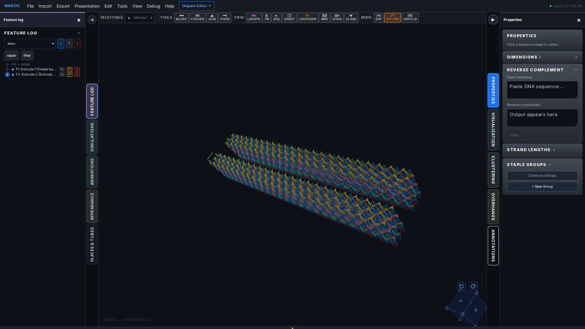

## Bend the first half

Choose Tools → Bend, then click the original 18-helix cluster. Set Plane 1 to 0 bp and Plane 2 to 127 bp, Angle to 60° and Direction to 0°. Angle controls the amount of bending; Direction rotates its orientation around the bundle axis. The Curvature (nm) field is the linked bend radius. After applying, reopen the saved part for a clean result view if the tool overlay remains dimmed (GUIDE-UX-008).

### Step 2

Choose Tools → Bend to open the tool and select a cluster.

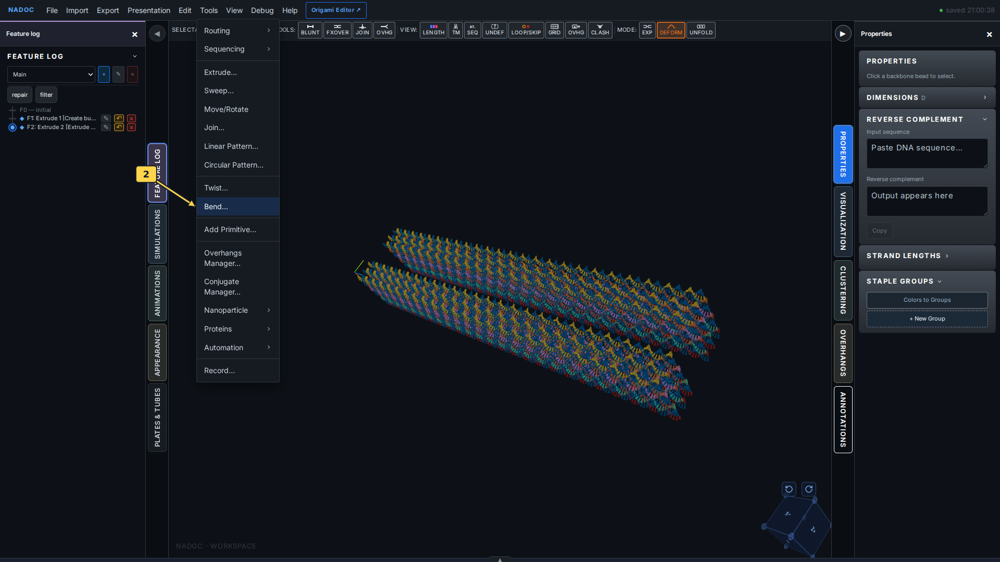

### Step 3

Click the original 3×6 bundle to choose its cluster for bending. The second cluster provides a straight reference.

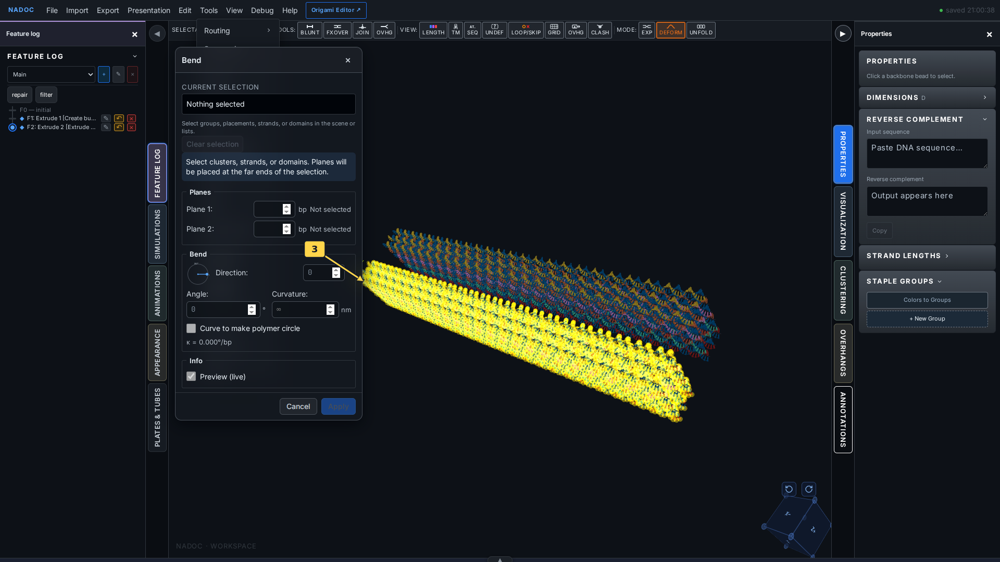

### Step 4

Set planes 0–127 bp, Angle 60° and Direction 0°. Inspect both plane guides on the preview, then click Apply.

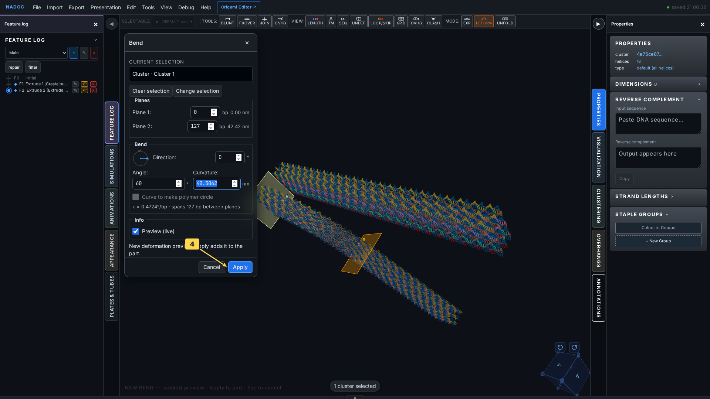

### Step 5

The first half now bends through 60°. The remaining half continues from its new orientation.

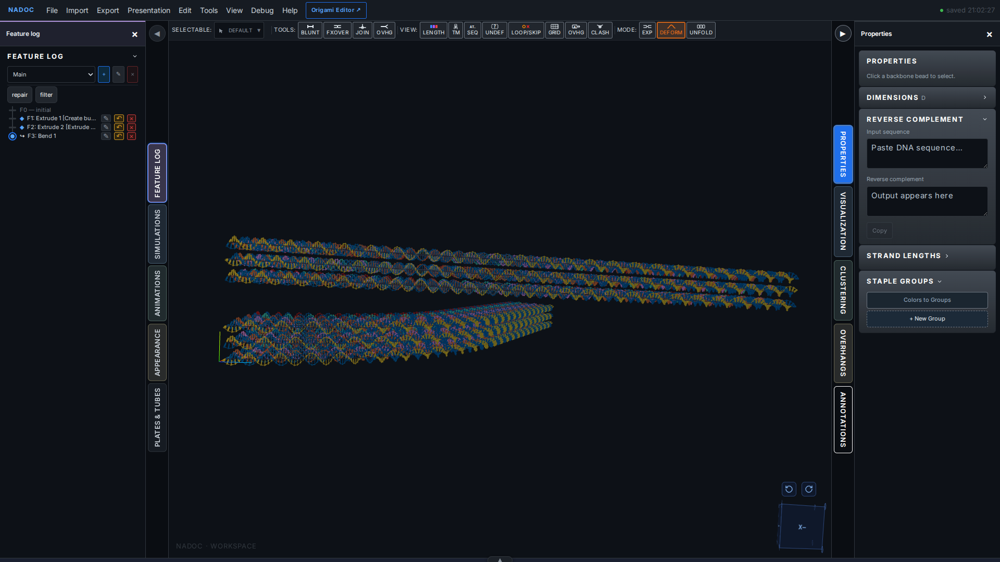

## Bend in another direction

Choose Tools → Bend again and select the same cluster. For the second half, use planes 128–255 bp, Angle 60° and Direction 90°. These are adjacent intervals, so the bends form one continuous multidirectional shape. Direction is measured in the bundle’s local frame; it is distinct from the camera angle.

### Step 6

Set planes 128–255 bp, Angle 60° and Direction 90°. Inspect both plane guides on the preview, then click Apply.

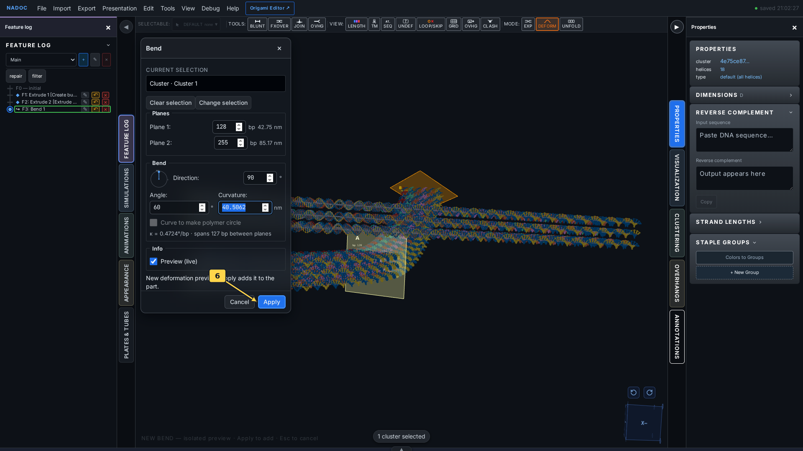

### Step 7

The second half bends through another 60°, with Direction 90°. The selected cluster turns in two directions alongside the straight second cluster.

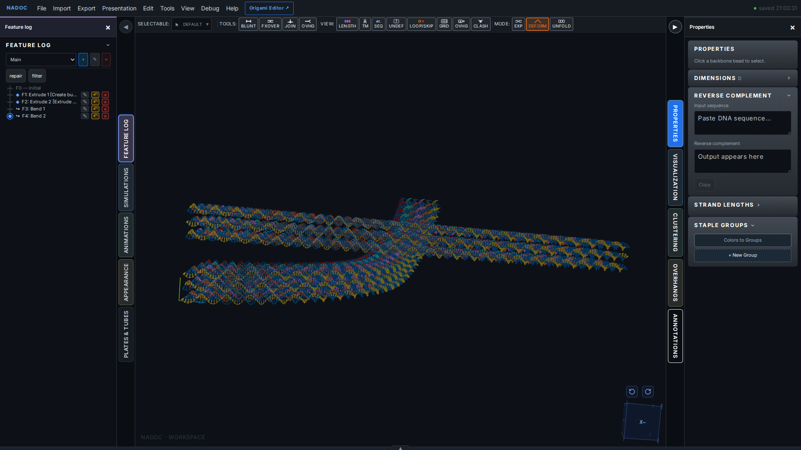

## Generate loops and skips

Geometric Bend defines the displayed shape. Add Loops/Skips creates the discrete insertion/deletion marks that accompany that design intent; use LOOP/SKIP to display the saved marks. The routing action requires crossovers, so first run Full Autostaple with Standard settings on this demonstration bundle.

### Step 8

Choose Tools → Routing → Full Autostaple to create the prerequisite staple routing and crossovers.

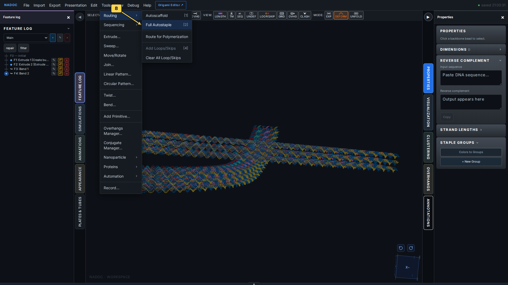

### Step 9

Keep Standard selected and click OK.

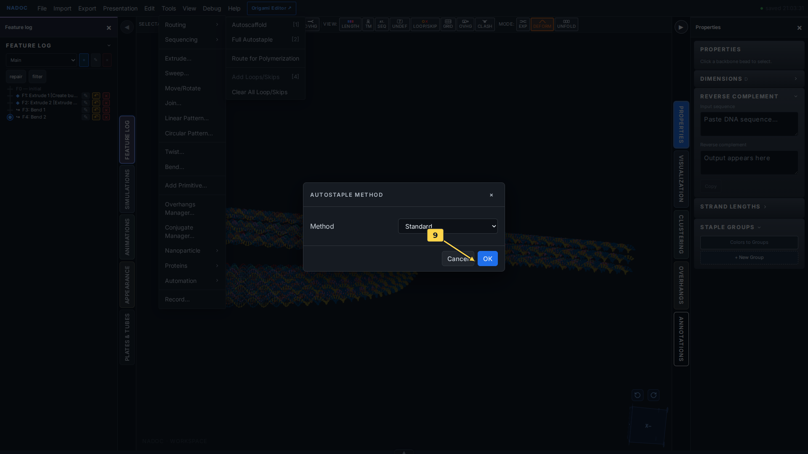

### Step 10

Choose Tools → Routing → Add Loops/Skips to generate marks for the square lattice and its bends.

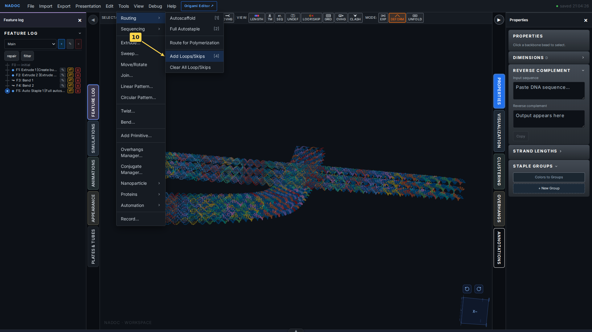

## Inspect loops and skips in 3D

Click LOOP/SKIP in the View toolbar (P). Orange loop markers indicate inserted bases and red × markers indicate deleted bases. The overlay follows the bent geometry while Full remains selected.

### Step 11

Click LOOP/SKIP in the View toolbar to show the markers.

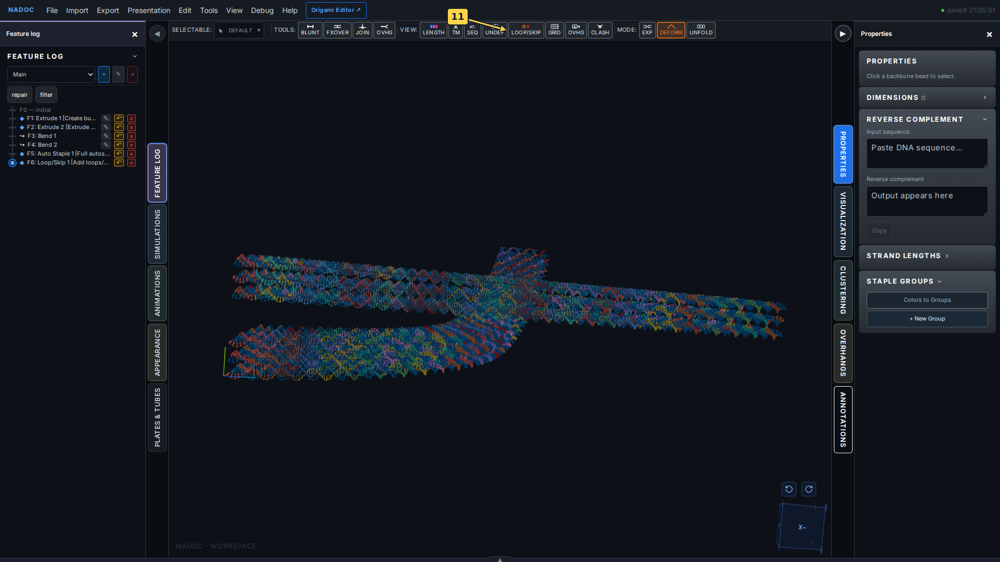

### Step 12

Full 3D view with loop and skip highlights on the bent 3×6 bundle. Compare the marker distribution across the two bend intervals.

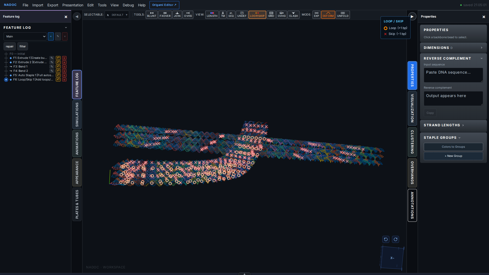

## Inspect the same marks in the cadnano editor

Open Origami Editor from the top bar. NADOC’s built-in cadnano-style path view shows the same document and loop/skip marks in a flat base-pair layout. Press F to fit, then zoom in to read individual symbols. The path view is a 2D topology view; the 3D window remains in Full representation.

### Step 13

Click Origami Editor to open the same document in NADOC’s cadnano-style editor.

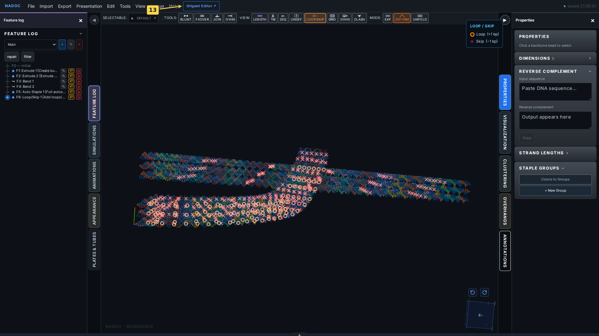

### Step 14

The cadnano-style editor shows the same routed bundle and saved loop/skip marks. Blue circles denote loops; red × symbols denote skips.

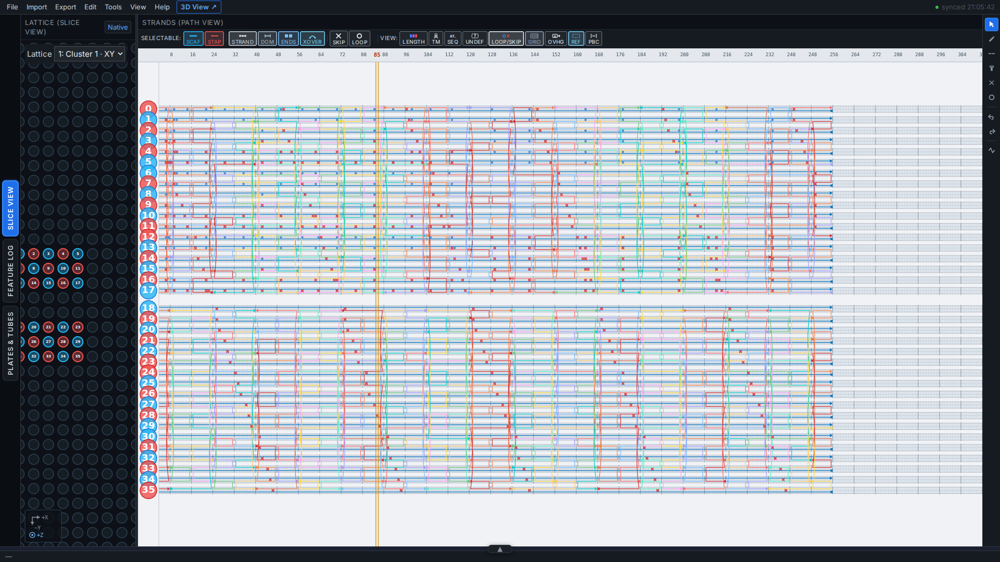

### Step 15

Scroll up over the path view to enlarge the symbols. Blue loop circles and red skip crosses appear directly on the routed strands; LOOP/SKIP remains enabled in the View toolbar.

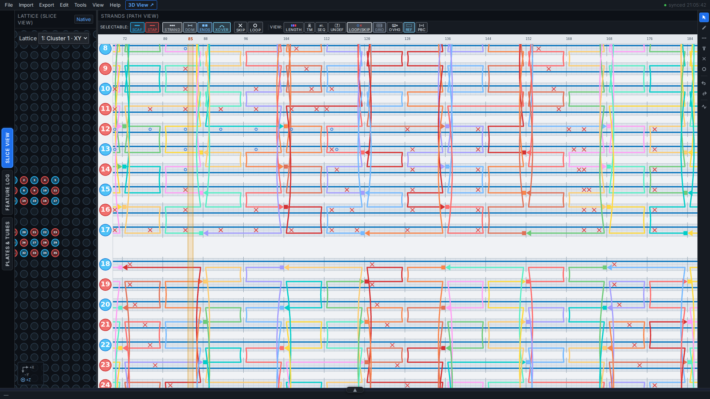
