# Feature Log: inspect, edit and verify the construction recipe

[All guides](../README.md) · [Coverage ledger](../LEDGER.md)

Use the Feature Log tab to inspect construction, revise recorded inputs, manage alternatives and verify a recipe. Illustrated standalone-part exercises are followed by references for assembly configurations and the desktop Origami Editor.

Numbered arrows point to
mouse targets while keeping their labels visible. Dashed boxes show drag extents.
Unmarked images show settings or results. This is an editorial draft for style review.

[Download the example](example.nadoc) · [Construction verification](verification.json) ·
[Capture and source metadata](manifest.json) · [UX findings](../UX_LEDGER.md)

## Scope

- Desktop part: 3×6 extrusion, 2×6 continuation, Bend, Autoscaffold and Full Autostaple; timeline navigation, historical editing, undo/redo, dependencies, suppression, deletion/revert, reorder dialog, filters, recipe verification and loadouts
- Origami Editor: two real staple-end resizes grouped as Fine Routing; expand, scrub individual sub-steps, child/group revert and undo
- Control reference: assembly targets/configurations and animation pinning

## Contents

- [Prepare the first extrusion](#prepare-the-first-extrusion)
- [Edit a recorded feature](#edit-a-recorded-feature)
- [Undo and redo a history change](#undo-and-redo-a-history-change)
- [Check the published recipe](#check-the-published-recipe)
- [Add the 2×6 continuation](#add-the-26-continuation)
- [Bend before routing](#bend-before-routing)
- [Inspect the geometry from several sides](#inspect-the-geometry-from-several-sides)
- [Add scaffold and staple routing](#add-scaffold-and-staple-routing)
- [Read the tab](#read-the-tab)
- [Browse construction stages](#browse-construction-stages)
- [Inspect dependencies](#inspect-dependencies)
- [Suppress and restore an operation](#suppress-and-restore-an-operation)
- [Move a feature](#move-a-feature)
- [Delete versus revert](#delete-versus-revert)
- [Filter the log and expand Fine Routing](#filter-the-log-and-expand-fine-routing)
- [Keep alternatives with loadouts](#keep-alternatives-with-loadouts)
- [Assembly targets and configurations](#assembly-targets-and-configurations)
- [Capture and use assembly configurations](#capture-and-use-assembly-configurations)
- [Use the same log in Origami Editor](#use-the-same-log-in-origami-editor)
- [Make two fine routing edits](#make-two-fine-routing-edits)
- [Scrub inside the group](#scrub-inside-the-group)
- [Revert one sub-step or the whole group](#revert-one-sub-step-or-the-whole-group)
- [Save and reopen](#save-and-reopen)

## Prepare the first extrusion

Start with a 3-row × 6-column square-lattice footprint, extruded 64 bp with Both strands. First practice editing and recipe verification on this initial feature, then add the 2×6 continuation, Bend, Autoscaffold and Full Autostaple. The later exercises use that richer construction history.

### Step 1

The starting 3×6 extrusion has one recorded operation. Next revise its length before adding dependent operations.

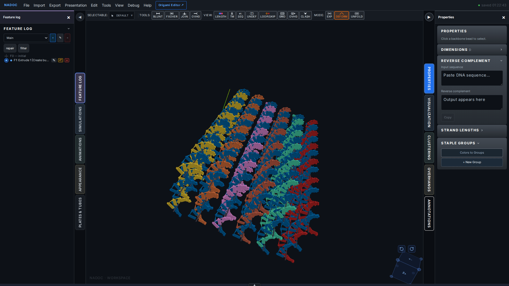

## Edit a recorded feature

Click the pencil on an editable row to reopen its parameter editor. Native tools such as Extrude, Sweep, Bend/Twist and Move/Rotate use their corresponding editors; other feature types use parameter dialogs. Inspect the preview and apply the change to that feature. Later supported operations regenerate against the revised inputs. Cancel leaves the published recipe unchanged. Availability depends on feature type, cursor position, retained recovery data and downstream support; use the disabled control’s tooltip for the reason. Generated features may show a rebuild arrow instead of a pencil. Orange rail dots and connecting segments identify autogenerated steps belonging to the same generated run.

### Step 2

Click the extrusion row’s pencil to edit its recorded parameters.

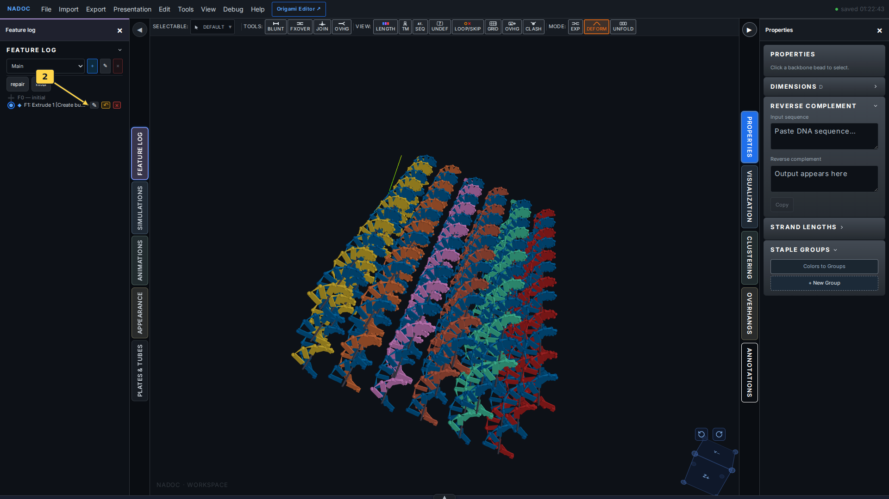

### Step 3

Change Length from 64 to 80 bp. Apply the historical edit using the tool’s confirmation button.

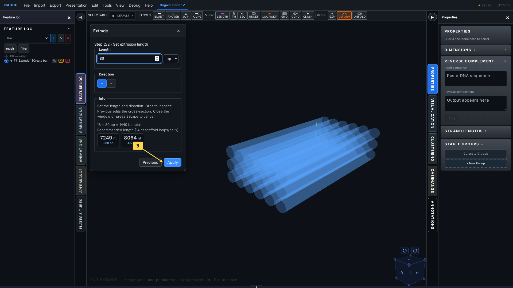

### Step 4

The bundle is now 80 bp long. Editing updates the existing feature rather than appending a second extrusion.

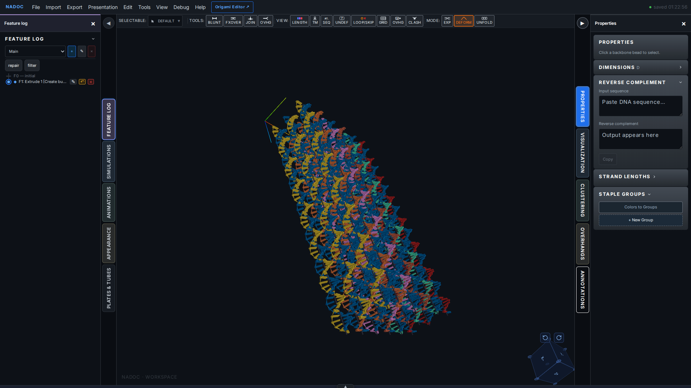

## Undo and redo a history change

Use Edit → Undo (Ctrl+Z) to undo the last change, and Edit → Redo (Ctrl+Y) to restore it. These controls belong to the edit stack. The feature rail instead chooses a stage within the construction recipe. Use a named loadout when you want to retain an alternative for later work.

### Step 5

Undo restores the original 64 bp input in the same feature row.

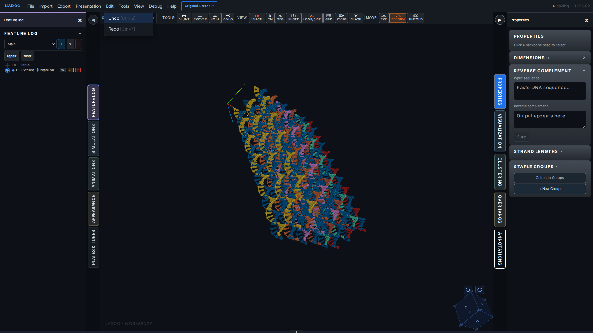

### Step 6

Choose Edit → Redo to restore the 80 bp edit.

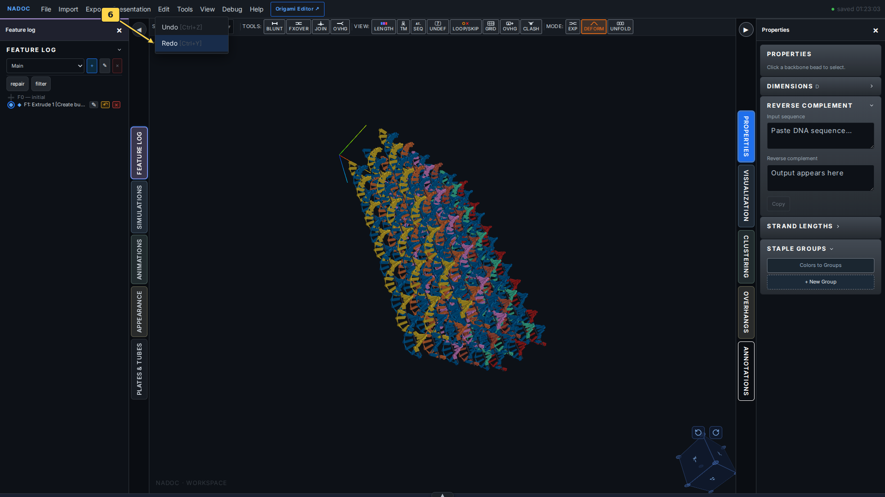

## Check the published recipe

Click repair, then Check published recipe. This independently regenerates the published construction and reports its status. If a feature fails, inspect its issue and use Inspect failing input. Error badges identify failed and unevaluated steps; hover their explanations. Missing targets can also produce a warning triangle. Address the first failing input before interpreting later failures.

### Step 7

Open repair to check the published recipe. Advanced repair proposals are outside this designer walkthrough.

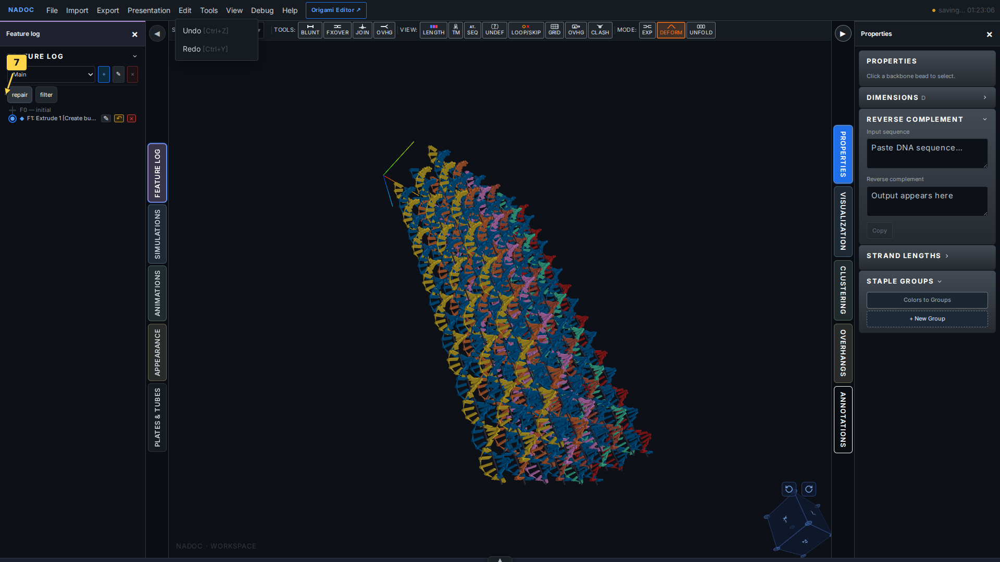

### Step 8

Published geometry: regenerated successfully confirms that this example’s saved recipe reproduces its authored state.

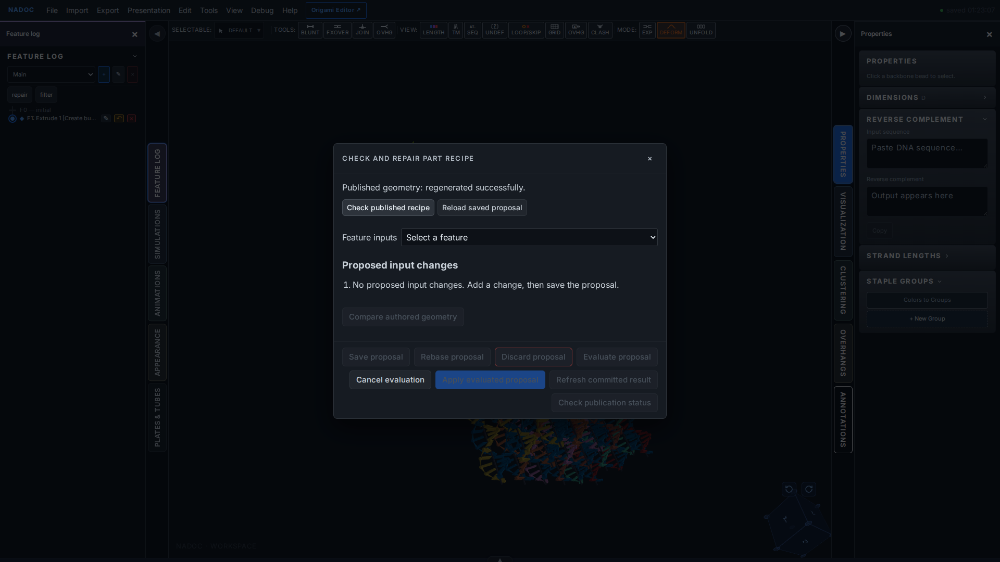

## Add the 2×6 continuation

Enable BLUNT, right-click a far-end ring and choose Extrude. Select two rows × six columns of the original footprint, then Next. Set 32 bp with Both strands and Ligate adjacent, and apply. This produces a stepped end: twelve helices continue beyond the original 80 bp body. F2 records the selected source ends and continuation inputs separately from F1.

### Step 9

Enable BLUNT in the toolbar to show selectable end rings.

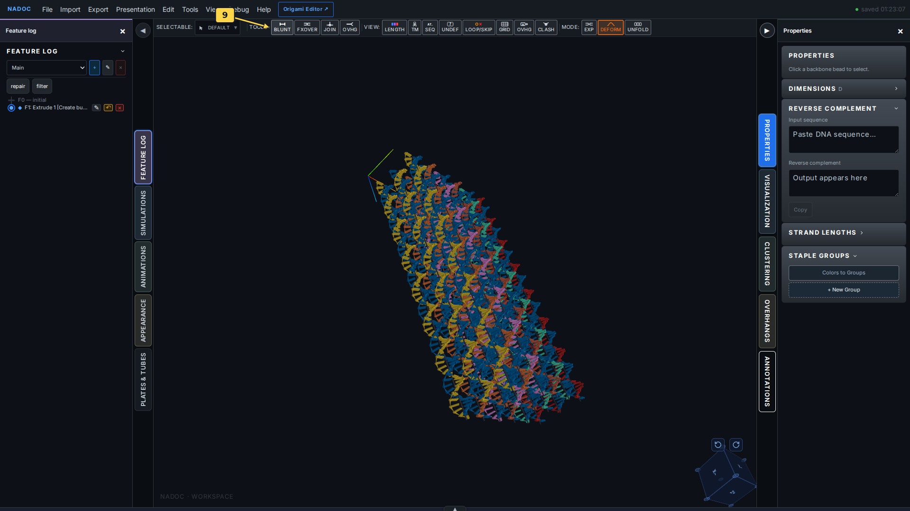

### Step 10

Right-click the marked far-end ring, then choose Extrude from its menu.

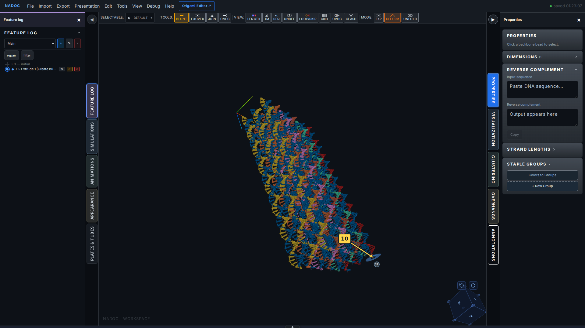

### Step 11

Choose Extrude to continue from this end.

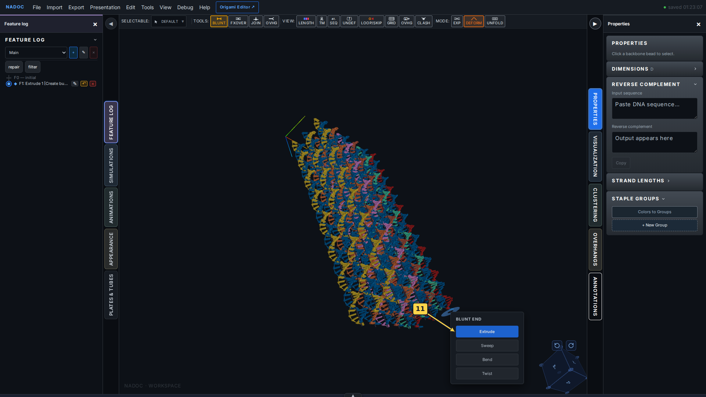

### Step 12

Select the 2×6 subset of amber source-end cells. The continuation selection contains twelve helices.

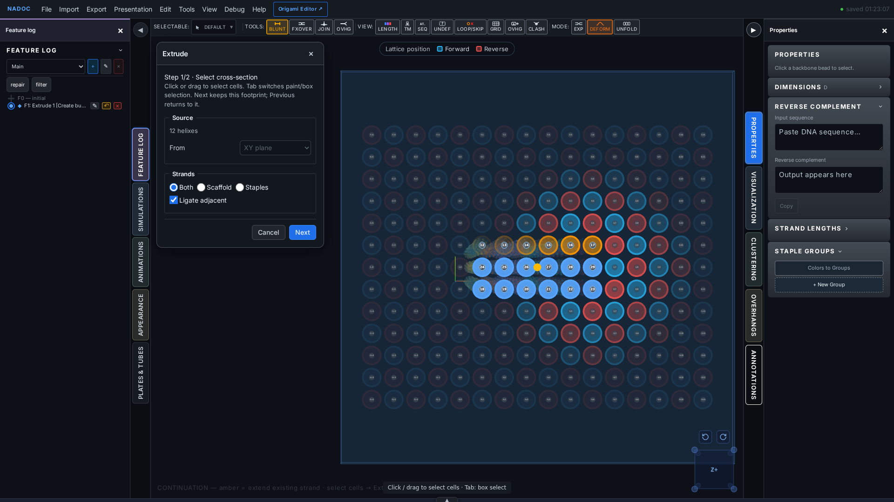

### Step 13

Apply the extra 32 bp extrusion to these twelve ends.

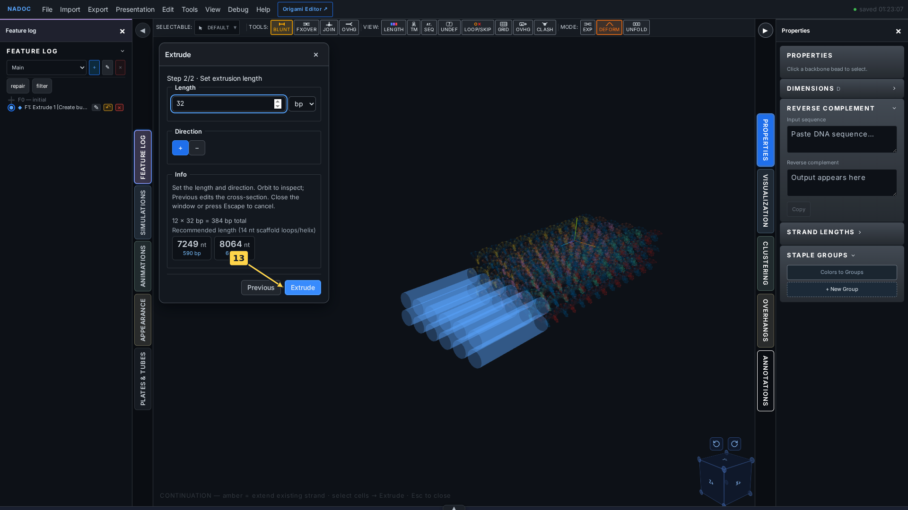

### Step 14

F1 builds the 3×6 body; F2 adds the 2×6 continuation. They remain distinct recorded operations.

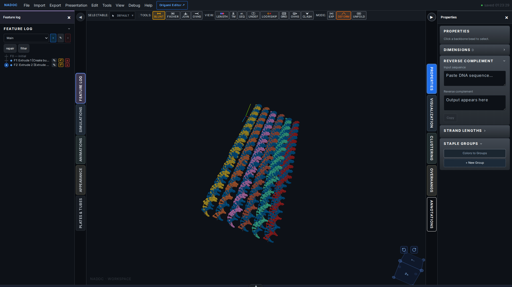

## Bend before routing

Choose Tools → Bend and click the cluster bead for the bundle. Set Plane 1 to 0 bp, Plane 2 to 79 bp, Angle to 30° and Direction to 0°, then Apply. This bends the original body before either routing operation. Reopen the saved part if the tool leaves its dimmed preview overlay behind (GUIDE-UX-008).

### Step 15

Click a backbone bead to select the cluster for Bend. Turn BLUNT off so end rings do not intercept the selection.

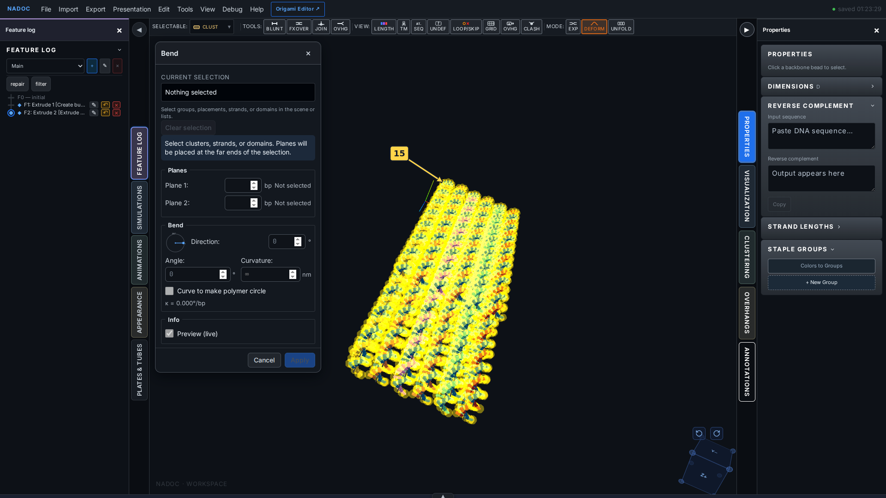

### Step 16

Apply the 30° bend over planes 0–79 bp. F3 will preserve these parameters.

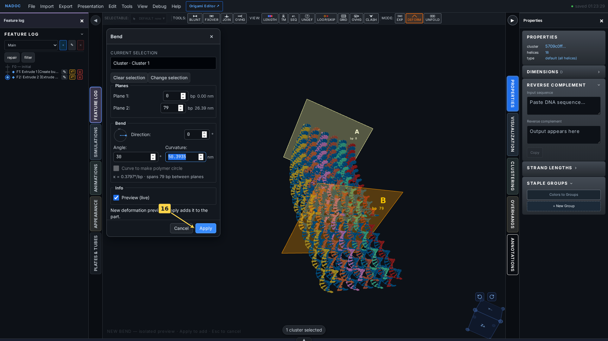

### Step 17

The bent, stepped bundle now has three construction operations, before scaffold and staple routing.

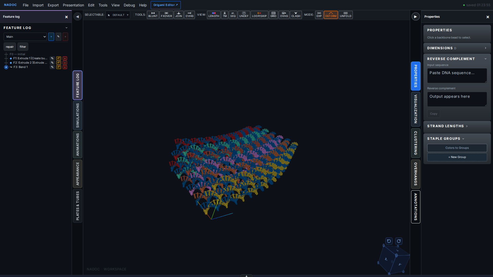

## Inspect the geometry from several sides

Right-drag the 3D canvas to orbit, then press F to fit the part and scroll down slightly for margin. Check the opposite side and look along the end regions as well as using the main oblique view. The view cube shows your orientation. Compare these perspectives before routing, after Autoscaffold, after Full Autostaple and after scrubbing. End bases, back rows and connections can hide behind an otherwise plausible overall silhouette.

### Step 18

Before routing, F3 — reverse oblique view. Right-drag to expose the scaffold ends hidden behind the bundle. Check that the terminal runs follow the bent body without a jump back to the straight axis.

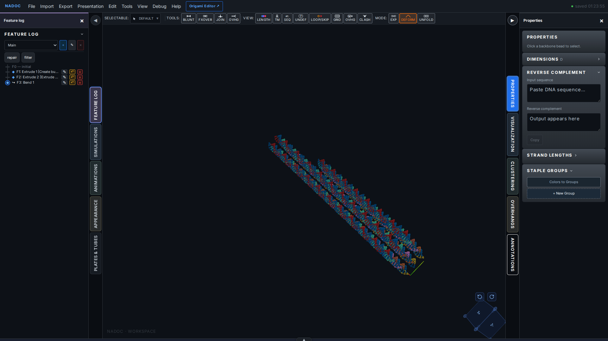

### Step 19

Before routing, F3 — end-region view. Orbit vertically as well as horizontally to separate overlapping rows. Inspect both ends and the junction between the 3×6 body and 2×6 continuation; use the view cube to orient yourself.

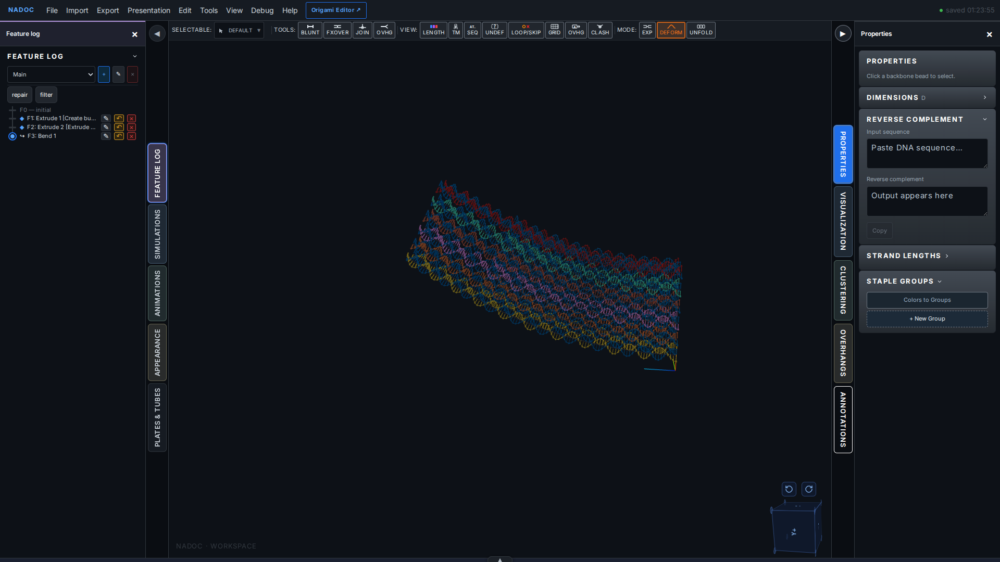

## Add scaffold and staple routing

Choose Tools → Routing → Autoscaffold, keep Seamed and click Run. Then choose Full Autostaple, keep Standard and click OK. Autoscaffold may adjust terminal positions; inspect its result rather than assuming the routed ends retain their extrusion indices. F4 and F5 record these generated routing operations after the two extrusions and Bend.

### Step 20

Autoscaffold is F4: new terminal scaffold bases follow the deformation of the ends they extend. Inspect their continuity before applying Autostaple.

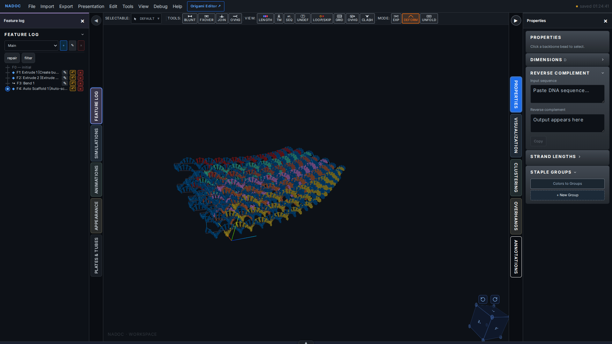

### Step 21

After Autoscaffold, F4 — reverse oblique view. Right-drag to expose the scaffold ends hidden behind the bundle. Check that the terminal runs follow the bent body without a jump back to the straight axis.

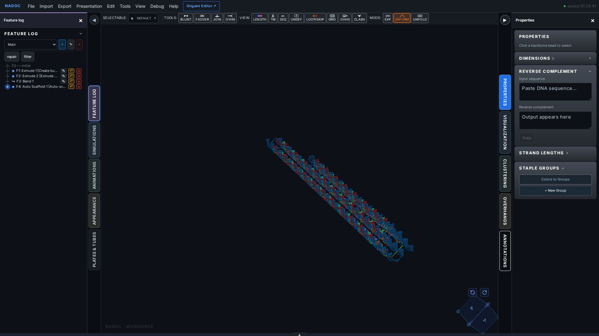

### Step 22

After Autoscaffold, F4 — end-region view. Orbit vertically as well as horizontally to separate overlapping rows. Inspect both ends and the junction between the 3×6 body and 2×6 continuation; use the view cube to orient yourself.

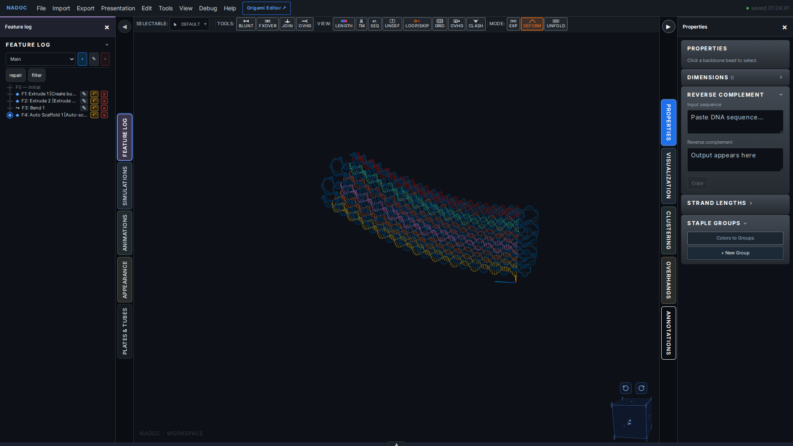

### Step 23

Full Autostaple is F5. Use this five-step recipe for the navigation, dependency and history-change exercises below.

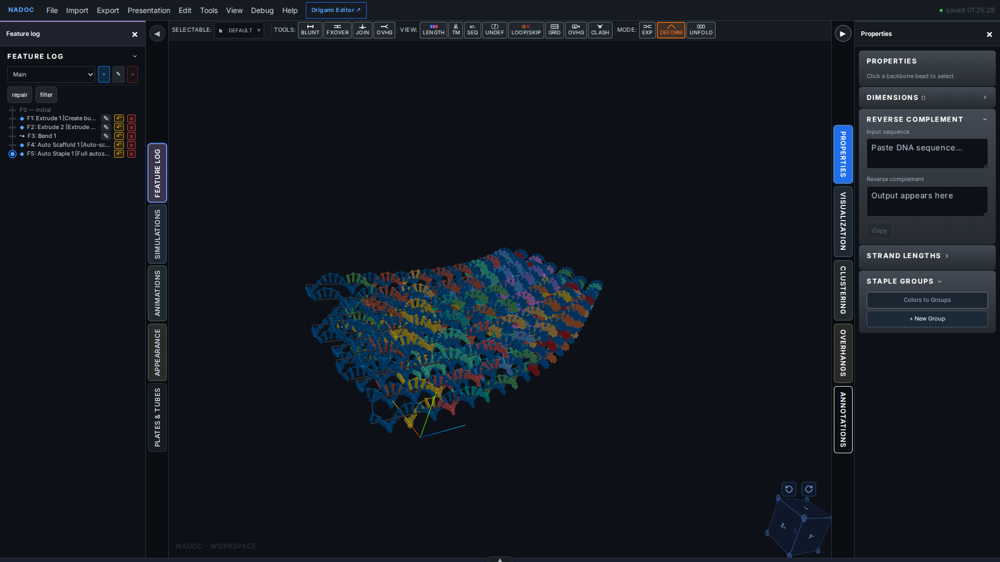

### Step 24

After Full Autostaple, F5 — reverse oblique view. Right-drag to expose the scaffold ends hidden behind the bundle. Check that the terminal runs follow the bent body without a jump back to the straight axis.

### Step 25

After Full Autostaple, F5 — end-region view. Orbit vertically as well as horizontally to separate overlapping rows. Inspect both ends and the junction between the 3×6 body and 2×6 continuation; use the view cube to orient yourself.

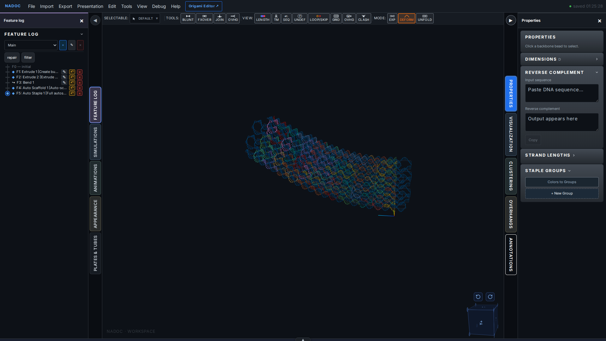

## Read the tab

Use the open Feature Log sidebar on the left. The vertical Feature Log launcher opens an additional sidebar; close extra copies with their header ×. This example now has five construction steps: a 3×6 extrusion, a 2×6 end continuation, Bend, Autoscaffold and Full Autostaple. F0 is the initial state. F1, F2 and later rows are ordered operations; hover a shortened label to read it. The heading collapses the section. The loadout selector chooses a saved design branch. Row buttons act on one feature; repair and filter act on the log. Selecting a strand, domain, cluster or overhang in the model outlines rows that reference it in green.

### Step 26

Read the operation labels and their order before changing history. Hover each small button for its exact action and availability.

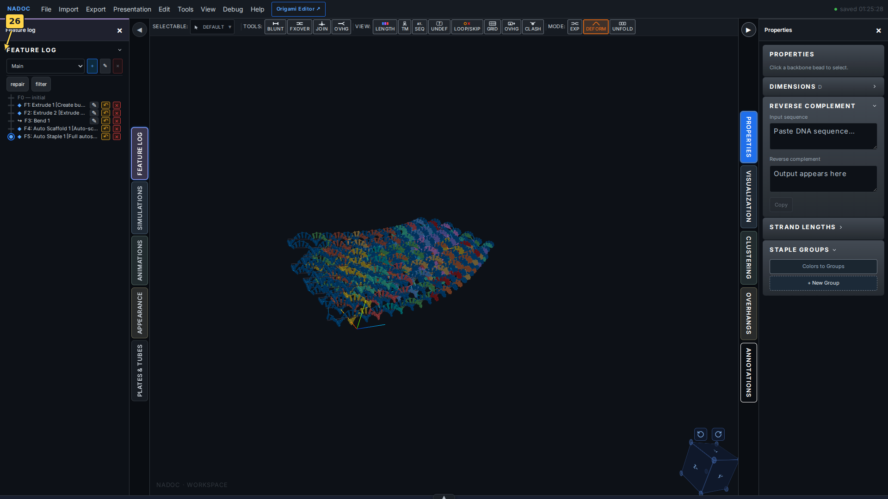

## Browse construction stages

Drag the blue handle along the vertical rail and release at a notch to scrub through construction. Clicking a bare notch does not seek. F0 restores the initial stage; a feature notch shows the state after that operation. Later rows dim while viewing an earlier stage. Browsing retains the recipe. Return to the last notch before changing its order, suppressing features or evaluating repair. A spinning ring means editable detail is loading; wait for Ready to edit. If loading fails, scrub again to retry.

### Step 27

At F0 the extrusion is absent, but its feature row remains. The blue cursor marks the inspected construction stage.

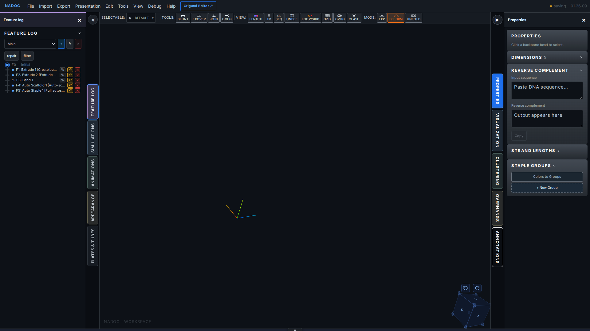

### Step 28

At F2, the 3×6 body and the extra 2×6 continuation are present, while Bend and the routing operations are still ahead of the cursor.

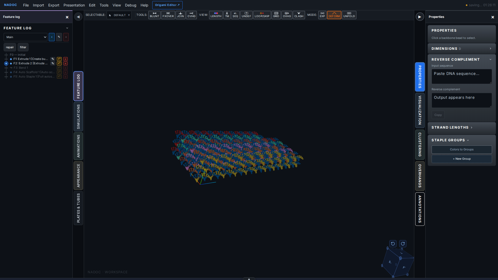

### Step 29

At F3, Bend has shaped the bundle. Autoscaffold and Full Autostaple remain dimmed because they have not yet been applied at this stage.

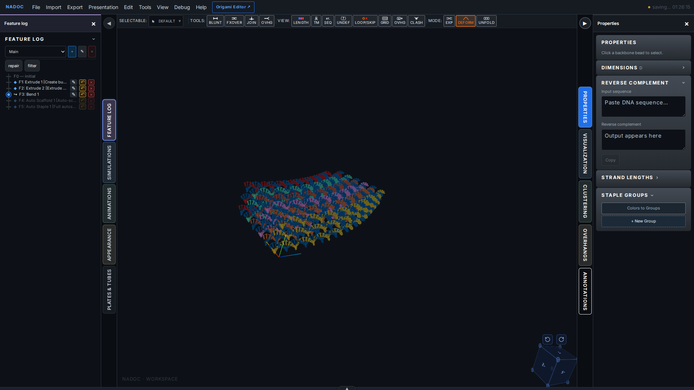

### Step 30

Returned to F5 after scrubbing — reverse oblique view. Right-drag to expose the scaffold ends hidden behind the bundle. Check that the terminal runs follow the bent body without a jump back to the straight axis.

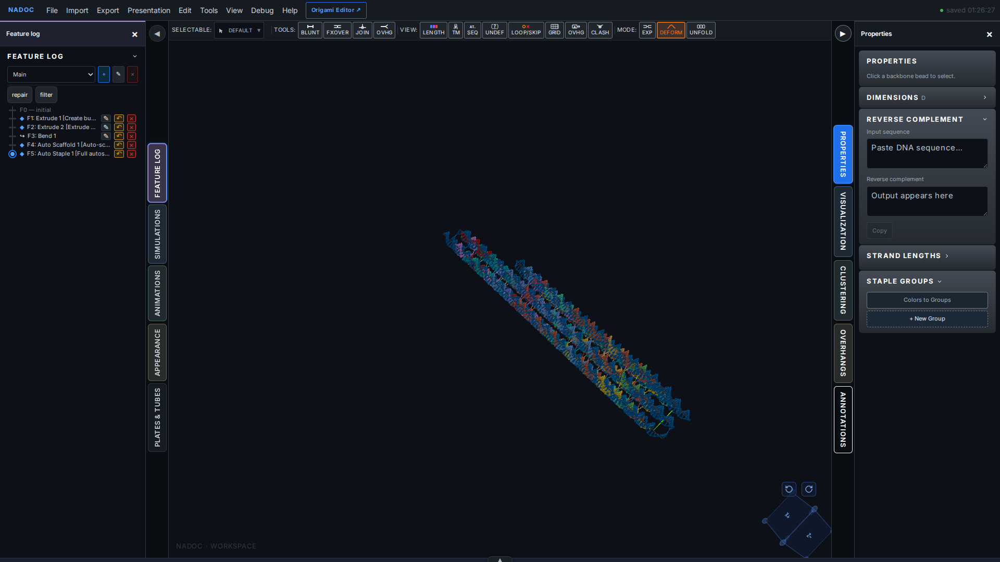

### Step 31

Returned to F5 after scrubbing — end-region view. Orbit vertically as well as horizontally to separate overlapping rows. Inspect both ends and the junction between the 3×6 body and 2×6 continuation; use the view cube to orient yourself.

### Step 32

Return to the final notch to restore the complete editable part. Seeking and reverting have different consequences: reverting removes recipe entries.

## Inspect dependencies

Right-click a part feature row, or focus it and press Shift+F10, then choose View dependencies. Parents supply inputs to the selected operation; Dependents consume its outputs. Conservative ordering relationships may also appear. The actual regeneration check decides whether a proposed edit is valid. Use this view before moving, suppressing or deleting an earlier step.

### Step 33

The row context menu provides Suppress, Move… and View dependencies for this multi-step part.

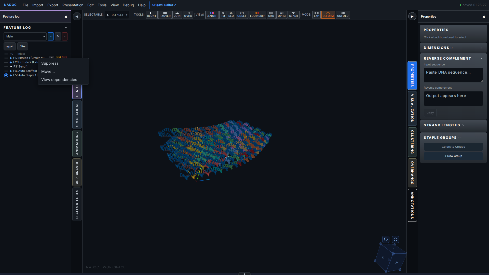

### Step 34

Read the first extrusion’s Parents and Dependents. Its outputs feed later construction; inspect these relationships before changing its order or deleting it.

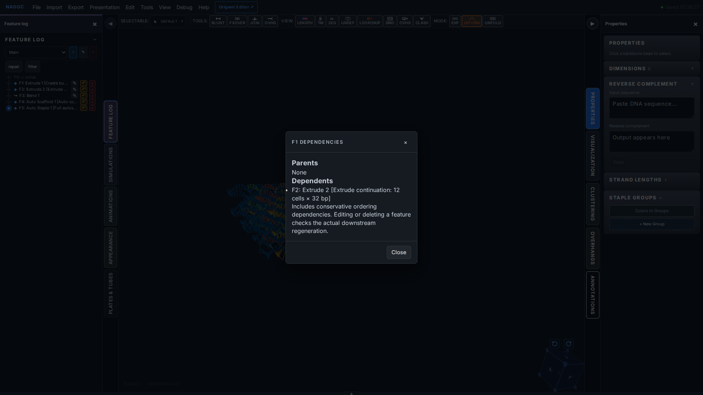

## Suppress and restore an operation

Suppress retains the feature definition while regenerating the part without applying it. The row gains a Suppressed badge. Right-click it again and choose Unsuppress to restore its contribution. Dependencies are checked before publication; an unresolved consumer prevents the change. Return to the current end of an editable loadout first.

### Step 35

The suppression dialog explains that the saved definition will remain and regeneration will check its dependents.

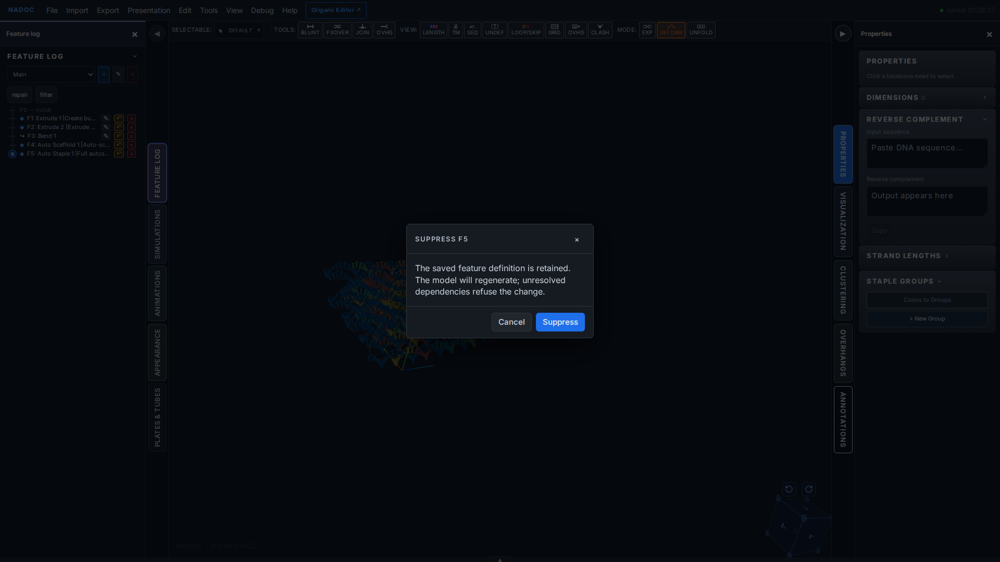

### Step 36

The Suppressed badge records that the operation is disabled. The recipe still contains its inputs.

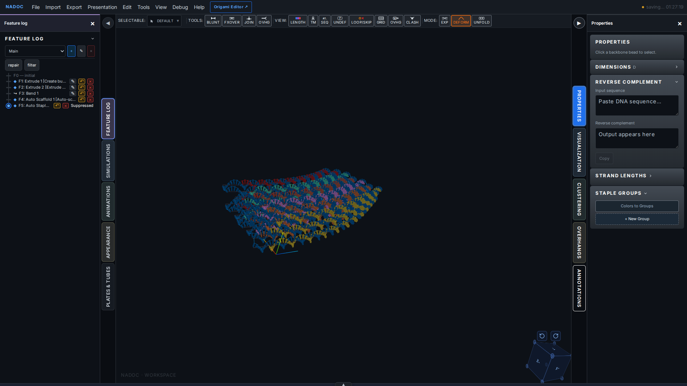

## Move a feature

For a part with at least two feature rows, right-click the operation and choose Move…. Select its final position, then click Move. NADOC regenerates the proposed order and refuses unresolved dependencies. The dialog disables Move until a different position is selected. Cancel closes it without applying the reorder. Here, inspect the available positions for the first extrusion, then cancel to preserve its upstream position.

### Step 37

Move selects a new position in the recipe. Moving the first extrusion behind operations that consume it can fail dependency validation. Cancel this inspection.

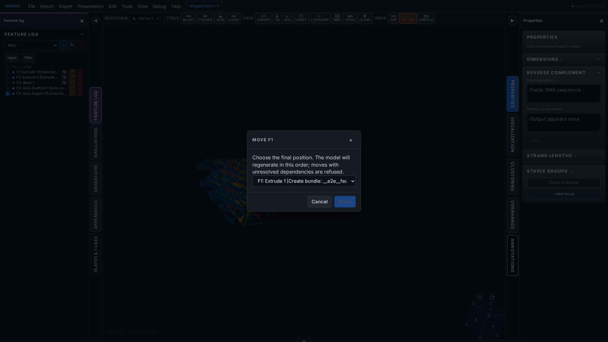

## Delete versus revert

The red × deletes a feature. In a standalone part, supported later steps are regenerated; if dependents prevent a simple deletion, review the offered cascade-delete or revert decision. Cascade removes the dependent operations listed by the dialog. The amber ↶ reverts to before the selected feature and removes it together with every later entry. Read the confirmation before accepting. Undo can restore the change. Large Fine Routing groups receive an additional deletion confirmation.

### Step 38

Click ↶ to inspect Revert to before this feature.

### Step 39

Revert discards this operation and the later tail of the recipe. Reverting the final Full Autostaple operation keeps both extrusions, Bend and Autoscaffold.

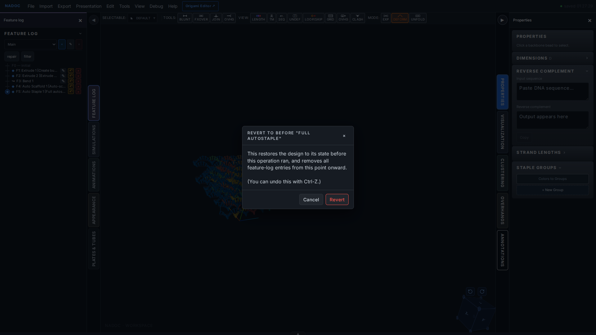

### Step 40

Click × to delete the final Full Autostaple operation. A simple part feature deletion can apply immediately.

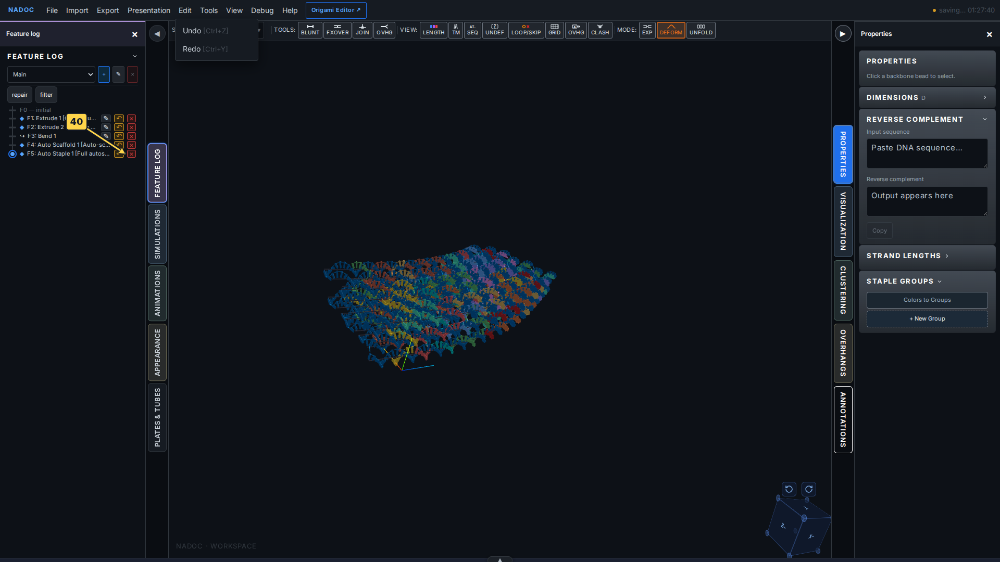

## Filter the log and expand Fine Routing

Click filter to choose visible categories. Fine routing is initially on; Document ops and Annotations and view volumes are initially off. Filters change visibility while preserving the recipe and feature numbering, so gaps can appear. Preferences persist for the document and synchronize across windows. A Fine Routing row groups small routing edits: click its triangle to expand individual sub-steps, inspect their rail positions, and use their available delete/revert controls. Collapse with the upper triangle, lower collapse row or connector spine. Tooltips explain unavailable child operations. Document ops is a separate journal of metadata and loadout changes, without geometry seek positions. Annotation and view-volume checkpoints appear when explicitly recorded; ordinary presentation autosaves do not produce construction rows.

### Step 41

Open filter to inspect the three visibility categories.

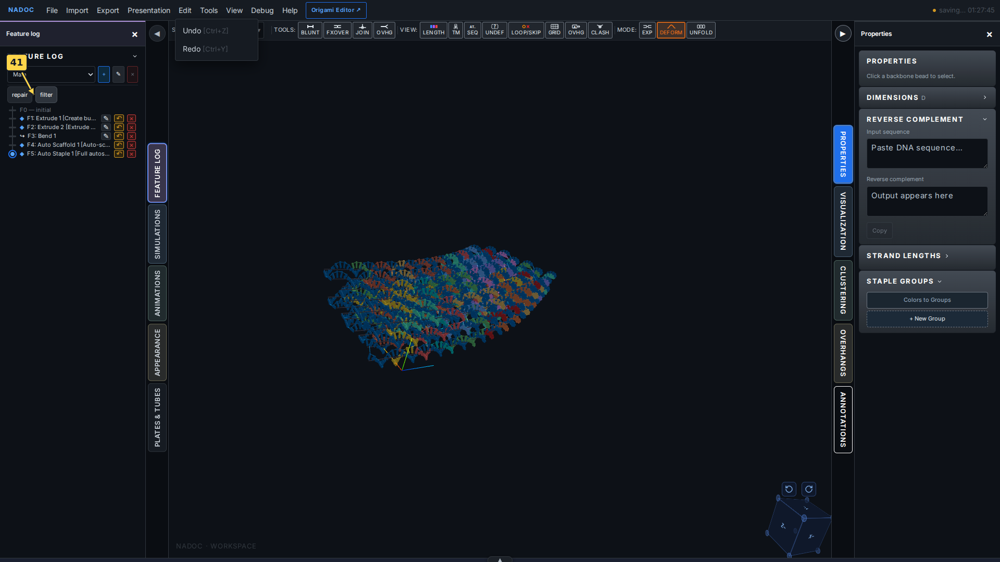

### Step 42

Enable Document ops to inspect the document journal; leave Fine routing enabled when diagnosing individual routing steps.

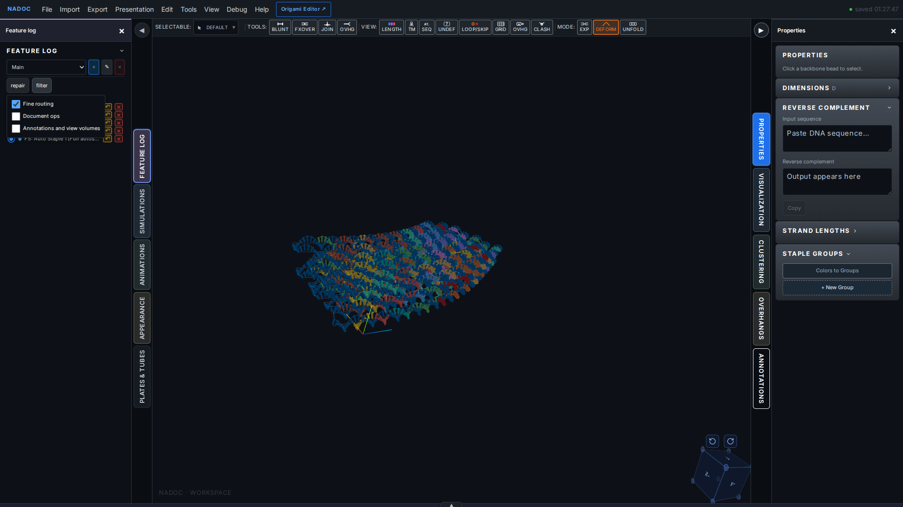

## Keep alternatives with loadouts

The selector at the top switches loadouts. Click + to create an alternative from the current state, then the adjacent pencil to name it. The × deletes the active loadout after confirmation; the final remaining loadout cannot be deleted. Locked loadouts show a lock symbol and protect their saved state. Loadouts preserve alternative recipes; assembly targets have their own loadout context. Document ops shows the recorded create, rename, select and delete actions.

### Step 43

Click + to create a second loadout from the current bent, routed design.

### Step 44

Name the new loadout Routed alternative. The document journal records its creation and rename separately from the construction steps.

### Step 45

Use the selector to return to the original loadout. Each branch retains its construction process.

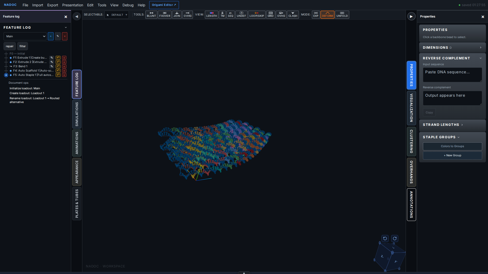

## Assembly targets and configurations

In an assembly, the Target selector offers Assembly, Configurations and individual part instances. Assembly shows assembly operations; choose an instance to inspect its embedded part history and loadouts. Repeated instances and their joins belong to the assembly recipe. In the current assembly UI, pencil editing is offered for the latest supported polymerization or overhang-connection operation. Deleting an earlier assembly entry replays later entries and refuses unsupported replay; ↶ drops the selected entry and all later ones. Part-instance controls currently differ from standalone-part controls: the context-menu dependency/suppression/reorder actions and standalone repair launcher are not offered, and some embedded history deletion paths remove log records without rebuilding geometry. For provenance-preserving changes, edit the source part in its own editor rather than using those embedded deletion controls. These are current implementation limitations.

## Capture and use assembly configurations

Choose Configurations in Target. Click + Capture Configuration to save the current assembly state. Click a configuration row to restore it, ▶ to animate to it, ⟳ to overwrite it with the current state, the pencil to rename it (Enter saves; Escape cancels), and × to delete it. The configuration list is distinct from the ordered assembly construction recipe. Animation also offers Pin to feature: enter that mode from the animation panel, click the desired feature when prompted, or Cancel to leave the picker. This section is a control reference; the captured part example does not contain an assembly or animation.

## Use the same log in Origami Editor

Open Origami Editor from the top bar, then choose its Feature Log tab beside the path view. This is the same document and construction recipe as the 3D editor. The shared panel provides history navigation, filters and supported history actions alongside the 2D topology view. Press F over the path view to fit the strands.

### Step 46

Choose Feature Log beside the path view to inspect both extrusions, Bend, Autoscaffold and Full Autostaple in the same document.

## Make two fine routing edits

In Origami Editor, use the Select tool and drag a free staple end inward by two bases. Repeat on a different staple end. These are two separate resize actions, not a multi-selection drag. The Feature Log collects consecutive small routing edits into one Fine Routing group, while retaining each operation and its exact end reference.

### Step 47

Resize 1: drag the marked staple 5′ end from bp 24 to 26, shortening it by two bases.

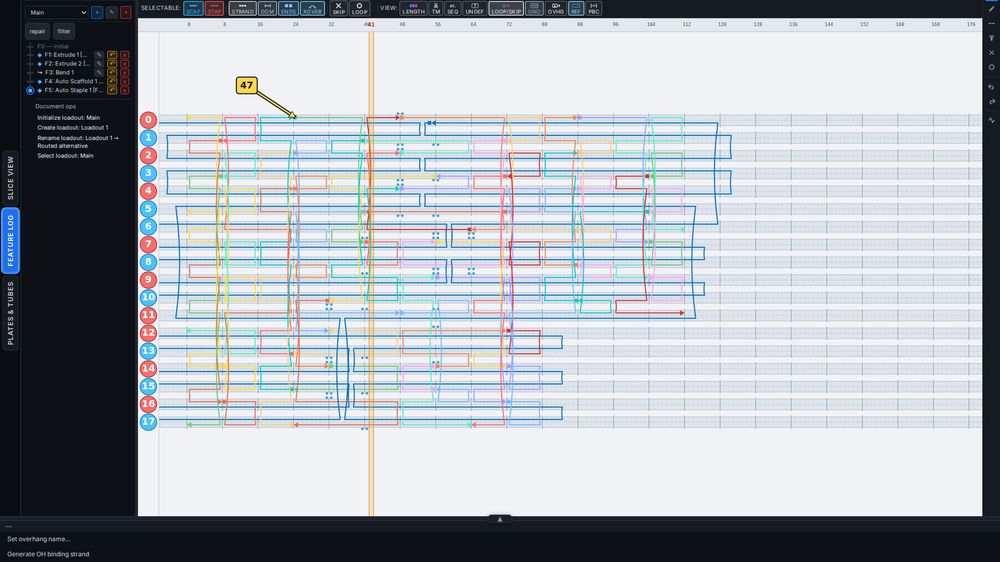

### Step 48

Resize 2: drag the marked staple 5′ end from bp 88 to 90, shortening it by two bases.

### Step 49

Two distinct endpoint drags produce one Fine Routing group with two retained sub-steps. The group follows Full Autostaple.

### Step 50

Expand the triangle to show both Resize strand ends sub-steps, their individual rail notches, pencils, delete buttons and revert arrows.

## Scrub inside the group

Drag the blue rail handle to the first resize sub-step. The first end is resized and the second is still at its original position. The complete group remains in the recipe. Drag to the second sub-step or final group notch to recover both edits. Grouping does not flatten the edit history.

### Step 51

At the first sub-step only the first resize is applied. The second sub-step remains in the log ahead of the cursor.

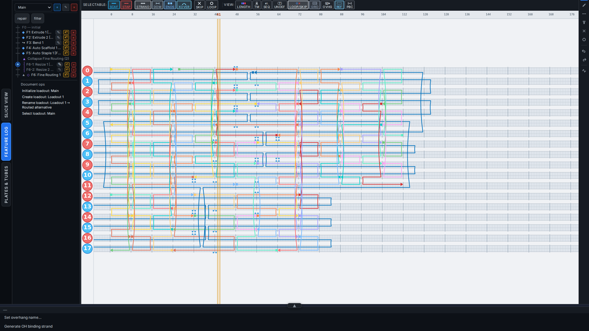

## Revert one sub-step or the whole group

The second sub-step’s ↶ reverts to before that resize: it removes the second edit and later history, retaining the first resize. Undo restores it. The Fine Routing group’s ↶ instead reverts to before the entire group, removing both resizes while retaining Full Autostaple and the earlier construction. Undo restores both. The individual × deletes its sub-step subject to downstream regeneration; its pencil opens its recorded inputs.

### Step 52

Confirm the second sub-step revert to keep the first resize and discard the second.

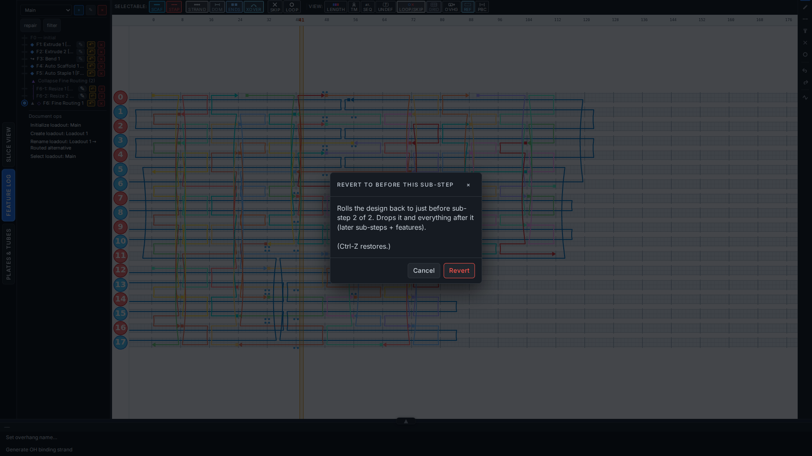

### Step 53

After reverting the second sub-step, the first resize remains as the sole child of Fine Routing.

### Step 54

Group revert removes both resizes and restores the routed baseline. Both extrusions, Bend, Autoscaffold and Full Autostaple remain.

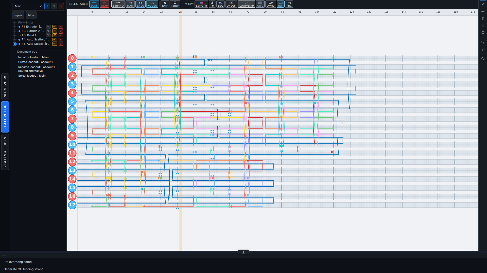

### Step 55

Undo restores the Fine Routing group and both individual resize operations. The saved example retains them for further exploration.

## Save and reopen

Save the part with its feature log and loadouts. Reopen it and inspect the saved operation inputs before continuing. The downloadable example accompanying this guide is reopened and independently replayed by the publication guard. The illustrated actions use a disposable example; apply them to your own design after inspecting its dependencies.

### Step 56

Reopened example: both extrusions, Bend, Autoscaffold, Full Autostaple and the two recorded Fine Routing resizes remain available.

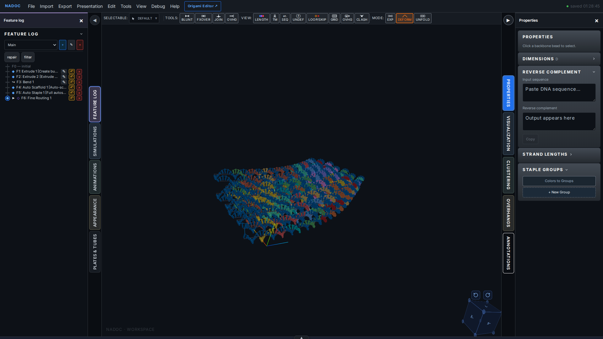
