# Sweep: a 3×6 square-lattice path

[All guides](../README.md) · [Coverage ledger](../LEDGER.md)

Create an 18-helix square-lattice bundle along a three-point spline. Choose the cross-section, enter path coordinates, inspect direction and twist controls, and confirm the sweep.

Numbered arrows point to
mouse targets while keeping their labels visible. Dashed boxes show drag extents.
Unmarked images show settings or results. This is an editorial draft for style review.

[Download the example](example.nadoc) · [Construction verification](verification.json) ·
[Capture and source metadata](manifest.json) · [UX findings](../UX_LEDGER.md)

## Scope

- Desktop: new 3×6 square-lattice cross-section on XY with strand and ligation controls
- Three-point spline using XYZ offsets in nm; per-point direction and twist controls
- Review path length and new base-pair count, confirm and inspect in Full representation

## Contents

- [Create a square-lattice part](#create-a-square-lattice-part)
- [Choose the source and plane](#choose-the-source-and-plane)
- [Select the 3×6 cross-section](#select-the-36-cross-section)
- [Choose strands and ligation](#choose-strands-and-ligation)
- [Define the path in nanometers](#define-the-path-in-nanometers)
- [Control direction and twist](#control-direction-and-twist)
- [Review and confirm](#review-and-confirm)

## Create a square-lattice part

Sweep carries a lattice cross-section along a spline. This example uses the same three rows × six columns (18 helices) as the Extrude guide, with a path defined in nanometers.

### Step 1

Choose File → New.

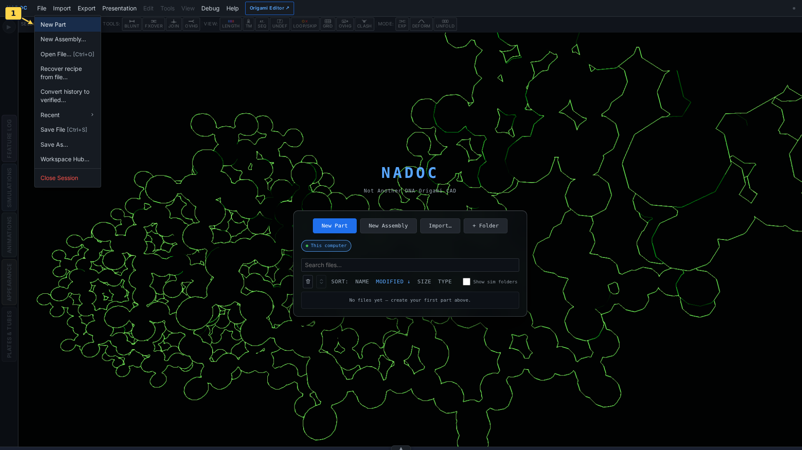

### Step 2

Choose Square for the lattice type. The guide uses a temporary example name; use a meaningful name for your own part.

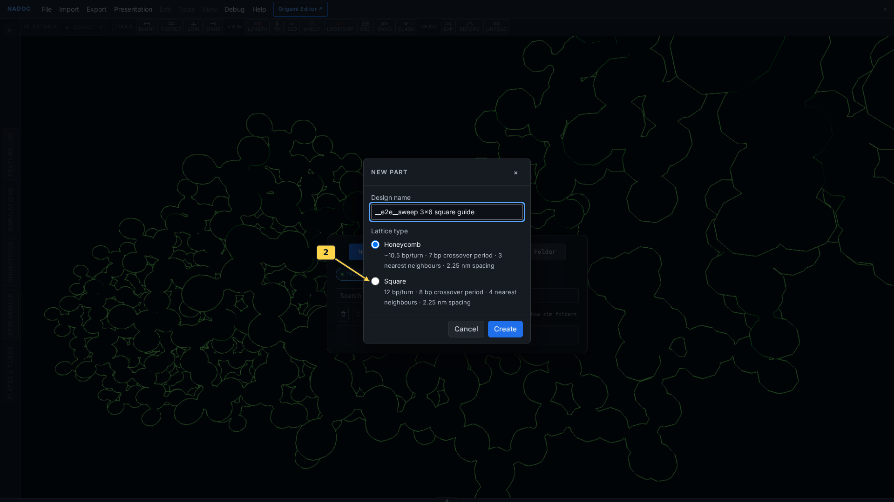

### Step 3

Click Create to open the empty square-lattice part.

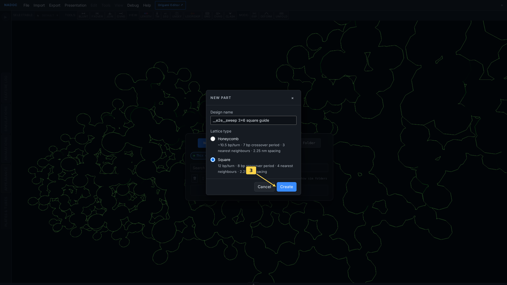

### Step 4

Use Full representation throughout this guide. Full shows the nucleotide beads and base slabs; it is the standard display for guides.

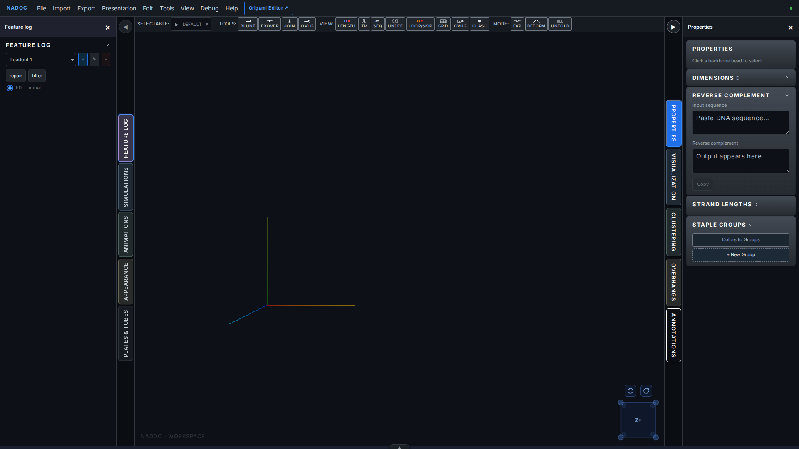

## Choose the source and plane

Open Tools → Sweep. From selects a new bundle or an existing helix end. For this example choose New bundle and XY. Plane sets the initial cross-section; choose it before selecting cells, because changing planes clears the footprint.

### Step 5

Open Tools → Sweep.

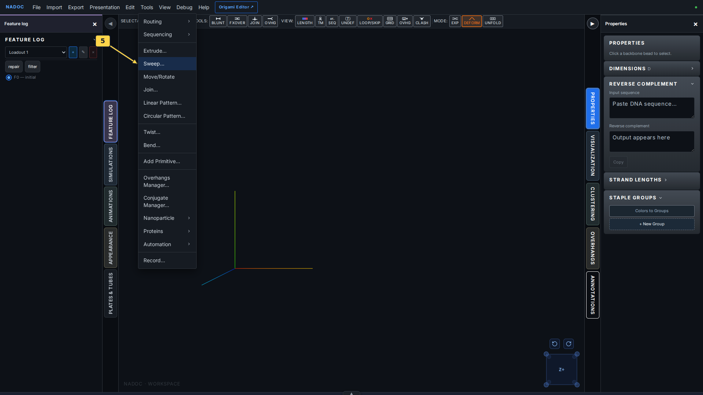

### Step 6

Keep From set to New bundle.

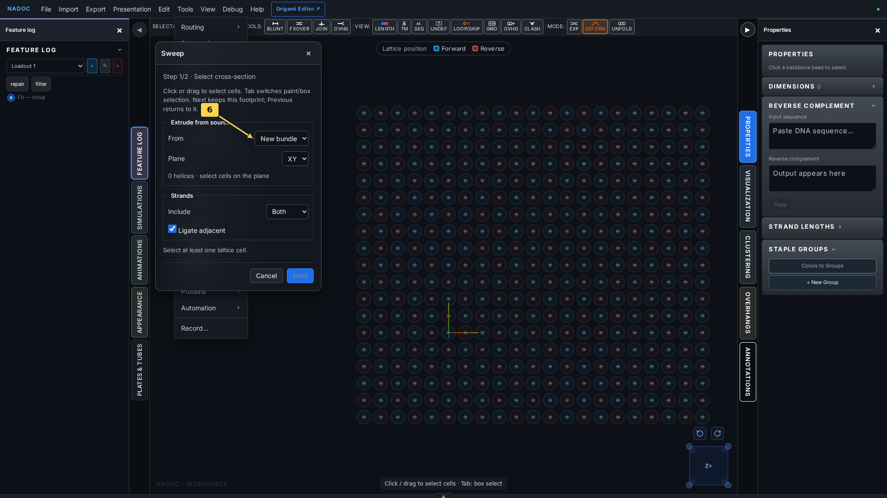

### Step 7

Choose XY for a cross-section initially normal to Z. XZ and YZ are also available.

## Select the 3×6 cross-section

The picker faces the selected plane and shares the Extrude selection gestures. Select rows 0–2 and columns 1–6: 18 helices. Drag the tool window by its title bar if it covers your intended cells.

### Step 8

Click a cell to select it. Click the same cell again to deselect it.

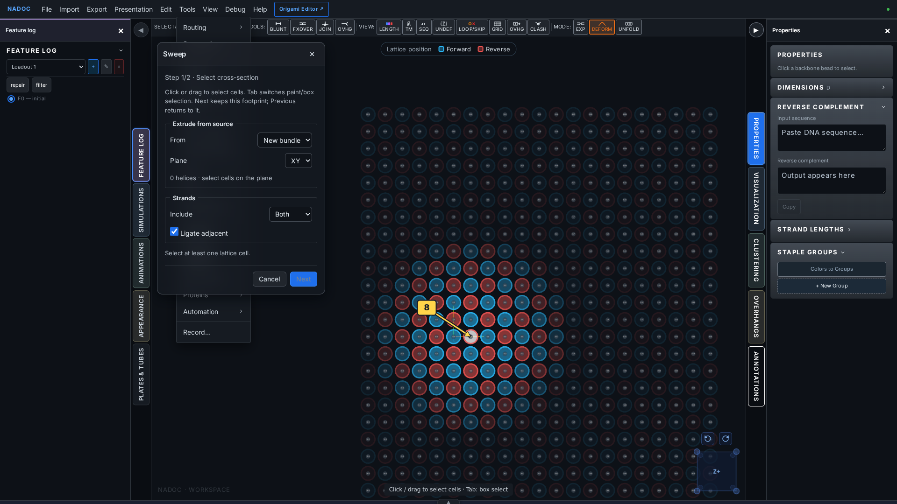

### Step 9

With the canvas focused, press Tab for box selection. Left-drag from upper left to lower right, enclosing the entire circles of the 3-row × 6-column footprint. Left-to-right requires full enclosure; right-to-left selects touching cells.

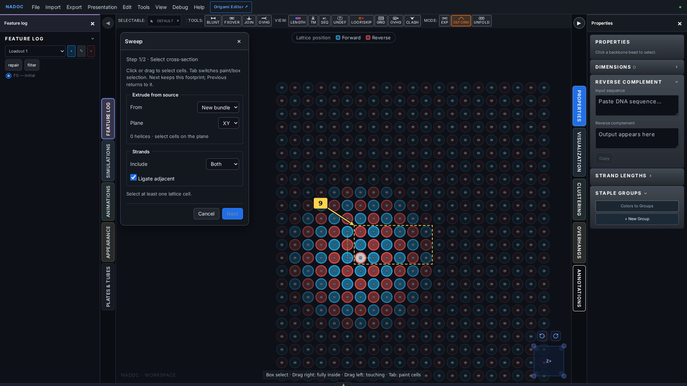

### Step 10

The count must read 18 helices. Tab returns to ordinary cell picking; a left-drag can also paint cells along its path.

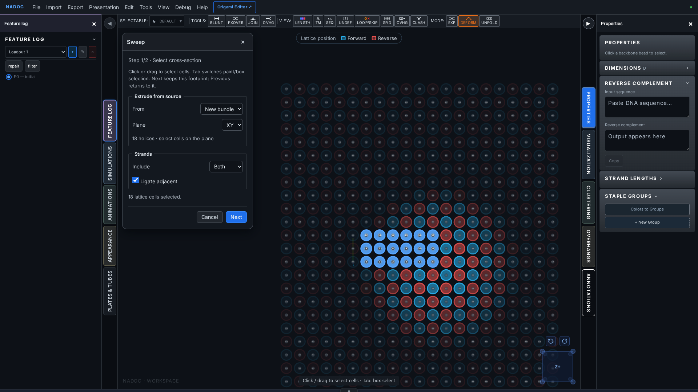

## Choose strands and ligation

Include chooses Both, Scaffold or Staples. Ligate adjacent requests joining compatible strand ends when continuing a source. Use Both with Ligate adjacent checked for this example.

### Step 11

Choose Scaffold to create only scaffold strands.

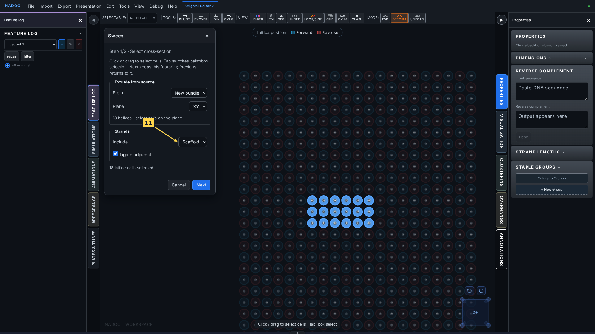

### Step 12

Choose Staples to create only staple strands.

### Step 13

Choose Both for this example.

### Step 14

Keep Ligate adjacent checked. The new-bundle example has no upstream ends to join.

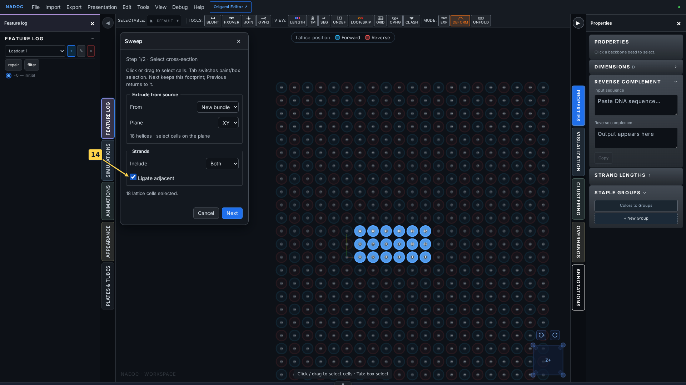

## Define the path in nanometers

Click Next to leave the cross-section picker and define the path in 3D. XYZ values are offsets in nm from the cross-section center. Select a point in the list to edit it. The initial XY path runs from Origin (0, 0, 0) to Point 1 (0, 0, 10). Previous returns to cross-section selection while retaining the path.

### Step 15

Click Next to open Step 2: Define sweep path.

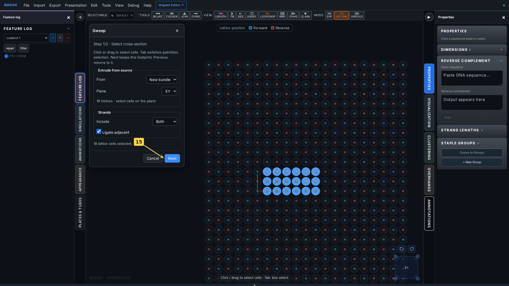

### Step 16

With Point 1 selected, set Z to 30 nm. Keep X = 0 and Y = 0.

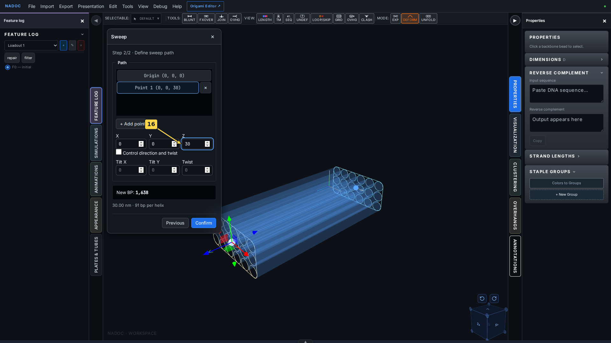

### Step 17

Click + Add point. The new point extrapolates the last segment and becomes selected.

### Step 18

For Point 2 enter X = 12, Y = 0, Z = 60 nm. The spline bends toward positive X. Scroll down over the canvas to zoom out as the path grows.

### Step 19

Review the ordered path: Origin (0, 0, 0), Point 1 (0, 0, 30), Point 2 (12, 0, 60). The × beside a non-origin point deletes it; a path needs at least two points.

## Control direction and twist

Select a point, then enable Control direction and twist to set Tilt X, Tilt Y and Twist in degrees. Green arrows indicate direction and amber arrows indicate the right axis. Disabling the checkbox restores automatic orientation. Selected points also have position handles in the canvas; Tab on the canvas or point entry switches to free-angle rotation handles.

### Step 20

Enable Control direction and twist for Point 2.

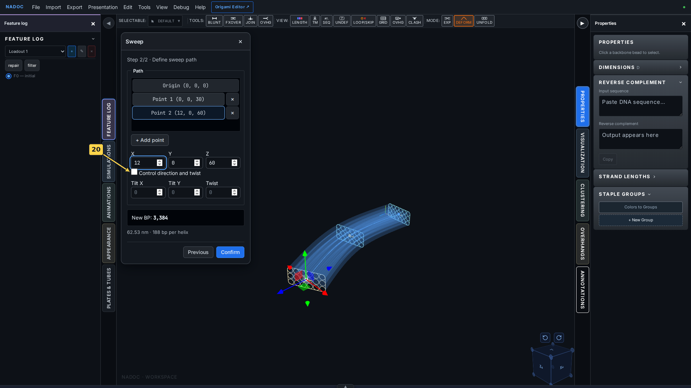

### Step 21

Enter 15° in Twist to inspect the end cross-section orientation.

### Step 22

Disable Control direction and twist to use automatic orientation for the final example.

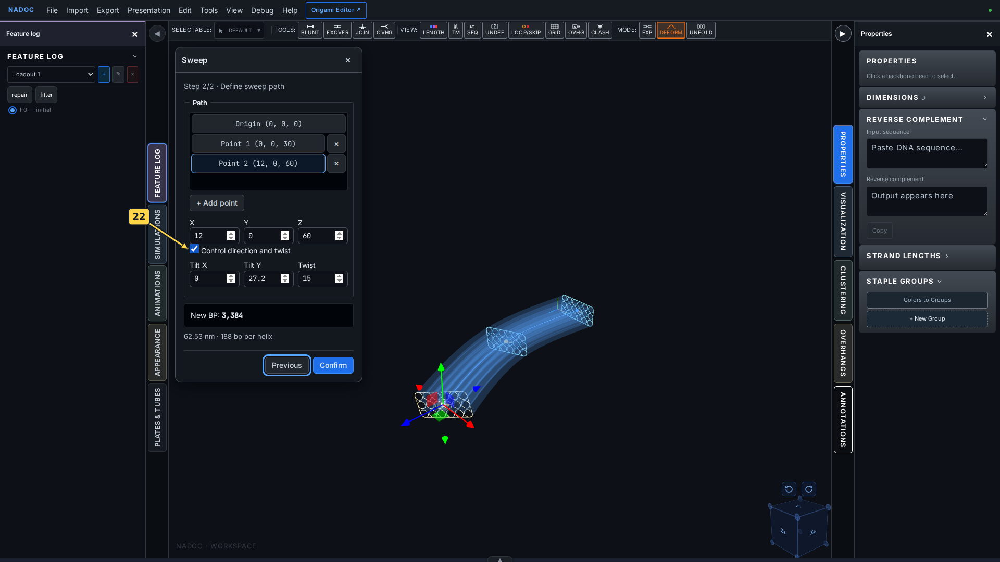

## Review and confirm

The status reports path length in nm and bp per helix. New BP reports the total new base-pair sites across the selected cross-section. Review any curvature warning before confirming; adjust the path if needed. Confirm creates the swept bundle.

### Step 23

Read New BP and the path-length status for the 18 selected helices.

### Step 24

Click Confirm to build the sweep.

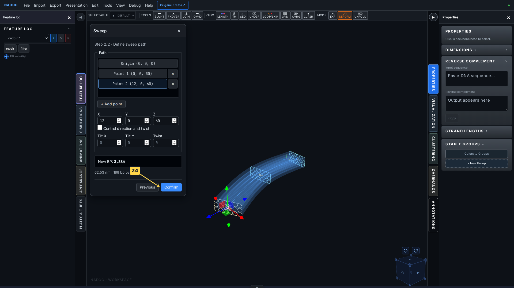

### Step 25

The completed 3×6 bundle follows the curved path. Right-drag to orbit and press F to fit the result; Full representation shows the nucleotide geometry.

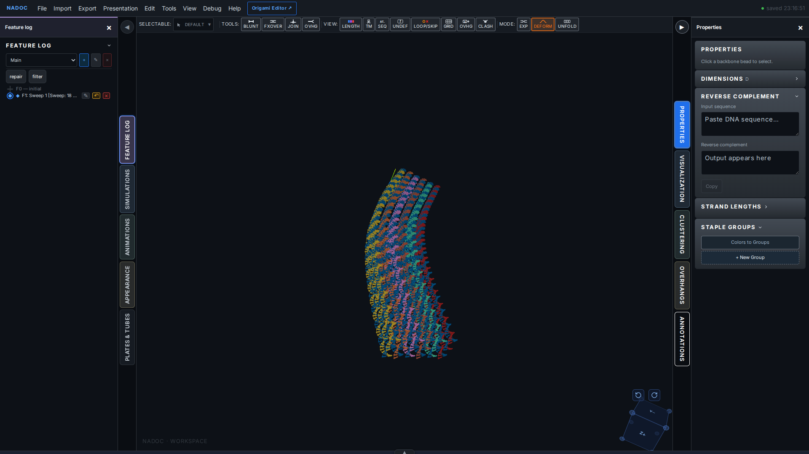
