# Twist: cluster selection, handedness, loops and skips

[All guides](../README.md) · [Coverage ledger](../LEDGER.md)

Twist one of two long 3×6 square-lattice clusters, choose the interval and handedness, then inspect NADOC’s loop/skip marks in 3D and in the cadnano-style editor.

Numbered arrows point to
mouse targets while keeping their labels visible. Dashed boxes show drag extents.
Unmarked images show settings or results. This is an editorial draft for style review.

[Download the example](example.nadoc) · [Construction verification](verification.json) ·
[Capture and source metadata](manifest.json) · [UX findings](../UX_LEDGER.md)

## Scope

- Two separated 3×6 square-lattice clusters, each 256 bp long
- Tools → Twist and selection of one cluster
- Adjacent intervals with 180° right-handed and left-handed total twist
- Full Autostaple and Add Loops/Skips
- Full 3D loop/skip overlay and cadnano-style editor views

## Contents

- [Start with a longer model](#start-with-a-longer-model)
- [Twist the first half](#twist-the-first-half)
- [Change handedness for the second half](#change-handedness-for-the-second-half)
- [Generate loops and skips](#generate-loops-and-skips)
- [Inspect loops and skips in 3D](#inspect-loops-and-skips-in-3d)
- [Inspect the same marks in the cadnano editor](#inspect-the-same-marks-in-the-cadnano-editor)

## Start with a longer model

Use the Extrude workflow to make two separated 3-row × 6-column square-lattice clusters, each 256 bp long. All 3D images use Full representation. This lesson makes two successive 180° twists with opposite handedness, then generates and inspects loop/skip marks through NADOC’s own tools.

### Step 1

Start with two 3×6 square-lattice clusters, each 256 bp long. Right-drag to view the clusters from the side, then press F to fit.

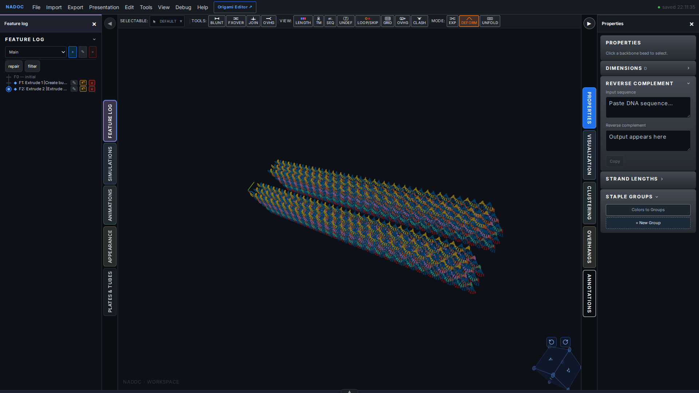

## Twist the first half

Choose Tools → Twist, then click the original 18-helix cluster. Set Plane 1 to 0 bp and Plane 2 to 127 bp. Select Total twist, enter 180° and select Right-handed. The planes bound the twisted interval. After applying, reopen the saved part for a clean result view if the tool overlay remains dimmed (GUIDE-UX-008).

### Step 2

Choose Tools → Twist to open the tool and select a cluster.

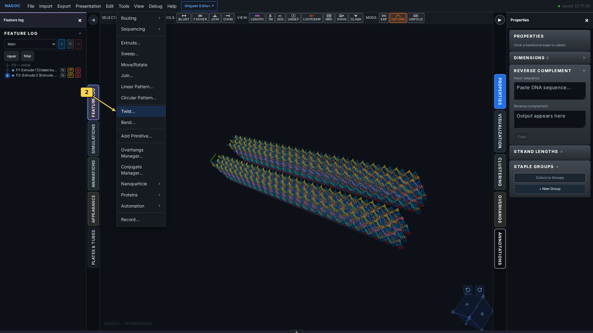

### Step 3

Click the original 3×6 bundle to select its cluster. The second cluster provides a straight reference.

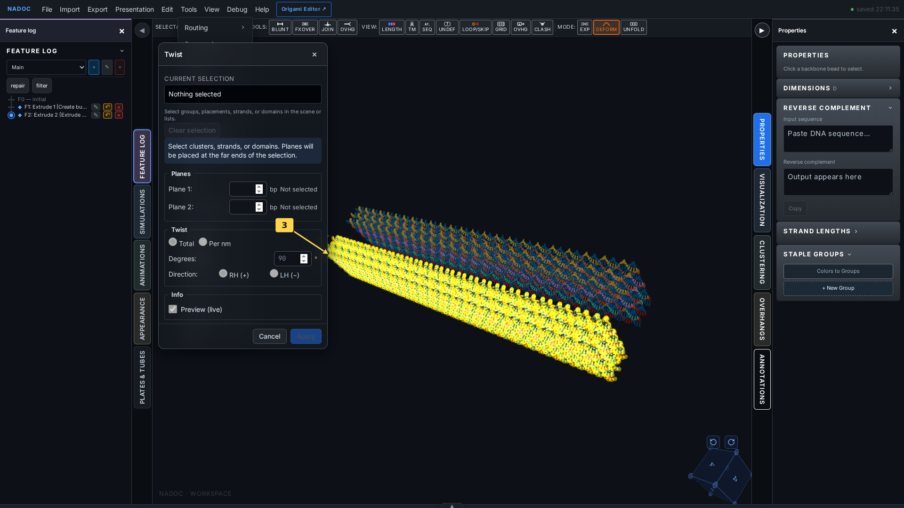

### Step 4

Set planes 0–127 bp, Total twist 180° and Right-handed. Inspect the preview, then click Apply.

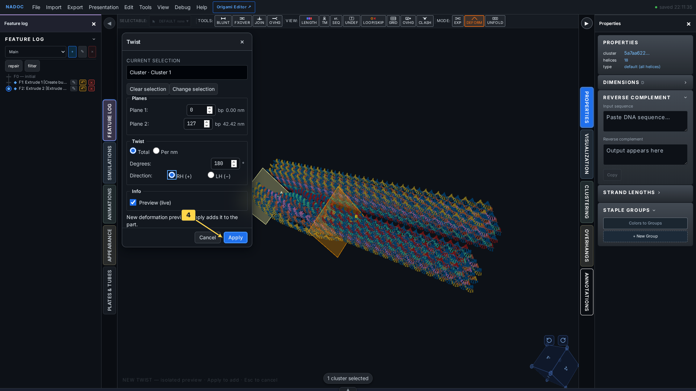

### Step 5

The first half twists through 180° with Right-handed selected. Compare its rotating cross-section with the straight second cluster.

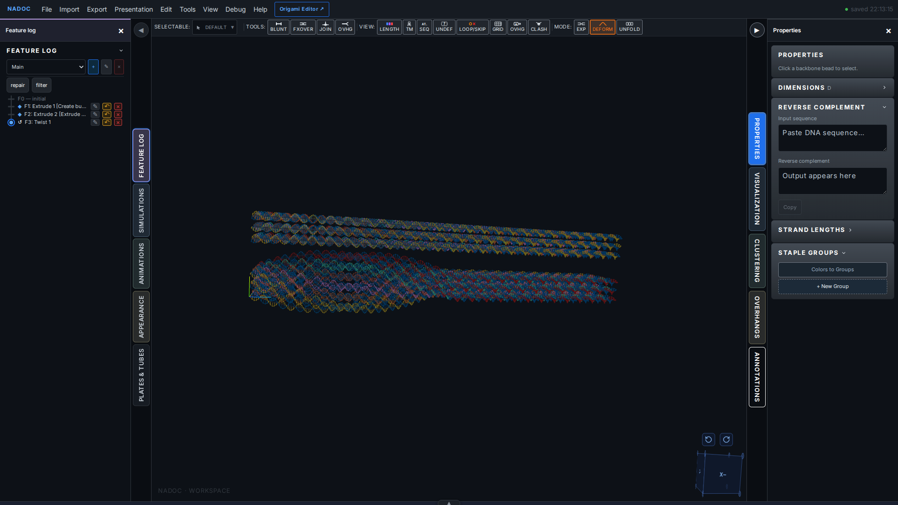

## Change handedness for the second half

Choose Tools → Twist again and select the same cluster. Set planes 128–255 bp, Total twist 180° and Left-handed. These adjacent intervals demonstrate the two handedness controls along one bundle. Total twist specifies the rotation across the selected interval; Degrees/nm specifies rotation per unit length.

### Step 6

Set planes 128–255 bp, Total twist 180° and Left-handed. Inspect the preview, then click Apply.

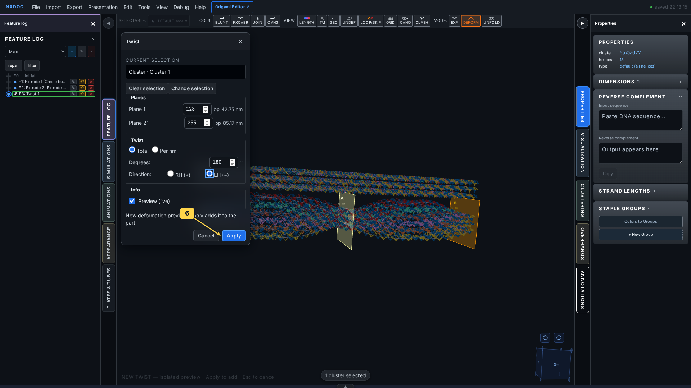

### Step 7

The second half twists through 180° with Left-handed selected. The two intervals show opposite twist directions within the selected cluster.

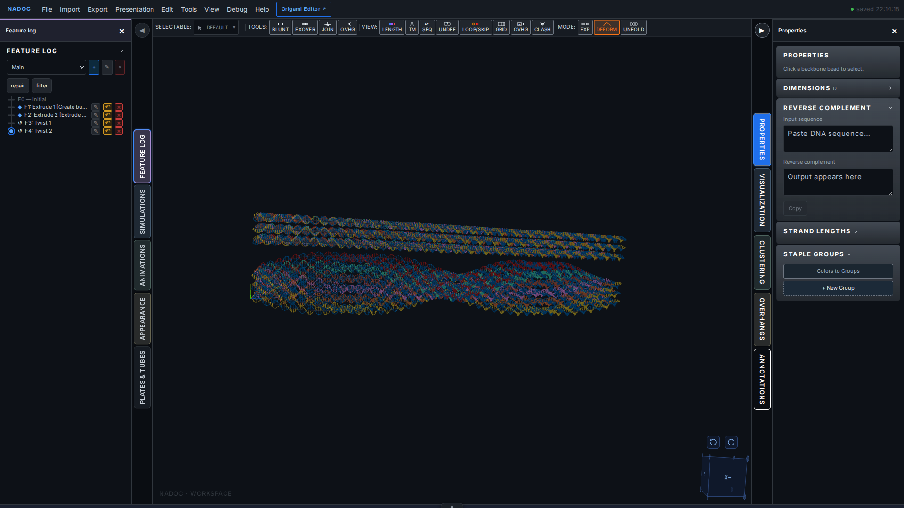

## Generate loops and skips

Twist rotates the bundle cross-section along the selected interval. Add Loops/Skips creates the discrete insertion/deletion marks that accompany that design intent; use LOOP/SKIP to display the saved marks. The routing action requires crossovers, so first run Full Autostaple with Standard settings on this demonstration bundle.

### Step 8

Choose Tools → Routing → Full Autostaple to create the prerequisite staple routing and crossovers.

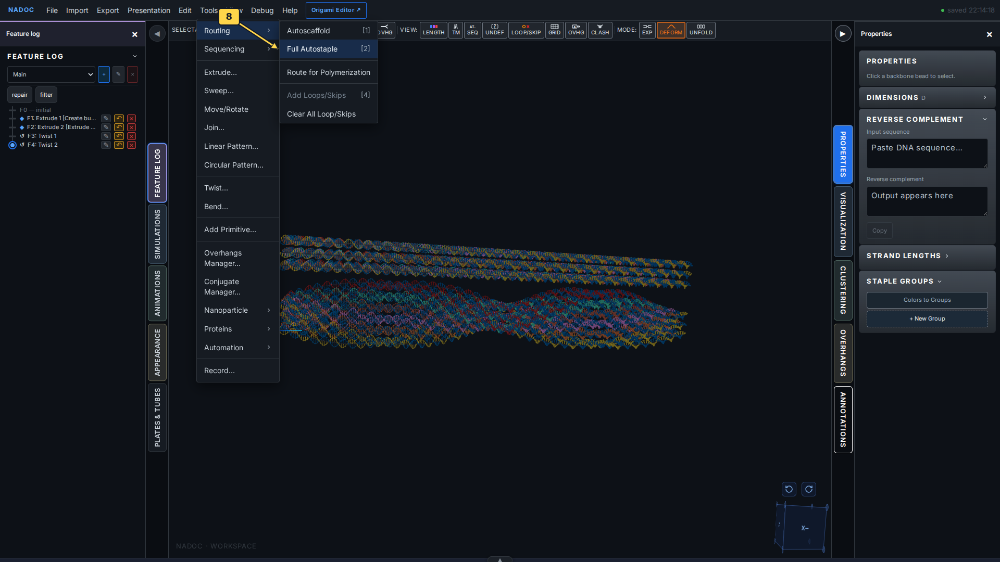

### Step 9

Keep Standard selected and click OK.

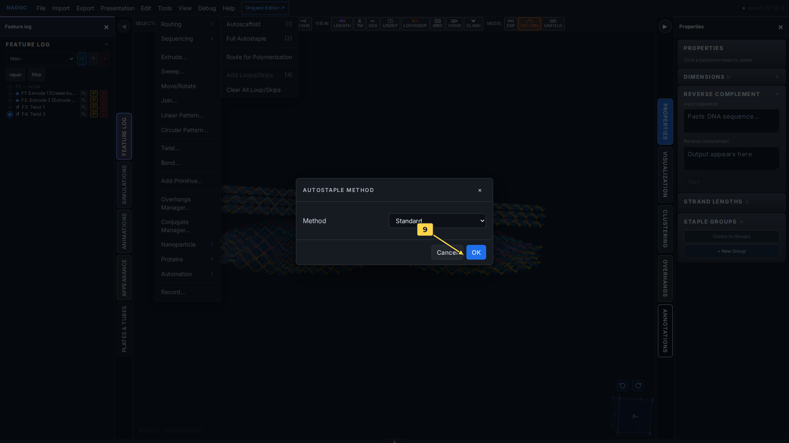

### Step 10

Choose Tools → Routing → Add Loops/Skips to generate marks for the square lattice and its twists.

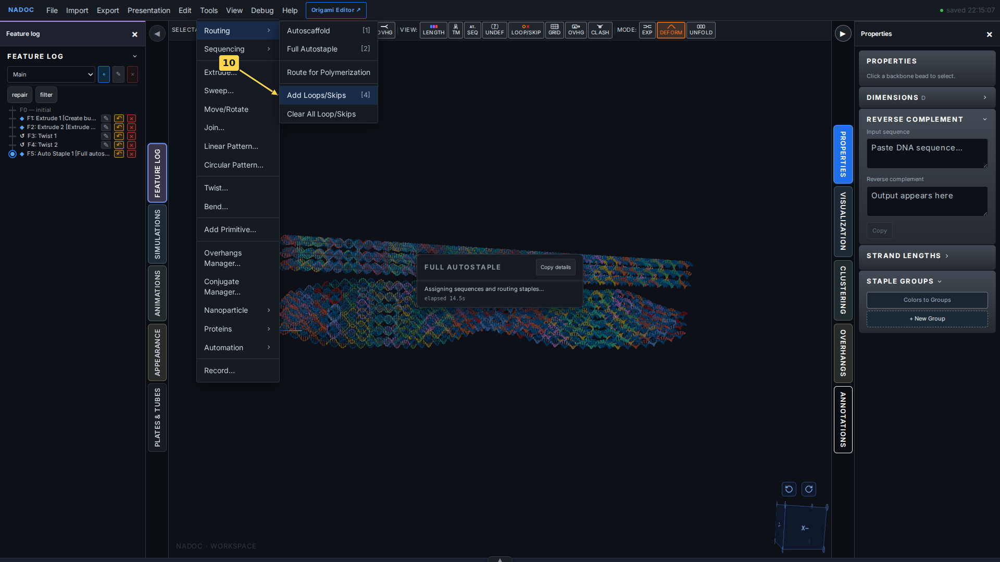

## Inspect loops and skips in 3D

Click LOOP/SKIP in the View toolbar (P). Orange loop markers indicate inserted bases and red × markers indicate deleted bases. The overlay follows the twisted geometry while Full remains selected.

### Step 11

Click LOOP/SKIP in the View toolbar to show the markers.

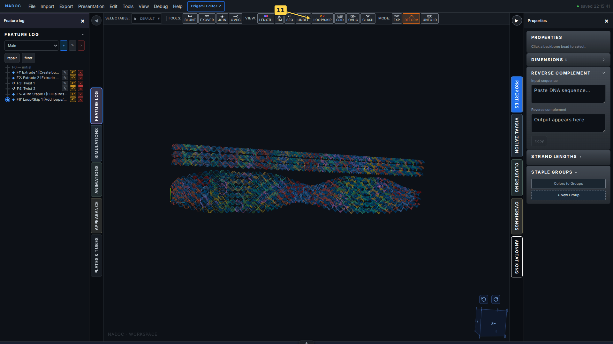

### Step 12

Full 3D view with loop and skip highlights on the twisted 3×6 bundle. Compare the marker distribution across the two twist intervals.

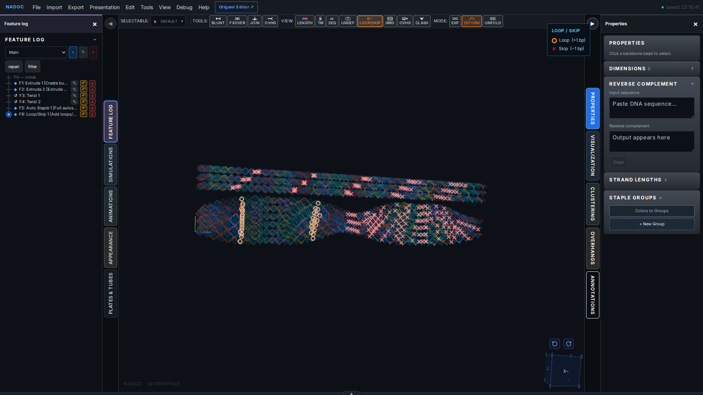

## Inspect the same marks in the cadnano editor

Open Origami Editor from the top bar. NADOC’s built-in cadnano-style path view shows the same document and loop/skip marks in a flat base-pair layout. Press F to fit, then zoom in to read individual symbols. The path view is a 2D topology view; the 3D window remains in Full representation.

### Step 13

Click Origami Editor to open the same document in NADOC’s cadnano-style editor.

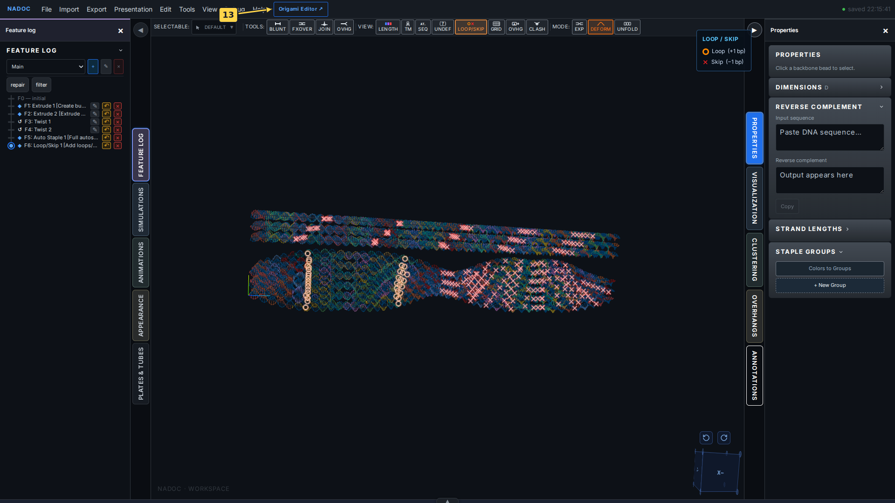

### Step 14

The cadnano-style editor shows the same routed bundle and saved loop/skip marks. Blue circles denote loops; red × symbols denote skips.

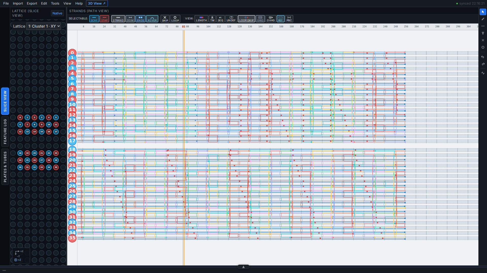

### Step 15

Scroll up over the path view to enlarge the symbols. Blue loop circles and red skip crosses appear directly on the routed strands; LOOP/SKIP remains enabled in the View toolbar.

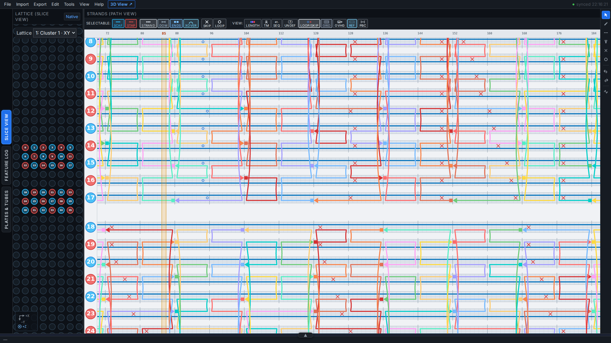
